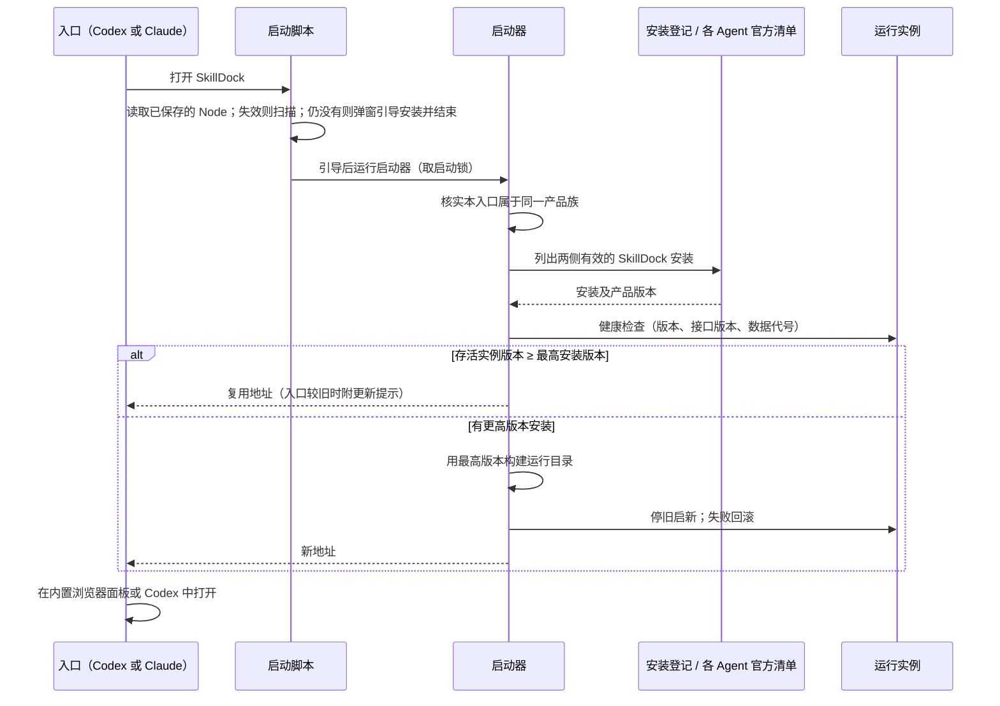
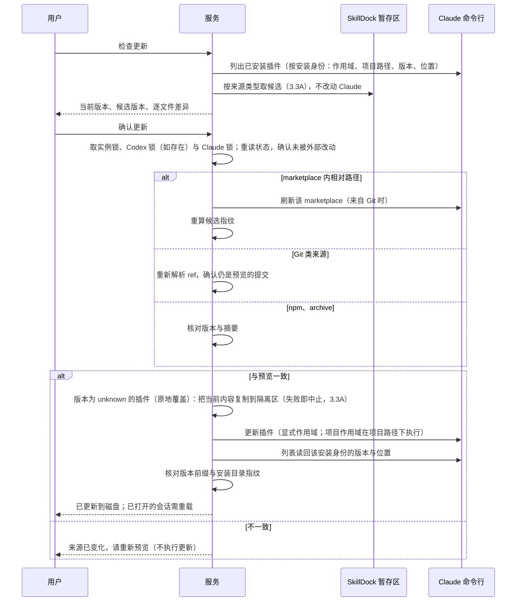
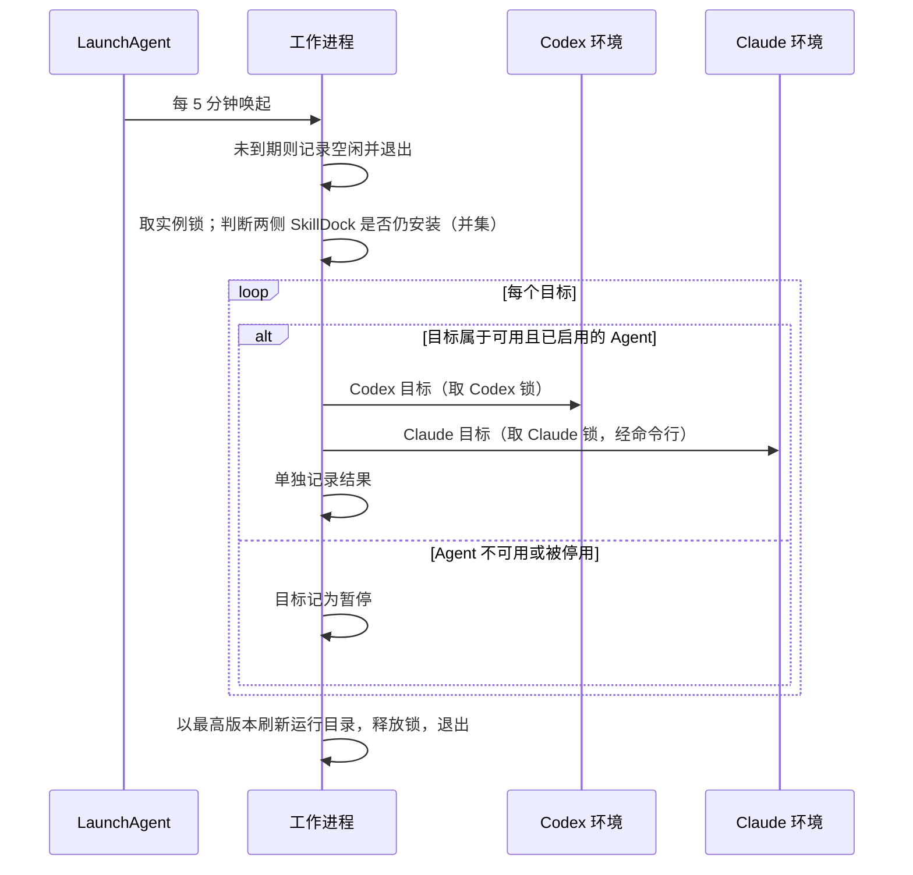
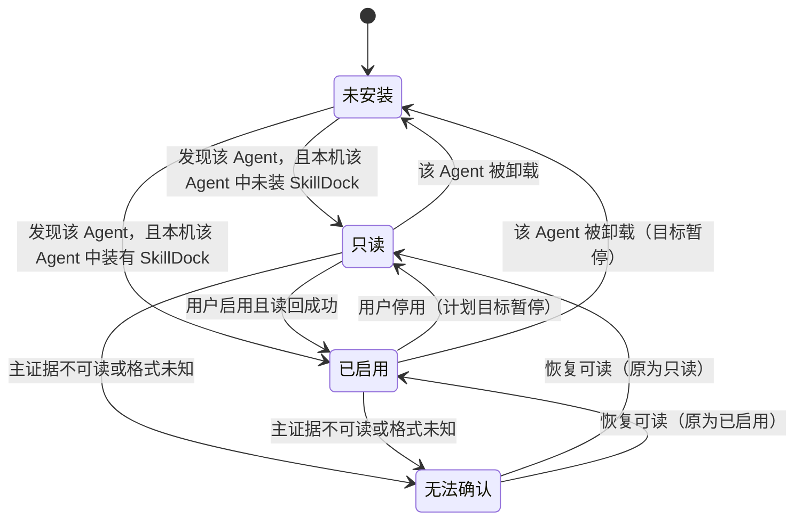
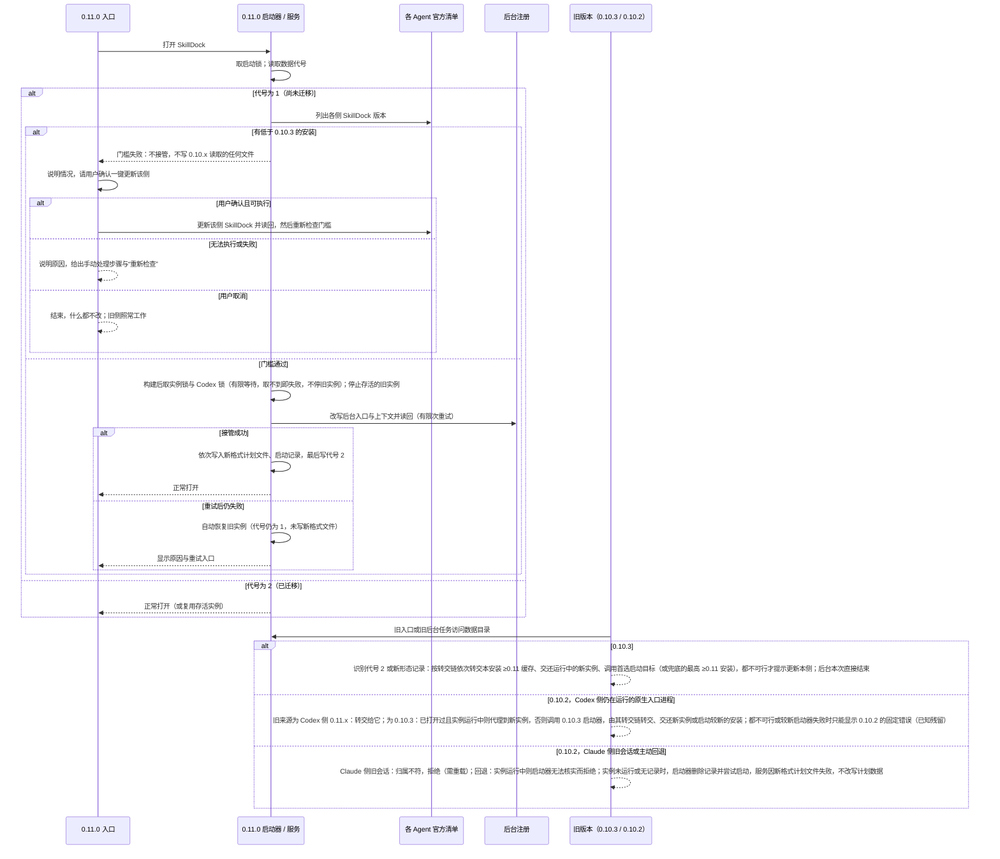

# SkillDock 跨 Agent 管理（Codex + Claude）技术设计

<!-- TRACEABILITY-METADATA:BEGIN -->
```yaml
schema:
  name: testany-traceability
  version: "1.0.0"
  profile: hld-profile-v1
artifact:
  id: HLD-SDX-001
  type: HLD
  title: SkillDock 跨 Agent 管理（Codex + Claude）技术设计
  status: approved
  owners:
    - engineering.claude
    - product.user
  created_at: "2026-10-07"
  updated_at: "2026-10-13"
  source_documents:
    - PRD-SKILLDOCK-002
entities:
  requirements: []
  risks: []
  must_not_regress: []
  external_behaviors: []
  decisions:
    - id: DEC-SDX-001
      title: 以 Agent 适配器扩展现有环境模型
      statement: 在服务现有的环境集合中，把“本机”拆为按 Agent 划分的环境；每个环境由发现根、配置存储、插件管理适配器和写锁组成，Codex 沿用现有实现，Claude 新增一套。
      status: approved
      scope: in
      decision: 保留 local / sandbox 的请求语义，在 local 内部按 Agent 组织环境；Codex 环境原样复用，Claude 环境新增适配器
      rationale: 现有服务已按环境组织扫描、边界与写入（service.mjs 的 environments），扩展该结构的改动面最小，并能保证只启用 Codex 时行为不变。
      source_refs:
        - artifact_id: PRD-SKILLDOCK-002
          note: REQ-SDX-001、MR-SDX-001
    - id: DEC-SDX-002
      title: API 契约只做向后兼容的增量
      statement: 对象与操作请求增加 Agent 维度，快照增加环境列表，健康检查增加应用版本、接口版本和数据代号；未声明支持多 Agent 的客户端只看到 Codex 对象。
      status: approved
      scope: in
      decision: 只新增字段与可选参数，不改变已有字段语义；客户端未声明多 Agent 时，读取结果只含 Codex 对象，写请求缺省视为 Codex
      rationale: 较新服务会被较旧的 Codex 原生界面通过 MCP 代理访问，增量兼容可避免旧界面误操作 Claude 对象。
      source_refs:
        - artifact_id: PRD-SKILLDOCK-002
          note: REQ-SDX-003、REQ-SDX-007
    - id: DEC-SDX-003
      title: Claude 写操作经官方命令行
      statement: Claude 插件与 marketplace 的安装、更新、卸载、启停、添加、刷新、移除全部通过 Claude 官方命令行的机器可读输出完成，不直接改写 Claude 的记录文件。
      status: approved
      scope: in
      decision: 使用 Claude 命令行（桌面应用自带或用户已安装）的白名单子命令，参数数组调用、不经过 shell，执行后读回
      rationale: 官方命令行与 GUI 写入同一套设置；Claude 的记录文件不是公开契约，直接改写会随版本失效（RISK-SDX-002）。
      source_refs:
        - artifact_id: PRD-SKILLDOCK-002
          note: REQ-SDX-004、REQ-SDX-015、REQ-SDX-016、8.3 第 3 条
    - id: DEC-SDX-004
      title: Claude 清单以官方列表为主证据
      statement: Claude 插件与 marketplace 清单以命令行列表输出为主证据，文件系统只作补充；格式未知或不可读时该环境降级为“无法确认”并禁用写操作。“可安装插件”一项例外，只取 marketplace 副本（第 10 节 DG-NO-AVAILABLE，v1.18）。
      status: approved
      scope: in
      decision: 官方列表为准，缓存目录、marketplace 副本与设置文件只读补充，未知格式降级
      rationale: 列表输出已包含启用状态、作用域、版本与安装位置，比解析内部文件稳定。
      source_refs:
        - artifact_id: PRD-SKILLDOCK-002
          note: REQ-SDX-002
    - id: DEC-SDX-005
      title: 先在自有暂存区预览，应用前再核对
      statement: 检查更新时在 SkillDock 自己的暂存区取得候选内容并与已安装目录比较；应用前按来源类型再次核对候选（Git 来源重新解析提交，目录与 marketplace 来源重算指纹），一致才执行更新并读回版本与内容指纹。各来源规则见 DEC-SDX-026。
      status: approved
      scope: in
      decision: 检查阶段不改动 Claude；应用前核对，不一致即中止并要求重新预览；应用后按来源类型读回
      rationale: 保证“看到的就是要装的”，避免 marketplace 在预览后移动导致装入未预览的版本。
      source_refs:
        - artifact_id: PRD-SKILLDOCK-002
          note: REQ-SDX-004
    - id: DEC-SDX-006
      title: Claude 独立技能可见性写入设置文件
      statement: Claude 独立技能的启禁写入 Claude 设置中的技能可见性条目；个人技能写用户设置，项目技能默认写本地设置，写项目共享设置需逐次确认。
      status: approved
      scope: in
      decision: 结构化 JSON 补丁，只改对应条目，写前写后摘要核对、原子替换、读回
      rationale: Claude 没有修改技能可见性的命令行；结构化补丁可保留其他键，写前摘要核对只能缩小与 Claude 并发写入的冲突窗口（Claude 不使用 SkillDock 的锁），冲突时中止并提示。
      source_refs:
        - artifact_id: PRD-SKILLDOCK-002
          note: REQ-SDX-012、REQ-SDX-016（5.6 独立技能启禁）
    - id: DEC-SDX-007
      title: 数据目录归属放宽到同一产品族
      statement: 数据目录可被同一 marketplace 名与插件名的 SkillDock 安装接管，无论它位于 Codex 还是 Claude 的插件缓存；其他来源仍拒绝接管。
      status: approved
      scope: in
      decision: 归属键为“marketplace 名 + 插件名 + marketplace 来源标识（规范化的来源地址）”，安装必须位于已识别 Agent 的插件缓存并可核实；来源不一致、开发源码与其他 marketplace 继续拒绝
      rationale: 两个 Agent 的 SkillDock 是同一产品的不同入口，应共用实例；保留对陌生来源的拒绝，维持现有安全边界。
      source_refs:
        - artifact_id: PRD-SKILLDOCK-002
          note: REQ-SDX-007
    - id: DEC-SDX-008
      title: 以产品版本选择运行源（最新者运行）
      statement: 启动、重启、后台刷新时，从所有 Agent 中仍有效的 SkillDock 安装里选择产品版本最高者作为运行源；产品版本取自应用自身的版本号，而非宿主缓存目录名。
      status: approved
      scope: in
      decision: 较旧入口遇到不低于自身版本的运行实例时复用；任一 Agent 出现更高版本时走现有重启协调器切换
      rationale: Claude 对无 manifest 插件以提交摘要命名缓存目录，无法比较；应用版本号在两侧一致且可比较。现有原生入口已有“不降级”逻辑，可推广。
      source_refs:
        - artifact_id: PRD-SKILLDOCK-002
          note: REQ-SDX-007、8.3 第 1 条
    - id: DEC-SDX-009
      title: 数据代号与接口版本
      statement: 数据目录记录数据代号，健康检查公开应用版本、接口版本与数据代号；服务、后台任务、自更新协调器、原生入口与启动器在写前都检查代号，遇到更高代号只读并提示更新；后台刷新运行目录时不得切换到不支持当前代号的版本。
      status: approved
      scope: in
      decision: 引入数据代号与接口版本，覆盖全部写入方；无可用的兼容版本时暂停计划，不降级运行
      rationale: 防止某侧卸载较新版本后，较旧版本改写较新格式的数据。
      source_refs:
        - artifact_id: PRD-SKILLDOCK-002
          note: REQ-SDX-007、MR-SDX-002
    - id: DEC-SDX-010
      title: 实例锁加各 Agent 配置锁
      statement: 所有写操作先取实例级写锁，再按固定顺序取所涉 Agent 的配置锁；Codex 沿用现有配置根锁，Claude 使用同一模式的配置根锁。
      status: approved
      scope: in
      decision: 固定顺序“实例锁 → Codex 锁 → Claude 锁”；共享状态（计划、运行记录、后台状态、启动记录）的写入在 Codex 配置根存在时一律同时持有 Codex 锁；取锁不得创建任何 Agent 的根目录
      rationale: 保留与旧版本在 Codex 写入上的互斥，同时覆盖新增的 Claude 写入；固定顺序避免死锁。
      source_refs:
        - artifact_id: PRD-SKILLDOCK-002
          note: REQ-SDX-006、REQ-SDX-016
    - id: DEC-SDX-011
      title: 单一后台任务覆盖两个 Agent
      statement: 沿用按数据目录命名的唯一 LaunchAgent；计划目标携带 Agent；“SkillDock 是否仍安装”按所有 Agent 的并集判断；某 Agent 不可用时其目标暂停。
      status: approved
      scope: in
      decision: 一个计划、一个后台任务；目标按 Agent 分派执行并分别记录
      rationale: 现有后台任务已与宿主是否打开无关，只需把宿主判断从 Codex 扩展到两侧。
      source_refs:
        - artifact_id: PRD-SKILLDOCK-002
          note: REQ-SDX-006、8.3 第 4 条
    - id: DEC-SDX-012
      title: 运行环境：扫描本机 Node、保存复用、找不到时引导安装
      statement: 按固定顺序扫描本机 Node.js，选第一个通过核验的并把路径保存到 SkillDock 设置，之后复用、失效时重扫；扫描不到时以 macOS 对话框引导安装，不自动下载。规则对 Codex 与 Claude 统一。
      status: approved
      scope: in
      decision: 停用自动下载；扫描顺序为“显式指定 → 已保存 → Codex 工作区 → 已下载的私有 Node → 常见安装位置 → 版本管理器 → PATH”，应用包内 Node 只用于引导；弹窗不阻塞调用方，`native.sh` 与后台任务不弹窗；单一可执行文件不采用
      rationale: Owner 决定（PRD 0.3）；复用用户已有的工具链，SkillDock 不再下载并执行可执行文件；保留 Codex 自带与已下载的私有 Node 作为扫描对象，现有用户不退化。
      source_refs:
        - artifact_id: PRD-SKILLDOCK-002
          note: REQ-SDX-009（0.3 修订）、MR-SDX-001 例外说明
    - id: DEC-SDX-013
      title: Claude 分发不新增 manifest
      statement: skilldock 插件不新增 Claude manifest；Claude 以 marketplace 条目和默认目录加载技能与命令；Codex 专用 MCP 配置改名并由 Codex manifest 显式引用；技能说明改为宿主中立。
      status: approved
      scope: in
      decision: 遵守仓库“单一 manifest”规则，借默认目录在 Claude 中分发，避免 Claude 默认加载 Codex 原生入口
      rationale: 仓库校验器拒绝同一插件同时存在两份 manifest；Claude 默认加载插件根目录的 MCP 配置，而 Code 标签页不渲染第三方 MCP App。
      source_refs:
        - artifact_id: PRD-SKILLDOCK-002
          note: REQ-SDX-008、REQ-SDX-017
    - id: DEC-SDX-014
      title: 仅支持 Codex 的插件在 marketplace 条目中标注
      statement: 共享 marketplace 中仅支持 Codex 的插件，在条目说明中标注支持的 Agent；SkillDock 把“只有 Codex manifest”作为作者声明证据。
      status: approved
      scope: in
      decision: 本期以标注满足 REQ-SDX-017；为两宿主拆分 marketplace 文件作为后续选项，先验证 Codex 的读取优先级
      rationale: 两个宿主共用同一 marketplace 文件，标注是无需改变发现规则的最小改动。
      source_refs:
        - artifact_id: PRD-SKILLDOCK-002
          note: REQ-SDX-017
    - id: DEC-SDX-015
      title: 兼容性推断分两步落地
      statement: 0.11.0 只在安装预览中展示作者声明证据；完整的四级证据推断、结论、操作限制与用户确认在 P1 里程碑实现。
      status: approved
      scope: in
      decision: 0.11.0 交付证据展示，完整推断随 REQ-SDX-010、011 交付
      rationale: P0 的能力对等不依赖完整推断；先展示最强证据可降低误装，同时控制首个版本范围。
      source_refs:
        - artifact_id: PRD-SKILLDOCK-002
          note: REQ-SDX-011、REQ-SDX-014
    - id: DEC-SDX-016
      title: 同源对象的归组键
      statement: 插件以 marketplace 名加插件名归组，Git 来源技能以规范化仓库地址加子路径归组，本地来源以真实路径归组。
      status: approved
      scope: in
      decision: 采用上述归组键，ref 不参与归组
      rationale: 两侧通常从同名 marketplace 或同一仓库安装；ref 不同仍属同一上游，只是版本不同。
      source_refs:
        - artifact_id: PRD-SKILLDOCK-002
          note: REQ-SDX-010
    - id: DEC-SDX-017
      title: 能力对照表落为对象级能力标记
      statement: 5.6 对照表的每一行映射为 Claude 适配器的能力与原因；界面沿用现有的可操作标记与原因字段，不为 Claude 另写一套页面。
      status: approved
      scope: in
      decision: 复用对象的 canToggle、canRemove、canUpdate、reason 等字段表达对等、调整与不提供
      rationale: 现有界面已按这些字段显示入口与原因，复用可保证两侧体验一致。
      source_refs:
        - artifact_id: PRD-SKILLDOCK-002
          note: REQ-SDX-016
    - id: DEC-SDX-018
      title: 环境启用状态的默认值
      statement: 本机装有 SkillDock 的 Agent 默认启用管理，其他被发现的 Agent 默认只读；状态持久化在数据目录，启用前需读回验证。
      status: approved
      scope: in
      decision: 以 SkillDock 自身的安装分布决定默认启用
      rationale: 满足“从哪侧安装就管理哪侧”，并保证 Codex 现有用户不被动开始写 Claude。
      source_refs:
        - artifact_id: PRD-SKILLDOCK-002
          note: REQ-SDX-001
    - id: DEC-SDX-019
      title: 命令行调用的安全约束
      statement: Claude 命令行调用沿用 Codex 适配器的约束：白名单子命令、参数数组、不经过 shell、超时与输出上限、错误脱敏；从不自动接受 marketplace 声明的命令。
      status: approved
      scope: in
      decision: 不传递自动确认参数；需要接受命令的插件标为不由 SkillDock 更新
      rationale: 自动接受等于替用户执行第三方命令，超出 SkillDock 的授权边界。
      source_refs:
        - artifact_id: PRD-SKILLDOCK-002
          note: REQ-SDX-012
    - id: DEC-SDX-020
      title: Claude 独立技能复用现有文件事务
      statement: Claude 个人与项目技能的安装、来源关联、更新、可恢复移除与恢复，复用现有文件事务、来源记录与隔离区；来源记录按 Agent 分区保存。
      status: approved
      scope: in
      decision: 复用，不为 Claude 另建文件操作实现；写入目标增加 Claude 根，来源记录按 Agent 分区
      rationale: 现有事务已覆盖预览、指纹核对、原子移动、本地修改保护与恢复，并经过多轮回归；分区可避免两侧同名路径混淆。
      source_refs:
        - artifact_id: PRD-SKILLDOCK-002
          note: REQ-SDX-005、MR-SDX-003
    - id: DEC-SDX-027
      title: 跨版本兼容测试矩阵作为发布关口
      statement: 实现阶段必须定义并实现一套可执行的跨版本兼容测试矩阵：用已发布的 0.10.2 与将发布的 0.10.3 的真实代码，在隔离目录中对 0.11.x 写下的各种状态逐情形运行，断言“不接管、不改写计划数据、能转交时转交、该提示时提示”；矩阵通过是 0.10.3 与 0.11.0 合并发布的前提。
      status: approved
      scope: in
      decision: 以历轮评审与作者的实验脚本为种子，并按 3.13A 补齐维度（原生入口真实子进程、是否已打开过、有无 project.json、实例存活或未运行或 pid 失效、Codex 侧只有 0.10.3、旧来源所指缓存被删、installation 取值、0.10.3 转交链）；每个用例的期望结果从 PRD 与 HLD（含已登记残留）推出，期望结果表放在 API 契约附录并随契约评审；0.10.3 关口用按 5.4 手写的 0.11.x 样本，0.11.0 关口改用真实 0.11.0 写下的记录重跑；只要仍声明与 0.10.x 共存，之后每次发布都跑；只用预置运行目录与本地依赖，不联网
      rationale: 过渡期问题集中在与已冻结旧代码的组合情形，五轮推演每轮都发现新组合；把已知组合固化为可重复运行的回归用例，比继续纸面推演更可靠。矩阵不能替代：发现新维度（仍须逐条读冻结代码）、5.4 契约本身的设计评审、真实宿主行为（V13、V14、V17）与产品决定。
      source_refs:
        - artifact_id: PRD-SKILLDOCK-002
          note: REQ-SDX-007、MR-SDX-002；Owner 要求以兼容测试矩阵作为关口（BRIEF-SDX-007）
    - id: DEC-SDX-021
      title: 先发布 0.10.3 过渡版
      statement: 0.10.3 不含跨 Agent 管理功能，只增加识别、交还、按记录调用已核实的较新安装的启动脚本与提示，以及自更新失败后的退避（Owner 2026-10-08）；它遇到数据代号 ≥2（无论有无启动记录）或 0.11.x 写入的启动记录时，从不自己接管，不改写计划、绑定、历史等数据，不停用或注销后台任务，并在解析工具链、下载 Node 或构建之前按“转交链”处理：①本安装（含 Claude 插件缓存，读缓存内应用版本、忽略废弃目录）中有支持代号 2 的最高版本缓存（≥0.11.0），就转交给它；②否则启动记录新字段中的“运行中的安装”对应的 ≥0.11.0 实例经核实在运行，就以退出码 0 交还给调用方，不改写启动记录（收到的有效 `--project` 与运行实例的项目不同时不交还，改走③并转发该项目，由较新启动器切换；③不可用时仍交还并说明未切换）；③否则调用新字段中“首选启动目标”的启动脚本（须属同一已核实来源、仍存在、未带废弃标记且 ≥0.11.0），不可用时改取各 Agent 中同一已核实来源、未带废弃标记的最高 ≥0.11.0 安装；④都不可行时提示“请把本侧 SkillDock 更新到 0.11 或更高”。0.10.3 不读取启动记录的旧来源与旧项目字段，转交时原样转发收到的 `--project`（没收到就不带），工作目录改用数据目录；只在转交链触发后只读“Claude 根目录记录”；提示由入口自身输出；同时修正 0.10.2 原生入口错误路径的导入缺陷。
      status: approved
      scope: in
      decision: 0.10.3 先于 0.11.0 合并发布；识别规则与 0.11.0 的数据代号和启动记录形态对齐
      rationale: Owner 不接受过渡期限制（PRD 0.4）；0.10.2 及更早代码无法修改，只能先发一个能识别新数据的版本，让大多数用户在 0.11.0 前完成过渡。
      source_refs:
        - artifact_id: PRD-SKILLDOCK-002
          note: REQ-SDX-007（0.4 修订）
    - id: DEC-SDX-022
      title: 0.11.0 的迁移门槛、接管顺序与启动记录
      statement: 0.11.0 在数据代号仍为旧值时先过门槛：只判断各 Agent 中是否装有低于 0.10.3 的 SkillDock（命令行不可用时用只读的缓存与安装记录兜底），有则不接管、不写任何旧版本会读取的文件，由入口引导一键更新该侧，一键更新不可执行或失败时给出手动处理步骤与重新检查。门槛通过后，先取与 0.10.x 共用的启动锁、再停掉存活的旧实例，然后在锁内接管后台注册（失败则自动恢复旧实例），再按“新格式计划文件 → 启动记录 → 数据代号 2”的顺序写入。启动记录中供 0.10.x 读取的旧字段：来源取 Codex 侧同一已核实来源中最高版本的 SkillDock 缓存（≥0.10.3），Codex 侧没有安装时取当前运行安装；installation 旧字段取与旧来源对应的 Codex 安装身份；项目字段取数据目录内由 0.11.x 创建并保持存在的固定子目录（与健康检查返回的项目不同），使 0.10.2 启动器无法核实实例，而 0.10.2 原生入口能以它为工作目录正常转交。Codex 侧缓存变化时在锁内刷新这些旧字段。0.11.0 自己停止时不删除启动记录。新格式计划文件迁移后必写、永不删除。
      status: approved
      scope: in
      decision: 门槛只看“是否存在低于 0.10.3 的安装”，并给出更新不可执行时的手动出路；接管与写入顺序固定，失败自动恢复；启动记录的旧字段按上述规则写（Owner“用户体验优先”）；回退防线以必写的新格式计划文件为主，辅以 0.10.3 的识别与“启动器无法核实实例”；对 0.10.2 冻结代码的兼容约束登记在 5.4，由兼容测试矩阵（DEC-SDX-027）把关；迁移只由 0.11.0 的启动器或服务执行
      rationale: 第 3～5 轮评审：只读打开、“清单无法确认即失败”与“更新不可执行即无路”都会让用户无路可走；Owner 选择用户体验更好的处理（PRD BRIEF-SDX-006～008）。评审实验证实：来源取同一 Codex 安装的较新缓存时，已加载的 0.10.2 原生进程会转交（第 3 轮 B、第 4 轮 L1、第 5 轮 E2、E7b）；项目字段与健康检查不一致时 0.10.2 启动器拒绝停止或接管（第 4 轮 K3），但该字段必须是存在的目录，否则首次打开的面板转交失败（第 5 轮 E1）；新格式计划文件使 0.10.2 服务启动失败且不改写计划数据（V16）。
      source_refs:
        - artifact_id: PRD-SKILLDOCK-002
          note: REQ-SDX-007（0.4 修订）、MR-SDX-002
    - id: DEC-SDX-023
      title: Claude 插件安装身份含作用域与项目路径
      statement: Claude 插件的安装身份为“Agent + 插件@marketplace + 作用域 + 项目路径（project 与 local 作用域）”；技能目录插件为“名称@skills-dir + 所在技能目录”。对象 ID、计划目标、绑定、读回与命令行调用（显式作用域、项目作用域时以项目路径为工作目录）都使用该身份。
      status: approved
      scope: in
      decision: 采用上述安装身份；命令行调用一律显式传作用域，不使用自动判断
      rationale: 实测同一插件可同时以 user 与 project 作用域安装且版本不同（评审复现）；不区分会导致更新、启停与读回指向错误的安装。
      source_refs:
        - artifact_id: PRD-SKILLDOCK-002
          note: REQ-SDX-002、004、015、016
    - id: DEC-SDX-024
      title: Claude 根目录持久化与进程环境白名单
      statement: Claude 配置根与插件缓存根在发现或启用时确定；门槛通过前只写入 0.10.2 不读取的新文件（其中的“Claude 根目录记录”仅供 0.10.3 在转交链触发后只读，格式随 0.10.3 冻结），迁移完成后再写入后台上下文；之后各入口与后台任务都使用保存值；服务与命令行子进程只继承白名单内的环境变量，剔除 Claude 与 Codex 的会话变量。
      status: approved
      scope: in
      decision: 根目录来源优先级为“SkillDock 设置中的显式指定 → 从 Claude 入口启动时记录的会话值 → 默认值”；新入口给出不同值时提示用户确认切换；进程环境按白名单构造
      rationale: 现有 Codex 设计已把配置根写入启动记录与后台上下文；只读当前进程环境会使结果取决于最先从哪个入口打开，并让会话凭据在长驻进程中残留。
      source_refs:
        - artifact_id: PRD-SKILLDOCK-002
          note: REQ-SDX-001、REQ-SDX-006、REQ-SDX-012
    - id: DEC-SDX-025
      title: Claude 侧从本地目录或 Git 安装插件
      statement: 来源带 Claude manifest 时，以技能目录插件方式放入目标技能目录，生命周期复用独立技能的来源追踪与隔离区，项目范围的启停默认用 local 作用域；来源没有 Claude manifest 时，与 Codex 侧现有做法一致，在数据目录生成 SkillDock 管理的本地 marketplace 再经命令行安装（只用 user、local 作用域），并规定清理与迁移。
      status: approved
      scope: in
      decision: 有 manifest 走技能目录插件；无 manifest 走 SkillDock 管理的本地 marketplace；兼容性结论为“不兼容”时不提供
      rationale: 实测技能目录插件无需 marketplace，也不在 Claude 设置中留下指向 SkillDock 数据目录的条目；无 manifest 的插件只能经 marketplace 加载，Codex 侧已有同类依赖并已发布。
      source_refs:
        - artifact_id: PRD-SKILLDOCK-002
          note: REQ-SDX-016（5.6 安装插件）
    - id: DEC-SDX-026
      title: 候选内容与读回规则按来源类型区分
      statement: Git 类来源以该提交的已跟踪文件为候选，应用前重新解析提交，读回时版本前缀须等于预览提交；本地目录 marketplace 以整个目录快照为候选；npm 与 archive 来源下载到暂存区生成差异；“是否需要更新”按内容指纹判断，不按版本字符串。
      status: approved
      scope: in
      decision: 采用按来源类型的候选与读回规则；指纹排除 Claude 的废弃标记与其依赖安装产生的目录
      rationale: 实测 Git 来源缓存恰为该提交的已跟踪文件，本地目录 marketplace 会复制被忽略与未跟踪文件；Owner 决定 npm、archive 也提供差异（PRD 0.4 记录）。
      source_refs:
        - artifact_id: PRD-SKILLDOCK-002
          note: REQ-SDX-004、MR-SDX-003
  flows:
    - id: FLOW-SDX-001
      title: 入口启动与版本收敛
      statement: 任一 Agent 的入口启动时，核实归属、发现所有 SkillDock 安装、选出最高版本，复用或切换运行实例。
      status: approved
      scope: in
      kind: system_flow
      source_refs:
        - artifact_id: PRD-SKILLDOCK-002
          note: REQ-SDX-007、REQ-SDX-008
    - id: FLOW-SDX-002
      title: Claude 插件更新（检查、预览、应用、读回）
      statement: 在暂存区取候选并生成差异，用户确认后刷新 marketplace、核对指纹、经命令行更新并读回版本与内容。
      status: approved
      scope: in
      kind: system_flow
      source_refs:
        - artifact_id: PRD-SKILLDOCK-002
          note: REQ-SDX-004
    - id: FLOW-SDX-003
      title: 跨 Agent 后台计划运行
      statement: 后台任务到期后取锁，判断各 Agent 可用性，按目标所属 Agent 分派执行，分别记录结果，最后刷新运行目录。
      status: approved
      scope: in
      kind: system_flow
      source_refs:
        - artifact_id: PRD-SKILLDOCK-002
          note: REQ-SDX-006
    - id: FLOW-SDX-004
      title: Agent 环境管理状态
      statement: 环境在未安装、只读、已启用、无法确认之间转换；启用需读回，停用使计划目标暂停。
      status: approved
      scope: in
      kind: state_transition
      source_refs:
        - artifact_id: PRD-SKILLDOCK-002
          note: REQ-SDX-001
    - id: FLOW-SDX-005
      title: 两边都更新到最新
      statement: 对同源组逐侧执行各自 Agent 的更新流程并分别读回，一侧失败不回滚另一侧。
      status: approved
      scope: in
      kind: system_flow
      source_refs:
        - artifact_id: PRD-SKILLDOCK-002
          note: REQ-SDX-010
    - id: FLOW-SDX-006
      title: 0.10.3 与 0.11.0 的共存与迁移
      statement: 0.11.0 首次运行时检查各侧版本，低于 0.10.3 则引导更新；随后在锁内接管后台注册、写入新格式计划文件、启动记录，最后写入新数据代号；0.10.3 遇到新数据时不接管、不改写，按转交链转交、交还或提示更新本侧，后台任务本次直接结束，自更新失败后退避。
      status: approved
      scope: in
      kind: system_flow
      source_refs:
        - artifact_id: PRD-SKILLDOCK-002
          note: REQ-SDX-007（0.4 修订）
  test_cases: []
relations:
  - {id: REL-HSDX-001, type: refines, from: DEC-SDX-001, to: REQ-SDX-001, status: active}
  - {id: REL-HSDX-002, type: refines, from: DEC-SDX-001, to: PRD-SKILLDOCK-002, status: active, note: "MR-SDX-001"}
  - {id: REL-HSDX-003, type: refines, from: DEC-SDX-002, to: REQ-SDX-003, status: active}
  - {id: REL-HSDX-004, type: refines, from: DEC-SDX-002, to: REQ-SDX-007, status: active}
  - {id: REL-HSDX-005, type: refines, from: DEC-SDX-003, to: REQ-SDX-004, status: active}
  - {id: REL-HSDX-006, type: refines, from: DEC-SDX-003, to: REQ-SDX-015, status: active}
  - {id: REL-HSDX-007, type: refines, from: DEC-SDX-003, to: REQ-SDX-016, status: active}
  - {id: REL-HSDX-008, type: refines, from: DEC-SDX-004, to: REQ-SDX-002, status: active}
  - {id: REL-HSDX-009, type: refines, from: DEC-SDX-005, to: REQ-SDX-004, status: active}
  - {id: REL-HSDX-010, type: refines, from: DEC-SDX-005, to: PRD-SKILLDOCK-002, status: active, note: "MR-SDX-003"}
  - {id: REL-HSDX-011, type: refines, from: DEC-SDX-006, to: REQ-SDX-012, status: active}
  - {id: REL-HSDX-012, type: refines, from: DEC-SDX-006, to: REQ-SDX-016, status: active}
  - {id: REL-HSDX-013, type: refines, from: DEC-SDX-007, to: REQ-SDX-007, status: active}
  - {id: REL-HSDX-014, type: refines, from: DEC-SDX-008, to: REQ-SDX-007, status: active}
  - {id: REL-HSDX-015, type: refines, from: DEC-SDX-009, to: REQ-SDX-007, status: active}
  - {id: REL-HSDX-016, type: refines, from: DEC-SDX-009, to: PRD-SKILLDOCK-002, status: active, note: "MR-SDX-002"}
  - {id: REL-HSDX-017, type: refines, from: DEC-SDX-010, to: REQ-SDX-006, status: active}
  - {id: REL-HSDX-018, type: refines, from: DEC-SDX-010, to: REQ-SDX-016, status: active}
  - {id: REL-HSDX-019, type: refines, from: DEC-SDX-011, to: REQ-SDX-006, status: active}
  - {id: REL-HSDX-020, type: refines, from: DEC-SDX-012, to: REQ-SDX-009, status: active}
  - {id: REL-HSDX-021, type: refines, from: DEC-SDX-012, to: PRD-SKILLDOCK-002, status: active, note: "MR-SDX-001"}
  - {id: REL-HSDX-022, type: refines, from: DEC-SDX-013, to: REQ-SDX-008, status: active}
  - {id: REL-HSDX-023, type: refines, from: DEC-SDX-013, to: REQ-SDX-017, status: active}
  - {id: REL-HSDX-024, type: refines, from: DEC-SDX-013, to: REQ-SDX-013, status: active}
  - {id: REL-HSDX-025, type: refines, from: DEC-SDX-014, to: REQ-SDX-017, status: active}
  - {id: REL-HSDX-026, type: refines, from: DEC-SDX-015, to: REQ-SDX-011, status: active}
  - {id: REL-HSDX-027, type: refines, from: DEC-SDX-015, to: REQ-SDX-014, status: active}
  - {id: REL-HSDX-028, type: refines, from: DEC-SDX-016, to: REQ-SDX-010, status: active}
  - {id: REL-HSDX-029, type: refines, from: DEC-SDX-017, to: REQ-SDX-016, status: active}
  - {id: REL-HSDX-030, type: refines, from: DEC-SDX-018, to: REQ-SDX-001, status: active}
  - {id: REL-HSDX-031, type: refines, from: DEC-SDX-019, to: REQ-SDX-012, status: active}
  - {id: REL-HSDX-032, type: refines, from: FLOW-SDX-001, to: REQ-SDX-007, status: active}
  - {id: REL-HSDX-033, type: refines, from: FLOW-SDX-001, to: REQ-SDX-008, status: active}
  - {id: REL-HSDX-034, type: refines, from: FLOW-SDX-002, to: REQ-SDX-004, status: active}
  - {id: REL-HSDX-035, type: refines, from: FLOW-SDX-003, to: REQ-SDX-006, status: active}
  - {id: REL-HSDX-036, type: refines, from: FLOW-SDX-004, to: REQ-SDX-001, status: active}
  - {id: REL-HSDX-037, type: refines, from: FLOW-SDX-005, to: REQ-SDX-010, status: active}
  - {id: REL-HSDX-038, type: refines, from: DEC-SDX-002, to: REQ-SDX-013, status: active}
  - {id: REL-HSDX-039, type: refines, from: DEC-SDX-004, to: REQ-SDX-005, status: active}
  - {id: REL-HSDX-040, type: refines, from: DEC-SDX-020, to: REQ-SDX-005, status: active}
  - {id: REL-HSDX-041, type: refines, from: DEC-SDX-020, to: PRD-SKILLDOCK-002, status: active, note: "MR-SDX-003"}
  - {id: REL-HSDX-042, type: refines, from: DEC-SDX-021, to: REQ-SDX-007, status: active}
  - {id: REL-HSDX-043, type: refines, from: DEC-SDX-022, to: REQ-SDX-007, status: active}
  - {id: REL-HSDX-044, type: refines, from: DEC-SDX-022, to: PRD-SKILLDOCK-002, status: active, note: "MR-SDX-002"}
  - {id: REL-HSDX-045, type: refines, from: DEC-SDX-023, to: REQ-SDX-004, status: active}
  - {id: REL-HSDX-046, type: refines, from: DEC-SDX-023, to: REQ-SDX-015, status: active}
  - {id: REL-HSDX-047, type: refines, from: DEC-SDX-023, to: REQ-SDX-016, status: active}
  - {id: REL-HSDX-048, type: refines, from: DEC-SDX-023, to: REQ-SDX-002, status: active}
  - {id: REL-HSDX-049, type: refines, from: DEC-SDX-024, to: REQ-SDX-001, status: active}
  - {id: REL-HSDX-050, type: refines, from: DEC-SDX-024, to: REQ-SDX-006, status: active}
  - {id: REL-HSDX-051, type: refines, from: DEC-SDX-024, to: REQ-SDX-012, status: active}
  - {id: REL-HSDX-052, type: refines, from: DEC-SDX-025, to: REQ-SDX-016, status: active}
  - {id: REL-HSDX-053, type: refines, from: DEC-SDX-026, to: REQ-SDX-004, status: active}
  - {id: REL-HSDX-054, type: refines, from: DEC-SDX-026, to: PRD-SKILLDOCK-002, status: active, note: "MR-SDX-003"}
  - {id: REL-HSDX-055, type: refines, from: FLOW-SDX-006, to: REQ-SDX-007, status: active}
  - {id: REL-HSDX-056, type: refines, from: DEC-SDX-027, to: REQ-SDX-007, status: active}
  - {id: REL-HSDX-057, type: refines, from: DEC-SDX-027, to: PRD-SKILLDOCK-002, status: active, note: "MR-SDX-002"}
waivers: []
```
<!-- TRACEABILITY-METADATA:END -->

## 元信息

| 项目 | 内容 |
|------|------|
| 关联 PRD | [PRD-SKILLDOCK-002 v0.13（已批准；0.3～0.13 为 Owner 批准的有限修订）](34-cross-agent-prd.md) |
| API 契约 | [API-SDX-001 跨 Agent 管理接口契约](36-cross-agent-api-contract.md)（索引；分册 [36a 跨版本文件格式](36a-cross-version-file-formats.md)、[36b 启动脚本与转交协议](36b-launcher-handover-protocol.md)、[36c HTTP 接口增量](36c-http-api-delta.md)）。跨版本冻结面与字段级定义以该契约为准；`assets/app/shared/contracts.ts` 仍是 HTTP wire 类型的代码事实源，按 36c 同步并随代码评审 |
| 版本 | 1.41 |
| 作者 | Claude（起草） |
| 创建日期 | 2026-10-07 |
| 状态 | 已批准（产品 Owner：用户，2026-10-08）；v1.17 为阶段 4a、4b 实现中的有限修订（见末尾“阶段 4a、4b 实现中的有限修订”），v1.18 为阶段 4c、4d 实现中的有限修订（见末尾“阶段 4c、4d 实现中的有限修订”），v1.19 写入阶段 5 编码前实测（见末尾“阶段 5 编码前实测”），v1.20 为阶段 5b 实现中的有限修订（见末尾同名一节），v1.21 为阶段 5c 实现中的有限修订（同上），v1.22 为阶段 5d1 实现中的有限修订（同上），v1.23 为阶段 5d2a 实现中的有限修订（同上），v1.24 为阶段 5d2b 实现中的有限修订（同上），v1.25 处理阶段 5c 代码评审（见末尾“阶段 5c 代码评审的处理”），v1.26 处理阶段 5a、5b 代码评审（见末尾同名一节），v1.27 处理阶段 5d 代码评审（同上），v1.28 处理阶段 5 合并复审（同上），v1.29 处理另一台电脑试用的观察（同上）；v1.16～v1.29 经第 24、25 轮核对后重新绑定（第 25 轮报告的文件名为 r24）；v1.30 处理第 25 轮与阶段 6 代码评审的意见（见末尾同名一节），经第 26 轮（[报告](58-cross-agent-6d-rereview.md)）核对后重新绑定。第 12 节末尾各修订表是对应版本的事实源，与正文不一致时以修订表为准（v1.30 已把被推翻的正文改正）。历经多轮独立评审（截至 v1.29 共 25 轮）：第 6 轮（[报告](35-cross-agent-hld-review-r6.md)）对 v0.8 签发带条件的 HLD 准出证书，第 7 轮（[报告](35-cross-agent-hld-review-r7.md)）延续到 v0.9；v1.0 按第 7 轮 P2 修订并写入批准，第 8 轮（[报告](35-cross-agent-hld-review-r8.md)）核对后重新绑定；v1.1 修掉第 8 轮的 5 项 P2，并落地 Owner“不写 LLD”的决定，第 9 轮（[报告](35-cross-agent-hld-review-r9.md)）核对后重新绑定；v1.2 落实第 9 轮 P2 与 Owner“实例运行中切换项目”的决定，并改为引用 API 契约，经第 10 轮（[报告](35-cross-agent-hld-review-r10.md)，与契约首轮评审合并）核对后重新绑定；v1.3 落实契约首轮评审涉及 HLD 的部分、Owner 两项决定（DG-NO-RECORD、DG-BACKOFF）与第 10 轮 P2，经第 11 轮（[报告](35-cross-agent-hld-review-r11.md)，与契约第 2 轮复审合并）核对后重新绑定；v1.4 修第 11 轮 P2 并同步契约 0.3 涉及 HLD 的义务，经第 12 轮（[报告](35-cross-agent-hld-review-r12.md)，与契约第 3 轮复审合并）核对后重新绑定；v1.5 拆分 11A 条件 1（Owner 决定）并修第 12 轮 P2，经第 13 轮（[报告](35-cross-agent-hld-review-r13.md)，与契约第 4 轮复审合并）核对后重新绑定；0.10.3 已于 2026-10-08 发布；v1.6 修第 13 轮 P2 与 FLOW-SDX-006 的过时描述，经第 14 轮（[报告](35-cross-agent-hld-review-r14.md)，与契约 v0.6 复核合并）核对后重新绑定；v1.7 写入 V11～V14 实测结果并修第 14 轮 P2，经第 15 轮（[报告](35-cross-agent-hld-review-r15.md)，与契约 v0.7 复核合并）核对后重新绑定；v1.8 修第 15 轮 P2，经第 16 轮（[报告](35-cross-agent-hld-review-r16.md)，与契约 v0.8 复核合并）核对后重新绑定；v1.9 修第 16 轮 P2，经第 17 轮（[报告](35-cross-agent-hld-review-r17.md)，与契约 v0.9 复核合并）核对后重新绑定；v1.10 修第 17 轮 P2，经第 18 轮（[报告](35-cross-agent-hld-review-r18.md)，与契约 v0.10 复核合并）核对后重新绑定；v1.11 修第 18 轮 P2 与阶段 1 代码复核的文字同步，经第 19 轮（[报告](35-cross-agent-hld-review-r19.md)，与契约 v0.11 复核合并）核对后重新绑定；v1.12 修第 19 轮 P2 与归属判定的死路（有限增量），经第 20 轮（[报告](35-cross-agent-hld-review-r20.md)）核对后重新绑定；v1.13 修第 20 轮 P2，经第 21 轮（[报告](35-cross-agent-hld-review-r21.md)，与契约 v0.13 复核及阶段 1 代码复核第 4 轮合并）核对后重新绑定；v1.14 修第 21 轮 P2，经第 22 轮（[报告](35-cross-agent-hld-review-r22.md)，与契约 v0.14 复核合并）核对后重新绑定；v1.15 修第 22 轮编辑性 P2，并按阶段 2 代码评审（[报告](38-cross-agent-phase2-code-review.md)）写明进程环境的范围、Claude 命令行发现中保存值的位置、门槛的执行顺序与 Node 选择的保存时机，经第 23 轮（[报告](35-cross-agent-hld-review-r23.md)，与阶段 2 代码复核第 2 轮合并）核对后重新绑定；v1.16 修第 23 轮两处措辞，经第 24 轮核对；v1.17～v1.31 各版的来由见末尾各修订表，分别经第 25 轮（绑定 v1.29）、第 26 轮（[58](58-cross-agent-6d-rereview.md)，绑定 v1.30）及其复核 r2（[59](59-cross-agent-6d-rereview-r2.md)，绑定 v1.31）核对；v1.32 为最终 UAT 与 0.11.1 的修订，经 [68](68-0111-hld-contract-delta-review.md) 核对后重新绑定（带条件）；v1.33 处理 68 的意见并写入 Owner 改定的“Claude 插件自带的技能以只读条目列出”，经 [70](70-0111-hld-contract-delta-review-r2.md) 核对后重新绑定（带条件）；v1.34 按 70 写准这类条目的取法，并写入 Owner 2026-10-12 的四项决定与 `.DS_Store` 的窄修，经 [72](72-0111-hld-contract-delta-review-r3.md) 核对后重新绑定；v1.35 处理 72 的文字意见与代码复核 71 涉及条文的几处，经 [74](74-0111-hld-contract-delta-review-r4.md) 核对后重新绑定；v1.36 为 0.11.2 的修订（见末尾“0.11.2 的修订”），经 [76](76-0112-hld-contract-delta-review.md) 核对后重新绑定（附条件）；v1.37 写入 Owner 2026-10-13 的两项确认、清单读取慢的定位与处理，并处理 76 与代码评审 75 的意见（见末尾“0.11.2 评审意见的处理”），经 [78](78-0112-hld-contract-delta-review-r2.md) 核对后重新绑定（附条件）；v1.38 处理 78 与代码复核 77 的意见（见末尾“0.11.2 第二轮评审意见的处理”），经 [80](80-0112-hld-contract-delta-review-r3.md) 核对后重新绑定（附条件）；v1.39 为 0.11.3 的修订（见末尾“0.11.3 的修订”），经 [82](82-0113-hld-delta-review.md) 核对，结论为需小改后复核，没有绑定；v1.40 处理 82 与代码评审 [81](81-0113-code-review.md) 的意见（见末尾“0.11.3 评审意见的处理”），经 [84](84-0113-hld-delta-review-r2.md) 核对后重新绑定（附条件）；v1.41 写入 Owner 2026-10-13 的两项决定与“官方应用目录的结果存在本机”（见末尾“0.11.3 第二次修订”），待增量复核。证书条件见 11A |
| 目标版本 | `skilldock` 0.10.3（过渡版，先发布）→ 0.11.0 |

## PRD↔HLD 需求映射表

**本 HLD 覆盖范围**：PRD-SKILLDOCK-002 的全部需求（REQ-SDX-001～017）与回归保护（MR-SDX-001～003）。

| PRD 条目 | 验收要点 | HLD 章节 | 状态 |
|----------|---------|---------|------|
| REQ-SDX-001 环境发现 | 三种安装组合、自定义目录（各入口与后台一致）、默认启用规则 | 3.1、3.6、6.4 | ✓（0.4 补根目录持久化） |
| REQ-SDX-002 Claude 清单 | 技能、插件（含作用域与项目路径）、marketplace、启用来源、托管与同步只读 | 3.2、3.3 | ✓ |
| REQ-SDX-003 统一视图 | Agent 标识、同一真实文件只算一个 | 4.1、5.1 | ✓ |
| REQ-SDX-004 Claude 插件更新与差异 | 自动更新关闭也能检出、所有可代为更新的来源都有差异、读回、需重载 | 3.3、3.3A、6.2 | ✓（npm 未声明版本的包已由 V11 证实；archive 与声明版本的 npm 包待阶段 5 编码前核实） |
| REQ-SDX-005 Claude 独立技能来源与更新 | 安装预览、关联来源、差异、可恢复移除 | 3.4 | ✓ |
| REQ-SDX-006 跨 Agent 后台计划 | 一个计划、关闭全部应用仍运行、Agent 不可用时暂停、与旧后台任务隔离 | 3.7、3.8、6.3、6.6 | ✓（Claude 写入已在模拟的无终端环境中证实（V13）；真实 launchd 任务待阶段 5 编码前） |
| REQ-SDX-007 单实例与版本收敛 | 一个服务、最新者运行、旧版不接管不改写、0.10.3 先行、门槛期间旧入口不受影响、同侧旧进程自动转交、回退不写入 | 3.7、5.4、6.1、6.6 | ✓（带条件准出，见 11A） |
| REQ-SDX-008 Claude 入口 | 内置浏览器面板打开、状态与停止、无插件错误 | 3.9、6.1 | ✓（会话关闭后服务存活已模拟证实（V14）） |
| REQ-SDX-009 运行环境 | 扫描并保存本机 Node、失效重扫、找不到时弹窗引导、两侧共用 | 3.10、6.1 | ✓（弹窗不阻塞已证实（V12）；真实 Codex 中的表现随 V17） |
| REQ-SDX-010 同源跟踪（P1） | 并列两侧版本、两边都更新 | 3.11、6.5 | ✓（M4） |
| REQ-SDX-011 兼容性推断（P1） | 四种结论、依据、操作限制、用户确认 | 3.12 | ✓（证据展示在 0.11.0，完整推断在 M4） |
| REQ-SDX-012 写入边界 | 默认当前用户、项目共享逐次确认、托管只读、无凭证、会话变量不残留 | 3.5、7.2 | ✓ |
| REQ-SDX-013 跨 Agent 文案 | 按启用的 Agent 显示、README 与规则文档覆盖两侧 | 4.3、8.4 | ✓ |
| REQ-SDX-014 作者侧声明（P2） | 规范内声明、本仓库补齐 | 3.12 | ✓（M5） |
| REQ-SDX-015 Claude 插件启禁 | 按安装身份启禁并读回、覆盖来源、托管不可停用 | 3.3 | ✓ |
| REQ-SDX-016 能力对等 | 5.6 对照表逐行落地（含本地目录与 Git 安装）、写前重读、不重复更新 | 3.3、3.5 | ✓ |
| REQ-SDX-017 从 Claude 安装 | 插件浏览器可装、只得到 SkillDock、仅 Codex 插件有标注 | 3.9、3.13、8.4 | ✓ |
| MR-SDX-001 Codex-only 不变 | 不启用 Claude 时行为与 0.10.2 一致（运行环境例外已批准）；门槛不因其他 Agent 无法确认而阻断 | 3.7、5.2、8.3 | ✓（带条件准出，见 11A） |
| MR-SDX-002 数据无损迁移 | 计划、绑定、历史、偏好保留；旧后台任务与回退不改写新数据 | 3.7、5.3、5.4、6.6 | ✓（带条件准出，见 11A） |
| MR-SDX-003 不覆盖本地修改 | 手动与后台更新均保护 | 3.3、3.3A、3.4 | ✓ |

首轮评审按人工核对把其中 7 项判为“部分覆盖”。0.4 版针对这些项补齐了设计，逐项对应见第 12 节；括号中的待测项不影响设计结论，在实现前补测。

## 1. 背景与目标

### 1.1 业务背景

见 PRD 第 2 节。简言之：Claude 桌面应用的插件自动更新在桌面会话中整体关闭，第三方 marketplace 默认也不更新；SkillDock 0.10.2 只管理 Codex。本设计让同一个 SkillDock 实例同时管理两个 Agent，并让 Claude 用户能直接安装和打开它。

### 1.2 技术目标

- 在不改变 Codex 现有行为的前提下，为服务增加 Claude 环境。
- 本机只运行一个 SkillDock 服务、只注册一个后台任务，无论从哪个 Agent 打开。
- 两侧装有不同 SkillDock 版本时，以最高版本运行，旧版本不写坏新格式数据。
- 任何安装组合下，本机已有 Node.js 即自动选用并保存，没有时清楚引导安装。
- 在仓库“单一 manifest”规则内，让 Claude 能从同一 marketplace 安装 SkillDock。

### 1.3 非功能目标

| 指标 | 目标值 | 来源 |
|------|--------|------|
| 双环境首屏清单 | 两侧合计 200 个技能 < 3 秒 | PRD 7.1 |
| 本地搜索与筛选 | < 100ms | PRD 7.1 |
| Claude-only 首次可用 | 已装 Node.js 的干净账户、已联网 ≤ 3 分钟；无 Node.js 时 10 秒内出现安装引导 | PRD 2.3 |
| 单实例 | 服务进程 1 个、后台任务 1 个 | PRD 2.3 |
| 越界写入 | 0 次 | PRD 2.3 |

### 1.4 技术现状与变更

#### 受影响的技术组件

| 组件 | 当前状态（来源） | 变更内容 |
|------|----------|---------|
| 服务环境集合 | 只有 `local`（Codex），测试时另有 `sandbox`（`server/service.mjs`） | `local` 内按 Agent 划分环境，新增 Claude 环境（DEC-SDX-001） |
| 发现根 | Codex 个人根、`~/.agents/skills`、项目 `.agents` / `.codex`、系统根（`server/paths.mjs`） | 新增 Claude 个人根与项目根；Codex 根不变 |
| 插件管理适配器 | `CodexAdapter`，白名单 Codex 子命令（`server/cli.mjs`） | 新增 Claude 适配器（DEC-SDX-003、019） |
| 启动器归属 | 记录安装身份，按 Codex 插件缓存路径核实，跨安装拒绝接管（`scripts/launch.mjs`、`server/installation.mjs`） | 归属放宽到同一产品族、最新者运行（DEC-SDX-007、008） |
| 原生入口 | 同一安装内已有“不降级”逻辑（`server/native-backend.mjs`） | 推广到跨 Agent，增加接口版本检查 |
| 自更新 | 只观察 Codex 中 SkillDock 的已安装版本（`server/self-update.mjs`） | 观察两侧，选最高版本 |
| 后台任务 | 唯一 LaunchAgent，按数据目录命名；判断“已卸载”只看 Codex；写锁在 Codex 配置根（`server/background*.mjs`、`server/process-lock.mjs`） | 判断改为两侧并集；目标携带 Agent；增加实例锁与 Claude 锁（DEC-SDX-010、011） |
| 运行环境 | `launch.sh` 只在找到 Node 后才运行引导程序；固定版本 Node 下载由引导程序完成（`scripts/launch.sh`、`server/toolchain.mjs`） | 改为扫描本机 Node、保存复用、找不到时弹窗引导；停用自动下载（DEC-SDX-012） |
| 分发 | 只有 `.codex-plugin/plugin.json`；根目录 `.mcp.json` 为 Codex 原生入口；共享 marketplace 已列出 `skilldock` | Codex MCP 配置改名并显式引用；技能说明宿主中立（DEC-SDX-013） |
| API 契约 | `Mode = local | sandbox`；对象无 Agent 字段（`shared/contracts.ts`） | 向后兼容增量（DEC-SDX-002）；Claude 插件对象带安装身份（DEC-SDX-023） |
| 0.10.x 发布线 | 0.10.2 不识别任何较新数据 | 新增 0.10.3 过渡版：不含跨 Agent 管理功能，只含识别、交还、按记录调用已核实的较新安装的启动脚本与提示，以及自更新失败后的退避（DEC-SDX-021） |

#### 架构变更概述

架构形态不变：仍是插件携带的本机 loopback HTTP 服务，加独立的 macOS 后台任务，数据目录与宿主无关（`~/.local/share/skilldock`）。变化集中在三处：
1. 服务内部从“一个 Codex 环境”变为“多个 Agent 环境”；
2. 实例归属与版本选择从“同一 Codex 安装”变为“同一产品的所有 Agent 安装”；
3. 分发与启动链补齐 Claude 侧入口，运行环境改为扫描本机 Node 并保存。

## 2. 技术架构

### 2.1 整体架构

```mermaid
graph TB
    subgraph 入口
        CX[Codex 原生侧栏 / 浏览器面板]
        CL[Claude Code 标签页技能 → 内置浏览器面板]
    end
    subgraph 启动链
        SH[启动脚本（读取已保存的 Node；没有则扫描；仍没有则弹窗）] --> BS[引导程序：选择 Node/npm]
        BS --> LN[启动器：归属核实 + 选择最高版本安装]
    end
    CX --> SH
    CL --> SH
    LN --> SV
    subgraph 运行实例（本机唯一）
        SV[loopback HTTP 服务] --> AG{Agent 环境集合}
        AG --> EC[Codex 环境：TOML 配置 + Codex CLI 适配器]
        AG --> EL[Claude 环境：JSON 设置 + Claude CLI 适配器]
        SV --> ST[(数据目录：来源记录、计划、运行记录、安装登记、数据代号)]
    end
    subgraph 后台
        LA[唯一 LaunchAgent] --> WK[后台工作进程] --> AG
    end
    EC --> CXH[(CODEX_HOME：skills、config.toml、plugins/cache)]
    EL --> CLH[(Claude 配置目录：skills、settings、plugins)]
```

### 2.2 复用盘点

| 能力需求 | 候选方案 | 评估结论 | 来源 |
|---------|---------|---------|------|
| 多环境请求路由与边界 | 现有环境集合与边界核实 | 复用并扩展 | `server/service.mjs`、`server/paths.mjs` |
| 独立技能安装、更新、移除、恢复 | 现有文件事务、来源记录、隔离区 | 复用；写入目标增加 Claude 根 | `server/sources.mjs`、`server/move.mjs`、[20](20-source-links-and-diff.md) |
| 差异预览 | 现有逐文件 diff | 复用 | `server/preview-diff.mjs` |
| Claude marketplace 语义 | 现有按 Claude 规则解析 marketplace 与 manifest | 复用于 Claude 侧候选内容解析 | `server/cli.mjs`（readMarketplace、readPluginDefinition）、[marketplace-compatibility](marketplace-compatibility.md) |
| Git 来源获取 | 现有受限 Git 检出（禁 hooks、限制协议） | 复用于 Claude 插件候选获取 | `server/cli.mjs`（checkoutGit） |
| Claude 插件写操作 | 自研文件改写 / Claude 官方命令行 | 选官方命令行（DEC-SDX-003） | Claude 2.1.288 `plugin --help` 只读核对；[官方文档](https://code.claude.com/docs/en/discover-plugins#manage-plugins-from-your-shell) |
| 单实例与重启协调 | 现有启动记录、健康核实、重启协调器 | 复用；归属规则调整 | `scripts/launch.mjs`、`server/self-update.mjs`、[17](17-self-update-restart.md) |
| 不降级逻辑 | 原生入口的版本比较 | 推广到启动器、自更新、后台 | `server/native-backend.mjs` |
| 后台调度 | 现有 LaunchAgent 与 worker | 复用；目标与宿主判断扩展 | `server/background.mjs`、`server/background-worker.mjs`、[24](24-background-updates.md) |
| Node 发现与核验 | 现有候选发现、版本与 npm 配对、签名与原生模块核验 | 复用核验逻辑，扩展扫描位置并增加“保存选择”；停用其中的自动下载 | `server/toolchain.mjs`、[18](18-codex-node-runtime.md) |
| 自定义目录与链接 | 现有根目录链接与真实路径绑定 | 复用到 Claude 根 | `server/paths.mjs`、[33](33-directory-compatibility.md) |

### 2.3 技术选型

| 组件 | 选型 | 理由 |
|------|------|------|
| 前端 | 沿用 React + TypeScript + Vite | 现有技术栈；新增的是 Agent 维度与少量页面 |
| 服务 | 沿用 Node 22.12+ loopback HTTP | 现有技术栈；不引入数据库 |
| Claude 写操作 | Claude 官方命令行（`--json` 输出） | DEC-SDX-003 |
| Claude 设置写入 | 结构化 JSON 补丁 + 摘要核对 + 原子替换 | DEC-SDX-006；与现有 TOML 最小补丁同一原则 |
| 缺少 Node 的提示 | macOS 原生对话框（由启动脚本经系统自带的脚本工具弹出） | DEC-SDX-012；无需 Node 即可弹出，符合用户在桌面上的预期 |
| 单一可执行文件 | 不采用 | 运行环境改为使用用户本机 Node，不再需要自带运行时 |

## 3. 服务端设计

### 3.1 Agent 环境层（REQ-SDX-001，DEC-SDX-001、024）

- 每个 Agent 环境包含：Agent 类型、配置根、发现根列表、插件缓存根、配置存储（Codex 为 TOML，Claude 为 JSON 设置）、插件管理适配器、配置锁、管理状态。
- **Codex 环境**：原样沿用 `CODEX_HOME` 解析、发现根、TOML 配置与 Codex CLI 适配器；`CODEX_HOME` 已写入启动记录与后台上下文。
- **Claude 环境的根目录**（DEC-SDX-024）：
  - 配置根与插件缓存根在首次发现或启用时确定，来源优先级为：SkillDock 设置中用户显式指定 → 从 Claude 入口启动时该会话的 `CLAUDE_CONFIG_DIR`、`CLAUDE_CODE_PLUGIN_CACHE_DIR`（启动器记录下来）→ 默认值（`~/.claude` 与其下 `plugins`）。
  - 确定后先写入 0.10.2 不读取的新文件（其中的“Claude 根目录记录”仅供 0.10.3 在转交链触发后只读）；迁移完成后再写入后台上下文（3.7 门槛通过前不碰 `background/`）。此后 Codex 入口、Claude 入口和后台任务都使用保存值，不再读取当前进程的环境变量。
  - 之后某个入口给出的值与保存值不同：不自动覆盖，界面提示用户确认是否切换，切换前重新核验新目录。
- **Claude 发现根**：个人 `技能根/skills`；项目 `.claude/skills` 从所选项目目录向上到最近仓库根（与 Claude 普通技能的发现规则一致）。技能目录中带 Claude manifest 的目录按“技能目录插件”识别，不当作独立技能（9.3 V9）。
- **环境发现**：Codex 以配置根存在或 Codex CLI 可用为准，Claude 以配置根存在或 Claude CLI 可用为准；两者都不存在时不显示该环境。发现、取锁与读取一律不得创建任何 Agent 的根目录（避免在只装 Claude 的机器上创建 `~/.codex` 后误判为已安装）。
- **Agent 维度的位置**：`sandbox` 仍是测试夹具的独立模式，不与 Agent 维度交叉。

### 3.2 Claude 读路径（REQ-SDX-002，DEC-SDX-004）

| 信息 | 主证据 | 补充证据 |
|------|--------|----------|
| 已安装插件、版本、作用域、启用状态、安装位置 | 命令行插件列表（含 `installed` / `available`） | 缓存目录内容（技能清单、manifest、图标） |
| 可安装插件 | marketplace 副本中的条目（0.11 不调用联网的 `available` 列表；刷新 marketplace 即更新副本，见 v1.18 修订） | — |
| marketplace | 命令行 marketplace 列表 | Claude 记录中的自动更新开关与上次刷新时间（只读） |
| 启用状态的决定来源 | 设置文件中的启用条目（user / project / local / managed） | — |
| 技能可见性 | 设置文件中的技能可见性条目 | — |
| 桌面会话是否禁用自动更新 | 不由 SkillDock 推断运行时环境；以“已知行为”说明展示（PRD 附录 A），并在 Claude 版本升级后复核 | — |

规则：
- 设置文件只读取与功能相关的键（启用插件、技能可见性、marketplace 声明），不读取、不展示其他键（如环境变量、凭证辅助程序）。
- 托管设置与 claude.ai 同步插件（`@synced`）标记为受保护。
- 技能库列出 Claude 的个人技能、项目技能，以及已安装插件自带的技能（REQ-SDX-002“已安装插件及其技能”）。插件自带的技能是只读条目：归在所属插件名下，启用状态跟随插件，不能单独开关、移除或更新——Claude 只能整个启停插件，Codex 一侧可以逐个开关，这是两侧的差别；“管理更新”定位到所属插件的更新项。
  - 列出的是 Claude 自己列为这个插件技能的那些（`claude plugin details`，去掉其中的命令文件；9.3 V23）。会话提供给模型的是其中带说明的，同一真实目录只出现一次，所以可能比清单少。取法：安装目录默认的 `skills/`，加上 Claude manifest 与 marketplace 条目的 `skills` 另行声明的路径——一个技能目录，或一个放技能的目录（只看一层，目录名以点开头的也算）。例外是来源为 marketplace 根目录的条目：它只要列出了至少一个实际存在的目录，就只有所列的这几项，根目录自己的 manifest 声明的路径也不再加上（一个仓库拆成几个插件、共用根目录下的 `skills/` 时的写法）；所列的包含根目录本身时，默认的 `skills/` 仍在。默认目录不管是自己被列出还是随根目录留下，都先于其余所列的读取——它里面某个技能同时被直接列出时，名称取目录名；其他目录按所列的先后读取（v1.37；75 C12-P3-01，四种写法入冒烟）。所列的没有一个是存在的目录（不存在，或是文件）时，按默认目录加 manifest 与条目声明的路径。v1.35 把“列的是 `./skills/` 或根目录本身”归到后一种，根目录自带 manifest 并声明了别的路径时会多列（73 IF4-P3-01），v1.36 与实现一起改为这里的写法，七种写法在入库冒烟里（9.3 V23）；“所列目录不存在”不带根目录 manifest 的一种见 71 第 4.2 节，不在冒烟里（74 D30-P3-02）。
  - 条目取自 marketplace 的本机副本。来源为根目录的插件，安装目录就是根目录的副本，带着它那个版本的 marketplace 文件，所列的目录以这份文件为准（marketplace 的副本可能已经前进）；marketplace 中已没有这个插件时用安装目录里那一份，都没有时只按默认目录与 manifest（这一段是设计上的取法，没有用真实命令行对照）。技能目录插件不经 marketplace，只看它的 manifest。
  - 安装目录之外的内容不算：声明的路径指出去的忽略，`SKILL.md` 的真实路径在安装目录之外的不列出并记一条诊断（SkillDock 自己的边界；Claude 是否跟随这类链接没有测）。
  - 名称按 Claude 的叫法：放在技能目录之下的，以它所在的目录名为名，不看说明头里的 `name`；声明的路径本身就是一个技能时（包括插件目录或默认的 `skills/` 自己带 `SKILL.md`），取说明头里的 `name`，没有才取目录名。说明头缺 `name`、缺 `description` 或整个没有的照样列出，说明读不出时为空。目录名以点开头的，清单里保留那个点（会话里 Claude 把它写成连字符）。已知差异（73 IF4-P3-02，实测）：声明的路径本身是技能、说明头又不规范时（YAML 解析不了、写了两个 `name`、`name` 超过 200 字），名称与 Claude 不同，条目照样列出、能读详情；不改。
  - Claude 报告的加载问题（v1.36；73 IF4-P3-03；9.3 V24）：`claude plugin list --json` 对加载有问题的插件给出 `errors`（文字）与 `errorDetails`（类别）。SkillDock 把文字放进该插件的提示（去掉控制字符、遮蔽凭证，每条限 300 字，最多 3 条；从 marketplace 安装的插件与技能目录插件都一样，后者 v1.37 补上，75 C12-P3-02），诊断里记一条，它的技能条目的说明改为“Claude 报告所属插件有加载问题……是否可用以 Claude 为准”（插件已停用或状态未知时仍先说停用或未知）。**不据此隐藏技能**：实测同一个字段既用于整个插件没有加载的情形（条目写了 `strict: false`、根目录 manifest 又声明了组件：类别 `generic-error`，`plugin details` 找不到它，会话不提供它的技能），也用于某个声明的路径失败而其余照常加载的情形（`component-load-failed`、`path-not-found`，`plugin details` 与会话照常）；类别名是 Claude 内部的，只见过这三种，SkillDock 不按它推断。所以前一种情形下技能仍会列出，带着上面的说明——已知差异。原文里可能有本机路径（“找不到路径”一类），照原样显示。说明只出现在插件详情、技能的开关提示与详情、诊断里，卡片上没有标记。
  - 旧式的 `commands/` 文件不是技能，不列出也不计入插件的技能数。同一插件装在两个作用域时各列一份（它们共用一个缓存目录，对象 ID 按安装区分）。
  - 所属插件的启用状态未知时（例如找不到可用的 Claude 命令行），这些条目跟着未知，但不逐个算作“状态待确认”、卡片上不出警告：未知的是插件，由插件的卡片提示（69 IF2-P2-01）。
  - 这些条目不参与两侧共用技能的合并（即使 Codex 的某个技能与它在同一真实路径上，仍是两条），不成为计划目标（Claude 自己的那一条不在了，同一目录上的插件技能也不接过它的计划目标），不共用个人与项目技能的可见性条目；“所选目录还包含其他技能”的移除检查不把它们算进去，内容在另一侧插件目录中的移除仍由“跨侧影响提示”的确认把关（36c 第 6 节“共用对象与去重”）。
  - v1.32 曾按 0.11.0 的实现写成“只计入所属插件的技能数”（41 UI-17 的第二种做法）；Owner 2026-10-12 改定为列出（第一种做法），v1.33 起如此。v1.33 只读默认的 `skills/`，对声明了技能路径的插件会多列或漏列（70 D28-P2-01），v1.34 与实现一起改为上一条的取法。
- 任一主证据不可得或格式未知时，Claude 环境整体为“无法确认”，写操作全部禁用。
- **快速路径**：清单可先展示文件系统证据，命令行结果到达后覆盖。缓存目录中带废弃标记（Claude 更新后保留 14 天的旧版本）的版本目录一律忽略。

### 3.3 Claude 插件写路径（REQ-SDX-004、015、016，DEC-SDX-003、005、019、023、025）

- **安装身份**（DEC-SDX-023）：Agent + `插件@marketplace` + 作用域 + 项目路径（project、local 作用域）；技能目录插件为 `名称@skills-dir` + 所在技能目录。对象 ID、计划目标、绑定、读回都用这个身份。命令行调用一律显式传作用域；project、local 作用域以项目路径为工作目录，项目路径不存在时该安装只读、计划目标暂停。
- **命令行发现**：
  1. 显式环境变量指定的绝对路径（指定后是唯一候选，无效即失败，与 Codex 命令行一致）；
  2. 用户在设置中手动指定并保存的命令行；
  3. 从 Claude 入口启动时会话提供的命令行路径（`CLAUDE_CODE_EXECPATH`，启动器记录下来）；
  4. Claude 桌面应用自带的命令行，按版本号取最高者（本机目录层级为“版本/构建摘要/claude.app”，不是公开契约，见 9.1）；
  5. 自动发现后保存的命令行（排在 3、4 之后，因此会追随会话与桌面应用的升级；桌面应用升级后旧版本目录仍会保留）；
  6. PATH 中的 `claude`；
  7. 用户目录下的独立安装。
  选中的路径保存在数据目录，每次使用前用版本查询验证，失效即重新发现。
- **进程环境**（DEC-SDX-024）：服务与命令行子进程只继承白名单变量——HOME、USER、LOGNAME、语言与区域、TMPDIR、按规则构造的 PATH、SSH_AUTH_SOCK 与 `GIT_SSH_COMMAND`（Git 通过 SSH 访问私仓需要）、代理变量、TLS 信任变量（`NODE_EXTRA_CA_CERTS`、`SSL_CERT_FILE`、`SSL_CERT_DIR`、`GIT_SSL_CAINFO`，企业代理环境需要）、SkillDock 自身的设置变量，以及保存的 `CODEX_HOME` 与 Claude 根目录。Claude 与 Codex 的会话变量（如 `CLAUDECODE`、`CLAUDE_CODE_*`、`ANTHROPIC_*`）一律剔除。调用 Claude 命令行时附加禁止其自身更新的变量，避免管理命令顺带升级命令行。
  - 范围包括启动器与引导程序派生的服务、Codex 与 Claude 命令行（含探测、诊断与透传），以及依赖安装与构建（`npm ci`、`npm run build`，会运行第三方代码）。启动链自身的进程除外：引导程序运行启动器、转交给另一安装的启动器（按 36b 原样传递调用方环境，由被调用的启动器再按白名单构造），以及核验 Node/npm 版本的短命令。依赖安装与构建另外保留 npm 自身的配置变量（`npm_config_*`，如镜像源），仍不含会话变量。命令行候选按调用方原来的 PATH 顺序发现，运行时只给白名单变量。
  - PATH 的构造规则：所选 Node 所在目录，固定系统目录（`/usr/bin`、`/bin`、`/usr/sbin`、`/sbin`、`/opt/homebrew/bin`、`/usr/local/bin`），再接调用方 PATH 中的绝对路径（相对路径丢弃）。与 0.10.x 后台入口的顺序一致。
- **白名单子命令**：插件 list / install / update / uninstall / enable / disable；marketplace list / add / remove / update；一律带机器可读输出参数。带 `--available` 的列表会联网并在 Claude 配置目录写入缓存，0.11 不调用（v1.18 修订）：可安装插件取自 marketplace 副本。
- **作用域**：安装默认当前用户；启禁默认按安装范围与决定层：用户范围的安装写用户设置，但当前由项目的本地或共享设置决定其启用状态时，写该项目的本地设置（写用户设置不会生效，还会改变其他项目）；project、local 范围的安装写该安装所在项目的本地设置，技能目录插件写当前项目的本地设置（`--scope local`，与下文技能目录插件的规则一致）。显式指定的写入层低于当前决定它的层时不写入、直接拒绝（写入不会生效）。写项目共享范围需用户逐次选择（Q3），并在确认中说明会改动协作者共享的设置文件。
- **从本地目录或 Git 安装**（DEC-SDX-025）：
  - 来源带 Claude manifest：经现有来源预览（Git 固定到预览提交）后，用文件事务原子放入目标技能目录——用户范围为 Claude 配置根下的 `skills`，项目范围为所选项目的 `.claude/skills`（确认中说明：项目范围的技能目录插件只在 Claude 以该目录为工作目录并已信任时加载）。更新、移除、恢复复用独立技能的来源追踪与隔离区。不在 Claude 设置中留下指向 SkillDock 数据目录的条目。
  - 技能目录插件的启停键只有 `名称@skills-dir`，不含所在目录：项目范围的默认用 `--scope local` 写项目本地设置（与 3.4 一致），用户范围的写用户设置；不使用自动判断，否则会写入用户设置并影响所有项目的同名插件。安装预览检查用户与项目技能目录的同名遮蔽；读回能识别“被遮蔽”“未信任（suppressed）”状态，按实际状态显示，不误报成功或失败。
  - 来源没有 Claude manifest：与 Codex 侧现有做法（`direct-plugins.mjs`）一致，在数据目录生成一个 SkillDock 管理的本地 marketplace，登记到 Claude 后经命令行安装。只允许 user、local 作用域：project 作用域会把只存在于本机的 marketplace 名写进项目共享设置，协作者无法解析。生命周期：最后一个经此安装的插件被卸载时一并移除该 marketplace；停用 Claude 管理时提示并可一键清理；更换数据目录前先移除再在新位置重建；README 的卸载说明列出清理步骤。登记期间，Claude 会在用户设置中写入这条 marketplace 声明（`extraKnownMarketplaces.<名称>`，含指向数据目录的绝对路径）；以上清理都经 `marketplace remove`，它会一并清掉该声明（9.3 V13）。上一条“不留下指向数据目录的条目”只针对带 manifest 的来源。
  - 兼容性结论为“不兼容”（如只声明了 Codex）的来源不提供安装到 Claude。
- **卸载**：确认框提供“保留插件数据”选项，对应命令行的保留数据参数；默认与 Claude 一致，删除插件数据。
- **移除 marketplace**：先由命令行列表找出从该 marketplace 安装的插件，在确认框列出。
- **不代为更新**：command 来源、带 headersHelper 的条目、`@synced`、managed 范围；只显示原因与手动途径（DEC-SDX-019）。
- **会话生效**：写入成功后返回“需重载”；Claude 桌面应用观察到会通知已打开会话重载，但不作为承诺。
- **本地修改保护**（MR-SDX-003）：SkillDock 安装或更新过的 Claude 插件记录安装指纹，更新前不一致即阻止覆盖；没有历史记录的，以首次检查时的安装指纹为基线，并在应用前再比对一次（v1.26）；首次检查之前已有的本地修改识别不出，登记为已知残余（第 10 节 DG-R24-2）。

### 3.3A 候选内容与读回（REQ-SDX-004，DEC-SDX-005、026）

| 来源类型 | 候选内容（预览与差异） | 应用前核对 | 读回核对 |
|----------|----------------------|-----------|----------|
| marketplace 内相对路径，marketplace 来自 Git | Claude 中该 marketplace 副本是 Git 检出；候选为刷新后副本中插件目录的已跟踪文件 | 刷新 marketplace 后重算候选指纹，与预览一致才更新 | 安装目录指纹 = 候选指纹 |
| marketplace 内相对路径，marketplace 为本地目录 | 插件目录的完整快照，包括被忽略与未跟踪文件（与 Claude 的复制行为一致，9.3 V8） | 更新前立即重算快照指纹 | 安装目录指纹 = 候选指纹 |
| github、url、git-subdir | SkillDock 受限 Git 检出，解析 ref 得到提交；候选为该提交的已跟踪文件（与 Claude 缓存一致、不含 `.git`，9.3 V7） | 更新前再次解析 ref；提交变化即中止。Claude 更新时自行解析最新提交，无需先刷新 marketplace | 安装目录指纹 = 候选指纹（不另核对列表中的版本前缀，v1.26） |
| npm | 用 npm 把同版本包下载到暂存区（不运行脚本），候选为解包内容 | 版本或完整性摘要变化即中止 | 安装目录指纹 = 候选指纹（排除 Claude 依赖安装生成的 `node_modules`；9.3 V11 已实测成立） |
| archive | 下载到暂存区，条目带 sha256 时先核对 | 摘要变化即中止 | 同上 |

- 指纹计算排除 Claude 写入的废弃标记（`.orphaned_at`）、Claude 依赖安装产生的 `node_modules`，以及 Claude 在安装目录中建立的 `.in_use/`（实测没有会话运行时为空；会话运行时是否写入未测，一律排除；9.3 V11）。
- **他人写入安装目录的文件**（v1.32；最终 UAT 2026-10-12，随 0.11.0 发布）：桌面应用在安装插件、刷新 marketplace（Manage marketplaces → Check for updates）时，会给没有 Claude manifest 的插件在安装目录写入合成的 `.claude-plugin/plugin.json`（实测只含 name、description；9.3 V22）；访达会在它显示过的目录中写入 `.DS_Store`（桌面应用提供 Show in Finder）。
  - 本次候选中没有同一路径的文件时，安装目录与候选的比较（检查、应用前核对、读回、差异预览）不计这些文件，差异中也不列出；候选中有（来源自带 manifest，或来源跟踪了 `.DS_Store`）时照常比较。上表读回列的“安装目录指纹 = 候选指纹”按这一口径。
  - 与更新记录（基线）比较时，安装目录的原样指纹、按本次候选去掉这些文件后的指纹、去掉全部这类文件后的指纹，三者之一等于基线即视为没有本地修改（基线可能是修复前按原样记下的，也可能是按去掉后的口径记下的）。由此：更新记录与候选中都有同一路径的文件时，访达或他人改写它算本地修改；候选中有而更新记录中没有的（来源后来新增 manifest，或开始跟踪 `.DS_Store`），安装目录中的那份不算本地修改，在差异中显示并被来源的文件覆盖（v1.33）。
  - 已知残留：来源没有 manifest 时，对合成清单这一个文件内容的本地修改识别不出（它由 Claude 生成，刷新时可能被重写），MR-SDX-003 对它不成立（Owner 2026-10-12 接受，登记为已知残留：第 10 节 DG-0111-1，PRD Q14）；更新记录与候选中都没有的 `.DS_Store`，内容或有无的变化同样识别不出（无害）；来源在新版本中去掉自己的 manifest 时，差异中不显示它被移除。
  - 这条规则只在从 marketplace 安装的 Claude 插件的更新路径上。
- **独立技能的 `.DS_Store`**（v1.34 起；v1.36 放宽到底。Owner 2026-10-12，第 10 节 DG-0111-3；0.11.2 的范围见 DG-0112-1）：对两侧的独立技能与 Claude 的技能目录插件（按 3.3 复用独立技能的来源追踪），`.DS_Store` 一律不算内容——访达在它显示过的每个文件夹里写一份，之后还会改写；它是隐藏文件，用户找不到 SkillDock 所说的“修改”或“更新”。具体是五处比较都不看它（文件名正好是 `.DS_Store` 的文件；名称只是以它开头或结尾的文件、叫这个名字的文件夹照常算内容）：
  - 检查更新时判断本地修改：安装目录与来源记录都去掉它再比。记录存有逐文件摘要（自第一个发布版本起安装与关联来源都会写），所以记录一侧也能去掉；没有逐文件摘要的记录按原样比较（71 IF3-P3-03）。
  - 检查更新时的差异与“有没有更新”：安装目录与来源两侧都去掉它再比。来源文件夹被访达打开过不算新版本（74 D30-P3-03）；来源另有改动时，差异里也不列它。
  - 恢复一次更新时的核对：按那次更新写下的来源记录（指纹须正是那次装入的内容）去掉它再比，更新之后才出现的那一份不再挡住恢复（72 D29-P3-02）。记录已被之后的“关联来源”换掉时按原样比较，后来的记录不为它之前的改动作保。
  - 计划绑定：技能与技能目录插件的内容指纹去掉它再算（3.8）。
  - 关联来源的预览：“与本机是否一致”和差异两侧都去掉它（v1.37；75 C12-P3-04、76 D31-P3-03。v1.36 没有改这一处，预览说“不一致”、关联之后的检查却说“一致”）。
  - 没有变的：更新预览与关联来源的预览仍绑定磁盘上的实际内容——检查与应用之间才出现或被改写的那一份会让应用以“技能在预览后发生变化，请重新检查”停下（来源一侧的是“来源在预览后发生变化”，关联来源时是“本机内容在来源预览后发生变化，请重新预览”），再检查或预览一次即可；更新时它随旧版本一起移入可恢复区，恢复时带回；来源里带着的那一份照常随更新装入并进入记录，只是比较时不看。v1.34、v1.35 只放宽“记录里没有的”，随来源装入的那一份被访达改写后仍算本地修改，来源文件夹里新出现的一份会带来一次只含它的更新、装入后又落回前一种情形；v1.36 起不再区分。
  - 与 MR-SDX-003（不覆盖本地修改）的关系：随来源装入、后来被改写的那一份不再阻止更新；更新时它随旧版本进可恢复区，可以找回。PRD 没有为此登记（76 第 5.7 节提示可选）：请示合并 0.11.2 时向 Owner 说明了这一点，Owner 2026-10-13 答复“不用登记”（v1.39 按实际改写，80 条件 3）。
  - 没有放宽的：Codex 插件（基线只存指纹，由 Codex 自己装入，用户一般不会在访达里打开它的缓存目录）；隔离区里备份的完整性核对；通用指纹本身（`inspectTree` 照常计入每个文件）——全局忽略会让记录时目录里已有 `.DS_Store` 的旧记录被判成本地修改、更新前的备份无法恢复（68 第 9 节）。
- Claude 只在它算出的版本变化时更新（5b 实测：manifest 固定版本、内容改变时 `plugin update` 报告已是最新；条目声明版本时相同，9.3 V21）。SkillDock 检查时按 Claude 的规则预测新版本（先 manifest、再条目、再按来源）：内容变了而版本不变，记为“版本未变”（`VERSION_UNCHANGED`），说明须由维护者递增版本，不提供应用（与 Codex 侧一致）；版本取不到时（例如 git-subdir 的版本含路径摘要）照常提供，由读回确认。SkillDock 自身自 0.11.1 起在条目中声明版本（3.9），因此在开发分支上测试它的 Claude 侧更新，也要先递增条目版本。
- “是否需要更新”按内容指纹判断，不按版本字符串：没有声明版本的插件，版本是提交摘要，仓库其他部分的提交也会改变它；声明了版本的插件，同一版本下内容仍可能不同（上一条）。内容相同即记为“无需更新”。界面显示产品版本（manifest、条目或应用包版本），取不到时显示摘要。
- 读回不一致（例如应用前核对之后、Claude 自行解析提交之前上游又有新提交）时如实报告“装入内容与预览不同”，保留 Claude 留存的旧版本目录信息供用户手动处理，不自动重试。后台自动应用遇到这种情况时，该目标转为“需要重新预览”，并暂停对它的自动应用，直到用户重新预览确认。
- npm、archive 来源的安装目录（排除上述三项后）与包内容逐文件一致，内容与权限位（含可执行位）都不改写（V11 实测，2026-10-09），读回按内容指纹核对，不需要改用“版本 + 下载包摘要”。
- 版本目录（V11 实测与 Claude 文档 Plugin loading reference）：Claude 按计算出的版本建 `cache/<marketplace>/<插件>/<版本>/`。manifest 或条目声明了版本的插件，以及没有声明版本的 archive 插件（版本为 sha256 前 12 位），更新时新建版本目录，旧目录写入 `.orphaned_at` 后保留 14 天；版本为 `unknown` 的插件（没有声明版本的 npm 插件，以及本地目录 marketplace 中没有声明版本的插件）在同一目录原地覆盖（见下文，v1.20）。
- 依赖：插件根目录同时有 `package.json` 与受支持的锁文件时，Claude 在每次新建版本目录（安装、更新、新机器上首次加载）时装依赖，不运行任何脚本；npm 来源须用 `npm-shrinkwrap.json`（npm 打包会排除 `package-lock.json`）。技能目录插件原地加载、不装依赖（V11 实测）；本地目录 marketplace 中的相对路径插件按版本复制进缓存（9.3 V8），复制后是否补装依赖未单独实测。
- 原地覆盖的插件（Claude 算出的版本为 `unknown`：没有声明版本的 npm 插件与本地目录 marketplace 中没有声明版本的插件；V11 与 5b 实测）：Claude 更新时在同一缓存目录原地覆盖，不保留旧版本目录。对这类插件：
  - “读回不一致时保留 Claude 留存的旧版本目录信息”不适用。暂存区中是检查更新时下载的候选包，即新版内容，只供读回不一致时比对“本应装入的内容”，不能用来回到旧版本；
  - 为满足“对象更新沿用可恢复机制”（PRD 第 7.4 节发布要求中的“回滚能力”），沿用 0.10.2 更新 Codex 插件前先备份的做法：在锁内重读核对之后、调用 Claude 命令行之前，把当前安装内容（含 `node_modules`：两种手动恢复途径 Claude 都不会补装依赖，见下文；排除 `.in_use/`、`.orphaned_at`）复制到 SkillDock 数据目录的隔离区；复制失败即中止更新，不调用命令行。这一步只读宿主目录、只写 SkillDock 自己的数据目录，不自动写回 Claude 插件缓存（若要自动恢复，须另行决定）；
  - 可见与清理：不新增接口，操作记录的 `message` 写明副本位置；每个插件只保留最近一次更新前的副本：Claude 的 npm 插件副本可能较大，且是唯一的回退来源；0.10.2 对 Codex 插件按次保留、从不清理，这里有意不同。新副本完整写入之后才替换旧副本；读回不一致（“装入内容与预览不同”）时保留基准副本，不被之后的更新替换：副本分两个位置：“基准副本”是最后一次读回一致之后、第一次读回不一致的更新之前的内容，一直保留到某次读回一致的更新完成；“最近副本”是本次更新前的内容，每次更新替换（复制失败即中止）。同一插件最多这两份；连续多次读回不一致时只替换最近副本，基准副本不变；读回一致的更新完成时删除基准副本，恢复只保留一份；操作记录的 `message` 写明各份副本的位置与含义。插件卸载、停用 Claude 管理、更换数据目录时不自动删除，README 的卸载说明列出该目录，由用户自行删除；
  - 桌面应用若也给版本为 `unknown` 的插件写入合成清单（未实测：这类插件来自 npm 或本地目录 marketplace，9.3 V22 只在 Git marketplace 上观察过），更新前副本会带上它；此时经“从本地目录安装”，副本按 3.3 成为技能目录插件 `名称@skills-dir`，而不是经 SkillDock 管理的本地 marketplace 登记（v1.32；v1.33 改为有条件的说法）。
  - 手动恢复：副本用于比对，或经“从本地目录安装”重新安装。须先卸载原插件：同名（按 manifest 名称）的已安装 marketplace 插件优先，副本不会加载（V11 实测）。按 3.3，副本带 Claude manifest 时成为技能目录插件 `名称@skills-dir`（个人或当前项目，原地加载），不带时经 SkillDock 管理的本地 marketplace 登记（user、local 作用域）；两种都是另一个安装，来源与原来的 npm 来源不同，之后要从 npm 获取更新须卸载后按原来源重装；原为 project 作用域的插件不能这样恢复到原作用域。技能目录插件原地加载、Claude 不补装依赖；经本地 marketplace 登记的会复制进缓存，是否补装依赖未单独实测；两种情形下副本都保留 `node_modules`。直接放回 Claude 插件缓存不作为恢复途径；
  - 更新确认中说明：更新后无法经 Claude 回到旧版本，SkillDock 保留更新前副本供手动恢复；后台自动应用没有确认框，在把这类插件加入计划时说明，并在操作记录中写明副本位置；
  - 界面版本取包内 `package.json` 的版本。

### 3.4 Claude 独立技能（REQ-SDX-005，DEC-SDX-020、006）

- 安装、来源关联、更新、可恢复移除、恢复，完全复用现有文件事务与来源记录；写入目标为 Claude 个人根或所选项目的 `.claude/skills`。
- 来源记录按 Agent 分区保存，避免同名路径在两侧混淆。
- **启禁**：写入技能可见性条目。
  - 个人技能写用户设置；当前由项目的本地或共享设置决定时改写本地设置（本地设置优先于项目与用户设置，又不与协作者共享；写用户设置不会生效）；项目技能默认写本地设置（不入库）；写项目共享设置需逐次确认。
  - 当前值为“仅名称 / 仅用户可调用”时先确认再改为开或关。
  - 写入采用结构化补丁：读取原字节与摘要 → 只改对应条目 → 写前再核对摘要 → 同目录临时文件原子替换 → 读回。撤销记录只保存被改条目的旧值，不整份备份设置文件（其中可能含环境变量等敏感内容）。
  - 项目的 `.claude/settings.local.json` 无论由 SkillDock 直接新建，还是由 SkillDock 调用 Claude 命令行（local 作用域）新建（实测命令行不会把它加入 Git 忽略），只要它在 Git 仓库中且未被忽略，就在确认框中征得用户同意后写入仓库本地的 `.git/info/exclude`；用户不同意则只提示风险。不改动受版本管理的 `.gitignore`。

### 3.5 能力对等与写入边界（REQ-SDX-012、016，DEC-SDX-017）

PRD 5.6 每一行落为 Claude 适配器对对象能力标记与原因的赋值：

| PRD 5.6 结论 | 实现方式 |
|--------------|----------|
| 提供 | 适配器实现对应操作，能力标记为可用 |
| 提供，按原生语义调整 | 操作可用；预览或确认结果携带原生规则说明（作用域、依赖插件、受影响插件、数据删除、可见性档位） |
| 不提供 / 不适用 | 能力标记为不可用并给出原因；服务端同样拒绝对应请求（例如对 Claude 插件提交“只启用部分技能”） |

写前一律重新读取对象状态，并与界面所依据的快照摘要比较；不一致即中止，并提示“Claude 中已有改动，请刷新”（PRD 5.6 并行规则）。

### 3.6 环境管理状态（REQ-SDX-001，DEC-SDX-018）

- 状态持久化在数据目录，取值为：已启用 / 只读 / 无法确认。“未安装”不持久化，每次发现时计算。
- **默认值**：
  - 首次出现某 Agent 环境时，若本机该 Agent 中装有 SkillDock，则为已启用，否则为只读。
  - 0.10.2 升级的用户：Codex 默认已启用（MR-SDX-001）。
  - 默认值只在该 Agent 环境第一次出现时确定并保存；之后在这一侧安装 SkillDock 不改变已保存的状态，由用户在“Agent 环境”页启用（v1.32，最终 UAT 2026-10-10；Owner 2026-10-12 决定保持，第 10 节 DG-0111-2，PRD 0.12 Q13）。
- **启用**：先验证该环境的主证据可读、命令行可用，读回成功才置为已启用。
- **停用**：该 Agent 的计划目标暂停，不删除。
- **只读一侧的例外**：SkillDock 自身的一键更新在只读一侧同样提供，只改 SkillDock 本身、每次经用户确认（第 10 节 DG-R24-1）。
- 状态转换见 6.4。

### 3.7 单实例与版本收敛（REQ-SDX-007，DEC-SDX-007、008、009、010、021、022）

- **安装登记**：数据目录记录已知的 SkillDock 安装（Agent、marketplace、插件名、marketplace 来源标识、安装位置、产品版本、内容指纹）；启动器、服务和后台任务每次按各 Agent 的官方清单复核。
- **归属**（DEC-SDX-007）：数据目录可由“同一 marketplace 名 + 插件名 skilldock + 同一 marketplace 来源标识”的已核实安装接管；来源标识的规范化等价规则（`owner/repo`、HTTPS 地址、SSH 地址等指向同一仓库）在 API 契约 36a 第 9 节冻结（0.10.3 第 3 步同样使用），避免把合法安装误判为来源不一致。来源标识不一致（例如 fork 或本地开发目录注册成同名 marketplace）、开发源码与其他 marketplace 一律拒绝并提示。
- **版本选择**（DEC-SDX-008）：产品版本取应用自身版本号；选版本最高的有效安装作为运行源；版本相同但内容不同，优先当前存活实例的来源，否则按来源标识的固定顺序取其一，避免反复重建运行目录。
- **入口行为**：较旧入口启动时，存活实例版本不低于自身则复用并提示可更新入口；任一侧出现更高版本时由现有重启协调器切换（先构建后停旧启新，失败回滚）。
- **数据代号**（DEC-SDX-009）：
  - 数据目录根记录数据代号：0.10.x 为 1（无记录视为 1），0.11.0 为 2。健康检查公开应用版本、接口版本、数据代号与最低兼容代号。
  - 服务、后台任务、自更新协调器、原生入口与启动器在写前都检查代号；高于自身支持即只读并提示更新本侧。
  - 后台“以最高版本刷新运行目录”不得切换到不支持当前代号的版本；最高版本被卸载、剩余版本都不支持时，暂停计划并提示，不降级运行。
- **0.10.3 过渡版**（DEC-SDX-021，先于 0.11.0 发布）：
  - 不含跨 Agent 管理功能（不管理 Claude 的技能与插件、不涉及计划）；只读识别各 Agent 中 SkillDock 自身的安装；只含识别、交还、按记录调用已核实的较新安装的启动脚本与提示，以及自更新失败后的退避。
  - 启动器与原生入口遇到代号 2 及以上的数据，或 0.11.x 写入的启动记录：不接管（转交与提示规则见下）；技能入口输出同样的文字。
  - 后台任务遇到代号 2 及以上：本次直接结束，不读写计划、不停用、不注销 LaunchAgent。启动器与原生入口不改写计划、绑定、历史等数据。
  - 转交链（遇到 0.11.x 的启动记录，或数据代号 ≥2 而没有启动记录时同样适用；0.10.3 从不自己接管；判定在解析工具链、下载私有 Node 与构建之前完成）：
    1. 本安装中有支持代号 2 的最高版本缓存（≥0.11.0）：转交给它的启动脚本，不要求不低于记录版本（与“最新者运行”一致，由较新启动器处理已在运行的实例）；
    2. 否则启动记录新字段中“运行中的安装”对应的 ≥0.11.0 实例经核实在运行（健康检查与启动记录一致）：以退出码 0 交还给调用方，逐字节不改写启动记录——包括被 0.10.2 原生入口当作较新启动脚本调用的情形（第 6 轮 G3）。例外（Owner 2026-10-08 决定）：收到的有效 `--project` 与运行实例的项目不同时不交还，改走第 3 步并转发该项目，由较新启动器切换；第 3 步不可用时仍交还，并说明项目未切换。第 1 步的被调用方失败、而本步条件成立时，回落到本步交还（API 契约 36b 4.7）；
    3. 否则调用启动记录新字段中“首选启动目标”的启动脚本：该安装须属同一已核实来源、仍存在、未带废弃标记且 ≥0.11.0；它不可用时，改取各 Agent 中同一已核实来源、未带废弃标记的最高 ≥0.11.0 安装（第 6 轮 G4、G4b）。被调用的启动器写好符合下文旧字段规则的启动记录后以 0 退出；
    4. 都不可行：提示“请把本侧 SkillDock 更新到 0.11 或更高”。（不再附“也可在另一侧使用一键更新”：有了第 3 步的兜底，走到这一步说明 0.10.3 已找不到可启动且可核实的 ≥0.11 安装。）
    “本安装”的识别与第 3 步的兜底都覆盖 Claude 插件缓存（版本目录名由 Claude 决定——提交摘要，或条目、manifest 声明的版本；读缓存内应用版本，忽略带废弃标记的目录；v1.33 改括注，行为未变）；自定义 Claude 目录按“Claude 根目录记录”识别——0.10.3 只在转交链触发后（数据代号 ≥2 或存在 0.11.x 启动记录）只读这份记录，其格式随 0.10.3 冻结，0.11.x 只要仍声明与 0.10.3 共存就须按此格式维护。0.10.3 不读取启动记录的旧来源与旧项目字段；被 0.10.2 原生入口调用时收到的 `--project` 按 0.10.2 的顺序取值（`SKILLDOCK_PROJECT_DIR` → `project.json` → 启动记录旧项目字段 → 主目录），工作目录同值。0.10.3 转交时原样转发收到的 `--project`（包括 0.10.3 自身技能入口显式传入的值；没收到就不带），但不沿用收到的工作目录，改用数据目录；由较新启动器按下文的项目回退顺序取项目，固定子目录等无效值由它跳过。
    对 0.10.2 调用方的实际表现（第 6 轮 G5、G5b）：第 1～3 步可行且被调用的较新启动器成功时，0.10.2 面板正常转交或代理；第 4 步，或被调用的较新启动器失败（缺 Node、构建失败、超时、输出超限）且没有核实的运行实例可回落时，0.10.2 面板只能显示它自己的固定错误（非 0 退出时为 “redact is not a function”，退出 0 但实例未就绪时为“后台尚未就绪”），任何 0.10.3 提示都传不到；重启 Codex 后由 0.10.3 入口给出提示。这是冻结代码的限制，登记为已知残留（PRD 0.8 Q9）；退出码语义在 API 契约中选定。0.10.3 自身入口的提示由入口直接输出，不经启动器失败路径。
  - 修正 0.10.2 原生入口错误路径中 `redact` 的错误导入（第 3 轮发现，否则启动器失败原因会被吞成 “redact is not a function”）。
  - 自更新照常，以便它能升级到 0.11.x；重启任务失败后退避（1 分钟起逐次加倍，最长 30 分钟；出现新的待更新版本或安装变化时重来；API 契约 36b 7.3，Owner 2026-10-08 决定），避免另一侧仍有低于 0.10.3 的安装、门槛不通过时反复重试。
- **0.11.0 的迁移门槛**（DEC-SDX-022，流程见 6.6）：
  - 只在数据代号仍为 1 时执行，且只由 0.11.0 的启动器或服务执行。0.11.0 的后台任务即使先被加载（`refreshBackgroundRuntime` 可能在任何 0.11.0 服务运行前就切到新代码），在代号 1 下也只按代号 1 的格式工作，不迁移。
  - 门槛只判断一件事：各 Agent 中是否装有低于 0.10.3 的 SkillDock。证据优先取该 Agent 的官方命令行清单；命令行不可用时，用只读的插件缓存与安装记录兜底（忽略带废弃标记的版本目录）。某 Agent 的环境“无法确认”只按 3.6 让该环境只读，不阻断门槛。
  - 执行顺序：先读文件证据，命令行只确认文件证据放行的情形（只在该 Agent 的配置根已存在时运行，列表会创建配置）；所用命令行的路径与版本、或改用安装记录的情况写入 stderr。迁移失败后对同一目标的重启任务，在运行任何命令行之前就被拒绝（36b 7.4），避免 0.10.x 协调器每轮重试都等待命令行。引导程序已确认过时，启动器只重读文件证据。
  - 文件证据也读不出来（例如目录无读权限）时，入口给出可执行的处理步骤（说明是哪个目录、需要什么权限）与“重新检查”，不提供“确认后跳过”。
  - 门槛失败（发现低于 0.10.3 的安装）：**不接管，不写任何 0.10.x 会读取的文件**（`background/`、`launcher.json`、`restart.json`、`project.json`、`local/`）；门槛通过前保存的 Claude 根目录、Node 路径等只写入 0.10.2 不读取的新文件（其中的“Claude 根目录记录”仅供 0.10.3 在转交链触发后只读）。另一侧的旧版本入口与正在运行的旧实例照常工作。
  - 交互入口当场引导：Claude 技能在对话中说明情况并请用户确认，Codex 原生入口在界面中显示同样的提示。用户确认后，启动器在 Codex 操作锁（更新 Codex 侧时）下调用该 Agent 的插件更新，读回后重新检查门槛；与 0.10.x 后台工作进程之间靠更新 Codex 一侧时取的 Codex 锁串行，与 0.10.x 的启动器和自更新重启任务之间靠启动锁串行（v1.27）。更新完成后，Codex 侧仍在运行的旧面板进程按下文旧字段规则自动转交；Claude 侧仍加载旧代码的会话需重载插件，新版提示。用户取消则什么都不改。
  - 迁移之后，“Agent 环境”页仍对每个装有较旧 SkillDock 的 Agent 显示版本与“一键更新”。
  - 一键更新不可执行或失败时（该 Agent 的命令行不可用、宿主应用已卸载、更新或读回失败）：入口说明是哪个 Agent、为什么无法更新，并给出手动处理步骤——在该 Agent 中手动更新 SkillDock，或从该 Agent 卸载 SkillDock；宿主已卸载、只剩配置残留时，列出构成“已安装”判定的具体配置项与缓存目录，说明清理后即可继续。同时提供“重新检查”。不提供“确认后跳过”。
  - 非交互入口：0.10.x 的自更新协调器会以重启任务调用 0.11.0 启动器。门槛失败时，启动器在停止旧实例之前拒绝，以非零状态退出并输出可读原因；旧界面此时只显示通用的“重启启动器退出”，旧实例继续运行。0.10.x 协调器失败后按轮询周期再次发起（约每秒一次，每次完整刷新清单）：0.10.2 无法修改，登记为已知残留（PRD 0.9 Q10）；0.10.3 起退避。0.11.0 在这条非交互路径上先用只读文件证据快速判定、不弹窗、不写 `restart.json`；0.10.x 自更新与后台入口对 0.11.x 的其他约束（源码布局、`runBackground` 接口、重启任务核对）见 API 契约 36b 7.4。门槛通过后迁移失败、已恢复旧实例时，0.11.x 记下这次失败，此后对同一目标的非交互重启在解析工具链与停止旧实例之前直接拒绝（直到交互重试成功或目标变化），避免旧服务反复重试导致实例被反复停止和恢复；接受任务后必须写终态：成功记为 `ready`；接受之后的任何失败都记为 `failed`，`restored` 按实际；门槛判定与快速拒绝都在接受任务之前，失败时不写 `restart.json`（36b 7.4）。
- **迁移与接管**（门槛通过后，顺序固定）：
  1. 在持有与 0.10.x 共用的启动锁（数据目录中的启动锁文件；门槛判定已在它之内进行）的情况下，构建好新运行目录之后取得实例锁与 Codex 锁（Codex 配置根存在时）：锁被占用时等待有限时间（在实现中定），仍被占用就在停止任何实例之前失败，旧实例照常运行，不算迁移失败。持锁后再停止存活的旧实例（经核实的启动记录与健康检查），两把锁一直持有到新实例写好启动记录，或本次启动以失败结束（含迁移失败后旧实例恢复与第 6 步的情形）；避免旧服务在不重读计划文件的情况下改写或注销后台，也避免停止后、接管前的窗口里旧入口或旧后台重新拉起旧实例。
  2. 在上述锁内接管后台注册：改写后台入口与上下文并读回；失败按有限次数重试（次数在实现中定）。仍失败则停止迁移：此时代号仍为 1、没有写入任何新格式文件，按现有重启协调器语义自动恢复上一运行目录（旧实例），入口显示原因与重试入口。
  3. 写入新格式的计划文件 `local/updates.json`：无论原先是否存在都写，此后永不删除。
  4. 写入启动记录。
  5. 最后写入数据代号 2。这样“代号 2 存在”时，计划文件与启动记录都已就位。
  6. 迁移后新版启动失败时，回滚不得回到 0.11 之前的运行目录。
- **启动记录**：
  - 新字段（运行中的安装、首选启动目标、Agent、数据代号、实际项目、“已停止”形态）供 0.10.3 与 0.11.x 识别；供 0.10.x 读取的旧字段按以下规则写，并须满足 5.4 登记的兼容约束。
  - 旧“来源”字段：取 Codex 侧同一已核实 marketplace 来源中最高版本的 SkillDock 缓存路径（门槛保证 ≥0.10.3）；Codex 侧没有 SkillDock 安装时取当前运行安装的路径（Owner“用户体验优先”与方案 B，PRD 0.8 Q9）。效果：
    - Codex 侧已有 0.11.x：仍在运行的 0.10.2 原生入口进程按其“不降级”逻辑转交给它（第 4 轮 L1、第 5 轮 E2）；
    - Codex 侧只有 0.10.3：已打开过的 0.10.2 面板直接代理到正在运行的新实例（第 5 轮 E7b）；未打开过或实例未运行时，面板调用 0.10.3 启动器，由其转交链交还新实例或启动较新的安装（3.7 转交链，待 0.10.3 写成后由兼容测试矩阵实测，9.3 V20）。
  - 旧 `installation` 字段：取与旧来源对应的 Codex 安装身份，而不是实际运行的安装。否则所指缓存一被删除，0.10.2 原生入口会报“无法核实 SkillDock 所属插件的安装身份”（第 5 轮 E6b）。Codex 侧没有 SkillDock 安装时，取 0.10.2 按旧来源计算出的身份形态；此时不存在需要转交的 Codex 侧 0.10.x 入口。
  - 旧“项目”字段：取数据目录内由 0.11.x 创建并始终保持存在的固定子目录的绝对路径，且不等于健康检查返回的 `launchProject` 与 `project`。效果：实例运行中时，0.10.2 启动器的 start、restart、stop 无法核实实例而拒绝，`status` 报“已停止”，都不停止正在运行的 0.11.x（第 4 轮 K3、第 6 轮 G2）；0.10.2 原生入口在 `SKILLDOCK_PROJECT_DIR` 与 `project.json` 都不存在时，会以它作为 `--project` 与子进程工作目录，因为目录存在，转交正常（第 5 轮 E2；若取不存在的路径，首次打开的面板会转交失败，见 E1）。
  - 项目回退（0.11.x 启动器）：被 0.10.3 以“`start`、数据目录为工作目录、可能带转发来的 `--project`”的形式调用，或收到固定子目录作为 `--project` 时，按以下顺序取项目：① 收到的 `--project`（固定子目录、数据目录内的其他路径或不存在的路径视为无效，跳过）→ ② 继承来的 `SKILLDOCK_PROJECT_DIR` → ③ `project.json` → ④ 启动记录新字段中保存的实际项目 → ⑤ 主目录；每一级都按 API 契约 36b 4.4 的“有效项目”判定过滤，无效即跳过；此时不把工作目录当作项目。①②与 0.10.2 文档化的项目优先级一致，过渡期用户在技能入口或环境变量中指定的项目在冷启动时同样生效（第 8 轮 R8-P2-04）。项目来自③～⑤时，复用运行实例不改变它的项目；来自①②时，与 0.11.x 自身入口收到显式 `--project` 时的处理相同（第 7 轮实验：0.10.2 的项目解析在没有 `project.json` 时会取工作目录）。
  - 字段的维护：新字段把“运行中的安装”（第 2 步核实用，实例启动时写入）与“首选启动目标”（第 3 步用）分开。“首选启动目标”按 DEC-SDX-008 取各 Agent 中同一已核实来源、未带废弃标记、产品版本最高的安装，首次写入启动记录时一并写入；“实际项目”在实例启动或切换项目时写入，写成“已停止”形态时保留，供项目回退的第④级使用。启动器、服务与后台检查发现任一 Agent 的 SkillDock 安装新增、升级或被删除时，在锁内刷新“首选启动目标”，以及（Codex 侧变化时）旧来源与旧 `installation` 字段；“运行中的安装”只在实例切换完成时更新，避免第 2 步因刷新而核实失败、多一次重启。旧来源只指向同一已核实 marketplace 来源（DEC-SDX-007），不指向同名 fork（第 5 轮 E6）。
  - 0.11.0 自己停止时不删除启动记录，改写为“已停止”形态。在当前旧字段规则下，该形态对 Codex 侧 0.10.2 不再起阻挡作用，只供 0.10.3 与 0.11.x 识别。启动记录被 0.10.x 启动器删除时（回退或在旧会话中执行），0.11.x 的启动器、服务与后台检查发现缺失即在锁内补写反映实际状态的记录（Owner 2026-10-08 决定，PRD 0.9 Q8；API 契约 36b 6.3）。
  - 回退的实际行为与取舍：
    - 实例正在运行：0.10.2 启动器因无法核实实例而拒绝，不停止它（第 4 轮 K3）。
    - 实例未运行（含“已停止”形态、机器重启后 pid 失效）或记录不存在：0.10.2 的 `status` 报已停止，`stop` 删除记录，`start` 删除记录后尝试构建并启动自己（运行目录缺失时可能联网 `npm ci`），随后其服务因新格式计划文件启动失败，不改写计划、绑定、历史等数据（第 5 轮 E5；9.3 V16）。0.11.x 再次运行时重建启动记录。
  - Claude 侧仍加载 0.10.2 及更早代码的旧会话：0.10.2 只认 Codex 插件缓存，无法转交，需重载插件（PRD 0.8 Q9，第 4 轮实验 M）；新版在相关场景主动提示。
  - 读取 0.10.x 写下的“目录形态”启动记录时，按来源是否位于 Claude 插件缓存根下区分（有限增量，第 19 轮范围外观察 1）：
    - 来源仍是 Claude 中未带废弃标记、低于 0.10.3（或其 `package.json` 存在但读不出）的安装：按门槛失败处理，引导更新该侧（此时门槛本身也会失败；读不出时门槛按文件证据读不出处理，给出权限步骤）。`package.json` 不是 JSON 时与门槛一致，不算安装；
    - 来源已更新到 0.10.3 或以上、带废弃标记或已删除，且 marketplace 名与来源标识与本安装相同（DEC-SDX-007）：视为同族的过期 0.10.x 记录，按迁移第 1 步处理——存活且经核实的实例先停止，否则清理记录后继续。这样用户按提示更新 Claude 侧后重新打开即可继续，不需要手动删除文件；
    - 不属于同一产品族的来源，以及其他位置（开发源码等），按归属规则拒绝；来源标识无法核实（该 marketplace 已不在 Claude 中；或 Claude 配置目录不可见，即来源具备插件缓存布局、marketplace 与本安装相同，但所在根目录不是本进程已知的配置目录）时同样拒绝，提示说明原因与可行步骤：记录中的旧服务仍在运行时，先给出停止它的步骤（迁移第 1 步要求先停止旧实例，删除记录不能绕过这一步）；随后是确认那份 SkillDock 不再使用且其服务已停止后删除启动记录、重新添加该 marketplace、从 Claude 一侧打开或设置 `CLAUDE_CONFIG_DIR`、改用独立数据目录；
    - 已知残留（自 0.10.2 起即有）：记录中的进程号已被无关进程占用时，启动器无法核实而拒绝，直到该进程退出。
- **停止与重启的期限**（v1.39；v1.40 按评审 81、82 把启动器的两条判断改严、把几处说法写准；0.11.2 发布当天的真机事故，9.3 V28。启动器开始强制结束进程，改了自 0.10.2 起“核实不了就不结束任何进程”的做法，Owner 2026-10-13 确认，第 10 节 DG-0113-1）：运行中的服务换到新版本时，由目标版本的启动器通知旧服务退出、等它退出、再启动新服务。旧服务收到通知后先收尾写操作、再关监听，关监听之后要等所有连接结束才退出，没有期限（0.11.0、0.11.1、0.11.2 三个版本的代码都是这样）。事故当天看到的是：旧服务不监听、也不退出，启动器等 10 秒后放弃并保留启动记录，此后每次启动都因“记录的进程活着、核实不了”而拒绝，SkillDock 打不开，约 8 分钟后旧进程才不在了。留住它的是什么，是 V28 的推断，没有直接看到：通知到达时有一个慢读取在途，它的连接没有被关，页面每 1.5 秒一次的健康检查之后继续用这条连接。这个机制可以用替身复现（82 D34-P3-05：按同样写法关闭的一个 Node 服务，同一条连接上的后续请求照常得到应答，关闭一直不完成；81 第 5.2 节用 0.11.2 的入口重现了同样的局面），事故当时走的是不是这条路仍只有推断。v1.39 从三处补上，v1.40 改准其中启动器的两处：
  - 服务：收到 SIGTERM、SIGINT 后，仍先等进行中的写操作与计划批次结束（不设期限，不打断写入），再关闭监听；这时还在处理的请求，各自的响应结束它的连接（`Connection: close`），2 秒后仍开着的连接一律切断（进行中的读取随之中断，页面按“后台已断开”处理并重连）。收尾一开始，服务就不再开始新的操作：Agent 管理状态与设置这两类操作此前不看关闭标记，v1.40 补上（81 第 2.1 节观察 2——退出有了期限之后，关闭后才开始的操作会被中途截断）。已知残留（0.11.0 起即有，81 第 2.1 节观察 1）：入口只接第一个停止信号，第二个按系统默认处理、进程立刻结束；所以“还在收尾写操作的服务留给它收尾”只保得住第一次通知，对同一个服务再执行一次 `stop`，会在写的中途结束它。
  - 启动器停止一个实例（`stop`、换版本前、重启任务；仍先经健康检查核实）：发 SIGTERM 后等 10 秒，仍未退出时看记录的地址上还有没有监听——对该地址做一次 TCP 连接，**被拒绝才算没有**；连得上（不论它答得多慢、答的是什么）、1.5 秒内没有结果、或这个连接试不了（例如沙箱不许连本机，得到的是权限错误），都按“还在监听”处理。还在监听的是在收尾写操作，照旧报“服务尚未停止”，不强制；0.11 格式记录的实例已经没有监听，说明它过了写操作（0.11.0 起的服务都是先收尾写操作、再关监听，81、82 逐版本核对属实），以 SIGKILL 结束，3 秒内确认退出后继续。这句话对 0.11.0～0.11.2 的服务差一类操作：它们的 Agent 管理状态与设置两类操作不看关闭标记，监听关了以后仍可以经留下来的那条连接开始（84 D35-P3-03）。窗口很窄——要有人在旧服务已经关了监听的时候，正好经那条连接改 Agent 管理状态或设置——这时被强制结束，那一次操作可能停在中途；作为已知残留。83 第 2 节据探针里那条连接上的请求都得到 403 推断旧服务开始不了任何操作，探针的请求是否带着页面的会话令牌没有交代，这里不据此排除。0.10.x 格式的记录不做这一步：不假定旧服务按这个顺序关闭。v1.39 用的是“1.5 秒内没有拿到合格的健康应答”，答得慢的服务会被当成监听已关、在写的中途被结束（81 C15-P2-01、82 D34-P2-01，替身实测），v1.40 改为上面的判断。
  - 启动器发现记录的进程活着而健康检查核实不了：此前一律拒绝、不结束任何进程。现在有一种可以认定，三个条件都满足——记录是 0.11 的格式；记录的地址上确实没有监听（判断同上一条）；进程表里这个进程的命令行与启动器当初启动它的那一条逐字相同，即“记录里的 Node 路径、一个空格、`<记录的运行目录>/server/index.mjs`”，没有别的参数（运行目录在数据目录之内、以来源摘要命名；0.11.0、0.11.1、0.11.2 的启动器都是这样启动服务、都把所用的 Node 路径写在记录里，已核对三个版本）——它就是上面所说留下来的服务，已过了写操作，先 SIGTERM、3 秒后 SIGKILL，再继续。读不到进程表（Windows；沙箱不允许执行 `ps`）、命令行有任何不同（别的程序打开着这个文件、另一个 Node、Node 与文件之间还有参数）、记录不是 0.11 的格式、或地址上有任何程序在监听（不论它答什么）时，照旧拒绝，提示里加上处理办法（关闭所有打开着的 SkillDock 页面等几秒，或确认后手动结束）。进程表在 UTF-8 区域设置下读取：桌面应用启动的环境通常没有区域设置，这时 `ps` 会把路径里的非 ASCII 字节写成转义，比对不上（81 C15-P3-02）。进程在核对之后、发信号之前自己退出的，按已停止处理，不报错（81 C15-P3-01）。上面“记录中的进程号已被无关进程占用时拒绝”的已知残留不变。v1.39 的这一条用“地址上没有任何应答”和“命令行以该文件结尾”，前者同上一条的问题，后者不看是哪个程序（82 D34-P2-01 的场景 A、C、D），v1.40 改为上面的写法。
  - 重启任务的状态：`restart.json` 记为失败、而它的目标其实已经在运行时（任务的启动器放弃了，实例由后来的启动带起来），启动器在随后的 `start` 中把它收为就绪，并去掉原来的失败说明；服务上报状态时，失败任务的目标来源与本实例相同、且两边都有来源摘要时摘要也相同的（任一边没有摘要时只比来源路径；0.10.x 写的任务带摘要，两边都有时照比，算法不同而对不上的仍按失败上报，等启动器在下一次 `start` 里收尾——84 D35-P3-03，v1.40 这里的类比不准），同样按就绪上报。目标不是本实例的失败任务原样保留。此前这种任务一直按失败上报，新版本自己提供的每个页面顶部都挂着“新版未能启动”，到下一次重启任务才被覆盖。健康检查里 `restart` 的形态不变（36c 第 4 节）。36b 7.4 写的遗留任务清理只及停在进行中的任务，并写明 0.11.x 不用“摘要相等即就绪”的捷径；这一条是 0.11.3 另加的，只对失败的任务。对 0.10.x 的读取方没有不利（它们读到的仍是冻结的形态；0.10.2 自己就有同样的捷径），契约的文字留到下一次契约修订补上并按 11A 条件 1b 复核（82 D34-P3-04）。
  - 对已经在运行的旧版本：执行“停旧起新”的是目标版本的启动器，所以从 0.11.2 及更早版本换到 0.11.3 的那一次靠启动器的两条；0.11.3 起的服务自己按第一条退出。留下来的 0.11.2 服务已经收过一次停止信号，启动器再发的是第二个，它会立刻结束，用不到强制（81 第 2.2 节（七），0.11.2 的入口副本）。0.10.2、0.10.3 的启动器与原生入口不受影响（它们核实不了 0.11 的实例，本来就不停止它）。
  - 没有验证的：三条都只有用例（替身进程：收到通知后关监听而不退出的、不理会通知的、还在监听只是答得慢的、地址被别的程序占着的）与两份评审的探针，真实的升级要等 0.11.3 发布后的下一次才看得到。读进程表在这台 macOS 上看过（9.3 V29；81 第 5.2 节有独立的实测），自动化用例跑在读不到进程表的沙箱里，那里只验证“读不到就拒绝”；Linux 上 `ps` 的输出与区域设置没有验证，对不上时落到“照旧拒绝”。`ps` 在 Claude 会话的命令行里可用（2026-10-13 见过），在 Codex 原生入口的子进程里是否可用没有验证，不可用时同样落到“照旧拒绝”。启动器与服务不在同一个网络环境里（只隔离网络、不隔离进程的容器或沙箱）时，“连接被拒绝”说明不了服务没有监听——没有验证；macOS 的沙箱禁止连接时得到的是权限错误而不是拒绝（V29），按“还在监听”处理。强制结束之后“确认进程确实不在了”的两处没有用例（造不出结束不了的进程）。
- **共存期的锁**（DEC-SDX-010）：共享状态（计划、运行记录、后台状态、启动记录）的写入，在 Codex 配置根存在时一律同时持有实例锁与 Codex 锁，与仍可能运行的旧后台任务互斥；Claude 写入另加 Claude 锁；顺序固定为“实例锁 → Codex 锁 → Claude 锁”。
- **剩余窗口与已知残留**：
  - 从未更新到 0.10.3 的 0.10.2 后台任务，在 0.11.0 首次迁移之前仍可能运行；此时数据代号为 1、没有 Claude 目标，旧任务的行为与今天完全相同，不会损及新数据。
  - 已知残留（Owner 已知悉，PRD 0.9 Q8～Q10）：用户主动回退到 0.10.2 或更早版本时，旧入口无法给出“请更新”的友好提示，但不接管、不改写计划数据；Claude 侧仍加载 0.10.2 及更早代码的旧会话需重载插件；Codex 面板仍运行 0.10.2 代码、Codex 侧只有 0.10.3、实例未运行且本机找不到可启动的 ≥0.11 安装（或较新启动器失败）时，面板显示 0.10.2 的固定错误，重启 Codex 后由 0.10.3 提示更新本侧；旧版 0.10.x 启动器删除启动记录后，仍打开着的 0.10.2 面板调用自身旧启动器而显示固定错误，0.11.x 补写记录后恢复（Q8）；另一侧仍有低于 0.10.3 的安装、门槛不通过时，仍运行 0.10.2 的服务自更新约每秒重试（Q10）。

### 3.8 后台计划（REQ-SDX-006，DEC-SDX-010、011、024）

- 沿用按数据目录命名的唯一 LaunchAgent 与“到期才扫描”的轻量检查。
- 计划目标增加 Agent 与安装身份；旧目标缺省为 Codex（MR-SDX-002）。Claude 插件的绑定只含条目来源的位置，不含所固定的版本，位置的写法见 36c 第 6 节（v1.28、v1.30）。
- **Codex 自己更新了插件**（v1.36；0.11.1 发布后的真机确认，9.3 V25；Owner 2026-10-13 确认，第 10 节 DG-0112-2。[26](26-baseline-recovery.md) 是 0.4.2 当时的记录，不随之改写）：Codex 把插件的每个版本装进各自的目录，计划对 Codex 插件绑定的是版本目录（0.4.2 起，[26](26-baseline-recovery.md) 第 2 条：路径与目录 inode 须保持一致）。Codex 自己把插件换到新版本后，目录是新的，计划每轮都以 `TARGET_BINDING_CHANGED` 跳过并要求重新选择——Codex 抢在计划之前更新一次，这个目标的自动更新就停了。v1.36 起，下面几条同时成立时沿用原计划、把绑定改到新目录，并记一条操作记录：
  - 绑定里除版本目录（路径与 inode）和内容指纹之外都没有变：目标、来源身份（marketplace 的来源与类型、包在其中的路径、所有者）、设备、SkillDock 的记录代次；
  - 新旧目录在同一个插件缓存目录之下，新目录名（即版本号）按版本比较规则能证明高于旧的；更低的、比不出先后的（例如 `nightly`）不算；
  - 装入的版本和内容与本机 marketplace 副本逐文件一致——沿用 0.4.2 的核实（先不刷新 marketplace，不调用会改动 Codex 的命令；核实期间来源或安装变化即作罢）。
  - 仍要求重新选择的：同一版本的目录被替换（路径相同而 inode 不同，0.4.2 的规则不变）、来源或所有者变了、换了 Codex 目录或缓存目录、装入内容与来源不一致（有本地改动，或本机 marketplace 副本已经又往前走了一版——这时无从核实装入的那一版）。手动检查同样会恢复计划的绑定。
  - 不改绑定的保存格式：0.11.1 及更早版本读到的仍是它们认识的形状；Claude 插件早已按插件的缓存目录绑定（v1.26），不走这条路。
  - 真机上的验证（v1.39；9.3 V27）：0.11.1 的计划在 Codex 自己换到新版本后确实以 `TARGET_BINDING_CHANGED` 跳过；0.11.2 下一次手动检查即沿用，绑定从已不存在的 0.11.0 目录改到 0.11.2 目录并留下操作记录。两次看到 Codex 自己换版本之后旧版本目录都不在了；由此推出它会删掉旧目录，删除本身没有看到（v1.40 写准，82 第 7 节）。
  - 核实不过的那几种，每一轮除了跳过，操作记录里还多一条失败的检查（“无法确认安装内容与来源一致，原定时计划绑定保持不变。”）——同版本内容漂移核实不过时本来就有，现在带到了这里（75 C12-P3-05）。沿用的那一轮多读几次 Codex 清单，只此一轮。
- **技能绑定里的访达文件**（v1.36；3.3A）：独立技能与技能目录插件的绑定，内容指纹不计 `.DS_Store`。0.11.2 之前保存的绑定把它算在内：目录没变（路径、inode 等）、按旧算法重算的指纹与保存的相同时，视为同一绑定并按新算法改写，不要求重新选择；之后才出现的访达文件不再让计划跳过；手动更新时同样认旧绑定。旧绑定算进去的那一份此后被访达改写过的，分辨不出来，仍要重新选择一次（它在 0.11.1 下已经在跳过）。退回 0.11.1 时，目录里有访达文件的技能会被它判为绑定已变而跳过，不会误执行（推断）。Codex 插件的绑定仍按原样指纹。
- **工作进程流程**：到期后取实例锁（并按 3.7 取 Codex 锁）；按目标所属 Agent 取对应配置锁并分派执行；每个目标的结果单独记录；某 Agent 不可用或被停用时，其目标记为暂停，不计为失败、不触发退避。
- **Claude 目标**：使用后台上下文中保存的 Claude 根目录与命令行路径（3.1、3.3），不读取 LaunchAgent 进程的环境变量；project、local 作用域的目标以其项目路径为工作目录执行。
- **SkillDock 自身是否仍安装**：取两侧并集。两侧都没有才关闭计划并注销任务；否则以最高的、支持当前数据代号的版本刷新运行目录（3.7）。
- **启动器持锁期间**：新实例在启动器仍持有实例锁与 Codex 锁时启动，需要这些锁的写操作（补写启动记录、刷新首选目标、计划已启用时补登记后台）这一轮跳过，由服务每 10 秒的维护周期补做（v1.22）。
- **命令行与 Node 重新发现**：每次运行都核验保存的 Claude 命令行与 Node 路径，失效即重新发现；后台任务从不弹窗，找不到时记录错误，下次打开界面提示。

### 3.9 Claude 入口与分发（REQ-SDX-008、013、017，DEC-SDX-013）

- **插件包结构**：
  - 不新增 Claude manifest。Claude 以共享 marketplace 中 `skilldock` 条目为准，按默认目录加载 `skills/`（0.11.0 还带 `commands/`，见下“斜杠命令”）。
  - Codex 原生入口的 MCP 配置从根目录 `.mcp.json` 改为 Codex manifest 显式引用的独立文件，Claude 不会自动加载它。Codex 接受自定义路径已实测通过（9.3 V1）。
- **技能说明**：`skill-manager` 改为宿主中立，分节写 Codex 与 Claude 的打开方式。
  - Claude 中运行同一启动脚本取得地址，用宿主提供的浏览器工具在内置浏览器面板打开；无此工具时给出可点击链接。
  - 状态与停止沿用现有子命令。
- **斜杠命令**：0.11.0 保留 `commands/skill-manager.md`，只去掉“Codex 专属”表述；它与技能同名，Codex manifest 不引用它。Claude 对它的处理有两处不一致的观察，哪一处在运行时生效没有定论：最终 UAT 中桌面应用的日志提示命令因与技能同名而被跳过；而 Claude 命令行的组件清单把两者都列为技能（`Skills (2)`），一次 Claude Code 会话的技能列表中 `skilldock:skill-manager` 带的是命令文件的描述（2026-10-12 观察，68 D27-P2-01）。0.11.1 删除这个文件，入口只剩技能：隔离实验中，删除前后的会话都有且只有一个 `skilldock:skill-manager`（9.3 V21）；删除后它来自技能本身，说明文字应是 `SKILL.md` 的 description（推断，未核对）。真实桌面应用中的打开方式随“桌面应用的 Update”一起待真机确认（v1.32；v1.33 改为只写观察到的事实）。
- **Claude 侧版本**：
  - 0.11.0：没有 manifest，条目中也没有版本，Claude 以提交摘要作为插件版本。桌面应用插件页的 **Update** 认不出这样的更新（最终 UAT 2026-10-12：marketplace 副本前进后按钮仍不可用），只能用 SkillDock 自己的更新页或 Claude 命令行；
  - 0.11.1 起（v1.32）：在 marketplace 条目中声明版本，取值与 Codex manifest 相同。Codex manifest 仍是版本的权威，条目是给 Claude 的镜像（Claude 不读 Codex manifest）；仓库校验脚本只对“仅有 Codex manifest 的插件”允许这样重复，并要求两处相等，应用的版本一致性用例覆盖这一处。Claude 采用它作为插件版本与缓存目录名（9.3 V6、V21），两侧显示同一版本，更新预览也能给出目标版本。此后 Claude 命令行只在条目版本变化时更新（3.3A；9.3 V21）：每次发布都要递增版本，与仓库“合并到 main 即发布、受影响的插件必须递增版本”的规则一致。桌面应用的 **Update** 在声明版本后是否可用、桌面应用刷新 marketplace 后是否仍另建版本目录，尚待真机确认（实施计划“0.11.1 进展”一节）；
  - SkillDock 运行版本以应用版本号为准（3.7）；
  - Claude 中安装的 SkillDock 可加入 SkillDock 自己的计划，弥补桌面会话不自动更新的问题。

### 3.10 运行环境（REQ-SDX-009，DEC-SDX-012）

规则对 Codex 与 Claude 统一（Owner 决定，PRD 0.3）：扫描本机 Node → 保存路径并复用 → 失效时重扫 → 找不到时弹窗引导安装。不再自动下载。

- **扫描顺序**（取第一个通过核验的）：
  1. 显式环境变量指定的路径（`SKILLDOCK_NODE_BIN`，已在技能说明中公开，优先于保存值；它也会被保存，后台运行继续使用。显式指定的 npm（`SKILLDOCK_NPM_CLI`）不会被保存值替代，无效即失败）；
  2. 已保存的选择；
  3. Codex 工作区 Node（0.10.x 的 Codex 用户默认就在用它，行为不变）；
  4. 已下载的 SkillDock 私有 Node（0.10.x 下载过的用户继续可用，不删除）；
  5. 常见安装位置：Homebrew（Apple 芯片与 Intel 两个前缀）、Node.js 官方安装包；
  6. 版本管理器：nvm、fnm、Volta、asdf、mise、nodenv 的已安装版本，同一管理器内取最高版本；
  7. PATH 中的 `node`。
  应用包内的 Node（如 ChatGPT / Codex 应用自带）只用于运行引导程序，不作为保存的选择，因为签名限制使它不能完成构建（[18](18-codex-node-runtime.md)）。
- **核验**：版本满足最低要求（22.12）；能找到配对的 npm；通过现有的签名与原生模块加载检查。不运行用户的 shell 配置文件来获取 PATH，避免副作用。
- **保存**：在数据目录的运行环境设置中保存路径、版本、来源与核验时间；设置页显示当前所用 Node，可“重新检测”或手动指定路径。后台入口脚本优先使用保存的路径，两侧入口共用同一保存值与运行目录，不重复准备。保存由启动器在归属检查通过后写入：引导程序只做选择，不在可能属于其他安装的数据目录中写入。
- **复用与失效**：每次启动只做轻量核验（文件存在、版本满足）；失败即按上述顺序重扫并更新保存值，在日志与界面中说明。
- **找不到时，由谁弹窗**：
  - shell 层找不到任何能运行引导程序的 Node：启动脚本弹窗；
  - shell 层只找到仅能引导的 Node（如应用包内 Node），而引导程序找不到能完成构建的 Node：引导程序弹窗；
  - `native.sh`（Codex 启动时的 MCP 发现入口）从不弹窗，保持“发现入口不联网、不构建、不启动网页后台”；用户点开界面后才进入上述启动链；
  - 后台任务不弹窗（无人值守），记录错误，下次打开界面时提示。
- **弹窗不阻塞调用方**：对话框以独立进程弹出（引导程序分支脱离调用方；shell 层在 macOS 默认的 `/bin/sh`（bash）下放入独立进程组，宿主结束调用方进程组时不随之关闭，`/bin/sh` 被改为 dash 或 zsh 时仍与调用方同组），启动链立即返回文字说明与“已显示安装引导”的状态，避免 Claude 的 Bash 工具或 Codex 调用因等待点击而超时；按钮为“打开 Node.js 下载页”“重新检测”“取消”，“重新检测”会重新运行启动链。两种入口中的实际表现待实现前实测（9.3 V12）。
- 入口同时返回文字说明：Claude 技能输出、Codex 原生界面的错误状态、`doctor` 诊断结果。
- **单一事实源**：shell 层与 Node 层的候选位置清单来自同一份定义，构建时生成 shell 片段，测试校验两处一致。两层都按清单逐个位置查找，同一位置内（版本管理器的多个版本）取能运行的最高版本；shell 层只核验能否运行与版本，npm 配对与签名检查在 Node 层。
- **兼容**：现有自动下载代码停用但不删除已下载的私有 Node；`doctor` 仍只读、不安装。

### 3.11 同源归组与“两边都更新”（REQ-SDX-010，DEC-SDX-016，P1）

- **归组键**：
  - 插件：marketplace 名 + 插件名；
  - Git 来源技能：规范化仓库地址 + 子路径；
  - 本地来源：真实路径。
- **两边都更新**：对组内每侧各自执行该 Agent 的更新流程，Codex 走现有流程，Claude 走 6.2。逐侧读回，结果分别记录，失败侧可单独重试（流程见 6.5）。
- **也装到另一侧**：调用目标 Agent 的安装流程，不在两侧目录之间复制文件；受兼容性结论约束（3.12）。

### 3.12 兼容性推断（REQ-SDX-011、014，DEC-SDX-015）

- **0.11.0 先交付证据展示**：插件安装预览与详情中，显示该插件带有哪个 Agent 的专用 manifest（E1）。
- **M4 交付完整推断**：
  - 按 PRD 5.4 四级证据计算每个对象对每个 Agent 的结论，并附依据；
  - 结论决定可用操作；
  - 用户确认按“上游来源身份 + Agent”保存，来源身份变化即失效。
- **作者侧声明键（M5）**：采用技能 frontmatter `metadata` 中的平铺键 `skilldock-agents`，值为空格分隔的 Agent 名（如 `codex claude`），与 `allowed-tools` 的写法一致。它符合 Agent Skills 规范中 `metadata` 为字符串映射的要求。插件级声明继续以宿主专用 manifest 的存在为准。

### 3.13 仅支持 Codex 的插件（REQ-SDX-017，DEC-SDX-014）

- 共享 `.claude-plugin/marketplace.json` 中仅支持 Codex 的插件（目前为 `teamdesk`），在条目说明中标注“仅支持 Codex”。Claude 的插件浏览器会显示条目说明。
- `skilldock` 条目说明写明同时支持 Codex 与 Claude。
- **拆分 marketplace 文件**（Codex 读 `.agents/plugins/marketplace.json`，Claude 读 `.claude-plugin/marketplace.json`）已实测可行（9.3 V5），但会改变仓库的发现规则与维护方式，是否采用见 10 Q2；未决定前按标注方案执行。

### 3.13A 兼容测试矩阵（DEC-SDX-027）

- **维度**（在历轮种子实验之外必须覆盖）：原生入口真实子进程路径（不注入替身启动函数）；进程是否已打开过；有无 `project.json`；实例运行中收到不同的有效项目；收到的 `--project` 来源（固定子目录、`SKILLDOCK_PROJECT_DIR`、`project.json`、0.10.3 技能入口显式值、未收到）；实例存活、未运行或 pid 失效；Codex 侧只有 0.10.3；旧来源所指缓存被删除；旧 `installation` 取值（含 Codex 侧没有安装）；调用方（0.10.2 原生入口真实子进程、0.10.3 自身入口）与转交链四个分支的交叉；0.10.3 所在侧 × 被调用的 0.11.x 所在侧（含带有 Claude 会话变量的调用环境）；“运行中的安装”与“首选启动目标”不同（另一侧已升级、实例尚未切换）；第 3 步目标被删除、带废弃标记或来源不符；新实例换端口；第 4 步与被调用的较新启动器失败；输出量与超时边界；门槛失败的交互与非交互路径；残留安装；Claude 缓存识别（含自定义目录）；0.10.x 自更新协调器以重启任务调用 0.11.x（含 0.10.3 退避、0.10.2 重试节奏、迁移失败后的快速拒绝与任务记为 `ready`）；0.10.x 后台入口加载 0.11.x 工作进程；启动记录被 0.10.x 删除后的表现与补写；两侧状态不同的共用技能（0.11.0 关口）。
- **期望结果**：每个用例的期望结果从 PRD 与本 HLD（含已登记残留）推出，列成表放在 API 契约附录，随契约评审。残留用例也要断言已登记的行为，以便在行为变差时发现（例如回退时变成停止正在运行的实例）。
- **样本与真实写入方交叉核对**：0.10.3 关口用按 5.4 手写的 0.11.x 状态样本；0.11.0 关口必须改用真实 0.11.0 代码写下的启动记录与健康检查返回，重跑全部 0.10.2 与 0.10.3 用例。
- **适用期**：只要仍声明与 0.10.2、0.10.3 共存，之后每次发布都跑。
- **断言与留证**：新实例进程是否存活、`launcher.json` 内容（第 2 步须逐字节不变，含“运行中的安装”与“首选启动目标”不同的情形）、计划文件哈希、临时 HOME 下后台注册未变（`launchctl` 用替身）、未联网（npm 缓存为空，且数据目录下私有 Node 目录未新增）、提示文字；新实例的项目（按 3.7 的项目回退顺序；收到有效 `--project` 或设置了 `SKILLDOCK_PROJECT_DIR` 时须为该项目；任何情况下不得为数据目录或固定子目录）；第 4 步与下游失败（且没有核实的运行实例可回落）按调用方断言已登记的表现（0.10.2 原生入口：固定错误；0.10.3 自身入口：第 4 步的提示文字，或入口输出的失败原因，文字在 API 契约中定），而不是断言“不走失败路径”；记录运行命令、代码提交与结果，随 PR 附上。
- **不能替代的**：发现新维度（仍须逐条读冻结代码）；5.4 契约本身的设计评审；真实宿主行为（V13、V14、V17）；哪些残留可以接受的产品决定。V18（门槛的环境组合）只取决于文件与命令行的组合，在临时目录中用真实 0.11.0 启动器完成（v1.30，兼容矩阵 V18 用例）。

## 4. 前端设计

### 4.1 页面结构

- 现有技能库、插件、Marketplace、更新、记录页增加 Agent 筛选（全部 / Codex / Claude）与对象上的 Agent 标识；只有一个已启用或只读环境时不显示筛选。
- 设置中新增“Agent 环境”页（PRD 5.1）。
- 更新页按上游来源分组并列两侧版本（P1，M4）。0.11.0 先按 Agent 分区展示更新项，计划目标显示所属 Agent。

### 4.2 状态与交互

- 前端始终以“多 Agent 客户端”身份请求快照（5.1），未启用的环境以只读呈现。
- 所有确认框展示服务端返回的原生规则说明，前端不自行推断。
- 写请求携带对象所属 Agent；服务端发现快照已过期时返回冲突，前端提示刷新。
- 不由用户开关的条目（`canToggle` 为假：随所属插件、由宿主或组织管理、整侧只读等）：开关的滑块里有一个锁；开着的保留颜色，关着的才是灰色；Claude 插件自带的技能没有自己的开关、随所属插件启停，开关旁另标“随插件”——Codex 插件里的技能本来可以逐个开关，因别的原因（例如 Codex 一侧只读）锁住时不标（v1.40；81 C15-P3-05：v1.39 的实现给所有属于插件的技能都标了）。只是在等别的操作完成的开关没有这些（v1.39）。v1.36 把这类开关一律显示为灰色，真机上读起来像“没有启用”（9.3 V27），改为现在的样子。

### 4.3 文案（REQ-SDX-013）

- 产品级文案改为跨 Agent。与宿主相关的提示按对象所属 Agent 选择，例如“新会话生效”的措辞两侧不同。
- 中英日三语同步。
- Codex 原生界面与浏览器界面共用同一份 React 页面，不另做 Claude 版界面。

## 5. API 设计（契约增量）

> 本节规定增量范围与兼容约束；字段级定义见 API-SDX-001（[36c HTTP](36c-http-api-delta.md)、[36a 文件格式](36a-cross-version-file-formats.md)、[36b 启动脚本](36b-launcher-handover-protocol.md)）。`assets/app/shared/contracts.ts` 按 36c 同步，随代码评审。

### 5.1 接口变化

| 接口 | 变化 | 兼容约束 |
|------|------|----------|
| `GET /api/health` | 增加应用版本、接口版本、数据代号、最低兼容代号、安装登记摘要 | 只增字段；入口以接口版本与数据代号判断能否继续 |
| `GET /api/state` | 新增可选参数，声明客户端支持多 Agent；快照增加 Agent 环境列表（状态、路径、命令行信息）；对象增加 Agent 字段 | 未声明时只返回 Codex 对象，`paths` 与 `cli` 保持 Codex 含义 |
| `GET /api/skill`、`/api/plugin-icon` | 接受可选 Agent 参数，但不读它 | 技能详情按对象 ID 判断所属 Agent（Claude 对象的 ID 自带前缀），插件图标只用于 Codex 的目录插件（v1.33 更正：原写“缺省为 Codex”） |
| `GET /api/updates/progress` | 接受可选 Agent 参数，但它不改变结果 | 运行级进度（含运行中的当前目标，可能属于 Claude）不按 Agent 过滤（36c 第 3、10 节；v1.32） |
| `POST /api/actions` | 请求可带 Agent；新增“设置环境管理状态”“一键更新另一侧 SkillDock”“设置 Claude 根目录 / Node 路径”操作；更新目标与绑定使用安装身份（Claude 含作用域与项目路径）；卸载请求可带“保留数据”；写入作用域可选 user / project / local | 缺省为 Codex；对 Claude 提交“只启用部分技能”返回不支持 |
| Claude 插件对象 | 增加安装身份字段（作用域、项目路径或技能目录位置）；对象 ID 由安装身份派生 | 只在多 Agent 客户端可见 |
| 错误 | 沿用现有 `{error:{code,message}}` 与状态码分类；新增环境只读、环境无法确认、数据代号更高（只读）等错误码 | 新错误码原则上只在新增路径上出现；Codex 环境只读或无法确认、数据代号更高时，1 版客户端的 Codex 写请求也会收到三个新错误码，其 `message` 须可独立理解（API 契约 36c 5）；`CONFIRMATION_REQUIRED` 的错误体带 `nativeRules`（36c 7.3） |

### 5.2 认证授权

沿用现有边界：仅绑定 IPv4 loopback，同源静态页与 API，校验 Host、Origin、跨站标记；写请求要求会话令牌与 JSON 类型；原生入口只代理固定路由。新增参数纳入原生入口的路由白名单校验。

### 5.3 数据与迁移

| 数据 | 变化 | 迁移 |
|------|------|------|
| 计划与运行记录 | 目标增加 Agent 与安装身份；计划文件升级为新格式版本，迁移时必写、此后永不删除 | 旧记录缺省为 Codex，不改写历史批次；迁移完成后 0.10.x 读到新格式即启动失败，不改写计划、绑定、历史等数据（9.3 V16） |
| 来源记录 | 按 Agent 分区 | Codex 现有记录原位保留 |
| 环境管理状态 | 新增 | 首次运行按 3.6 规则生成 |
| 安装登记 | 新增 | 首次运行由发现结果生成 |
| 数据代号 | 新增 | 0.11.0 首次写入时设置；不回写旧格式 |
| 启动记录 | 新字段记录运行中的安装、首选启动目标、Agent、数据代号与实际项目（维护规则见 3.7）；供 0.10.x 读取的旧字段：来源取 Codex 侧同一来源最高版本缓存（≥0.10.3，没有 Codex 安装时取当前运行安装），`installation` 取对应的 Codex 安装身份（Codex 侧没有安装时取 0.10.2 按旧来源计算出的身份形态），项目字段取数据目录内保持存在的固定子目录；任一侧安装变化时刷新首选启动目标与（Codex 侧变化时）旧来源、旧 `installation`，运行中的安装只在实例切换完成时更新；0.11.0 自己停止时不删除，改为“已停止”形态 | 读取 0.10.x 记录时：Codex 插件缓存中的视为 Codex 安装；位于 Claude 插件缓存根下的目录形态记录按 3.7 区分：仍在用且低于 0.10.3 的按门槛引导更新，已更新、带废弃标记或已删除且同族的按过期记录接管，其他拒绝；其他目录形态（开发源码等）按归属规则拒绝 |
| 数据代号 | 新增，位于数据目录根 | 无记录视为 1；0.11.0 迁移完成后写 2 |
| Claude 根目录、命令行路径、Node 路径 | 新增设置，并写入后台上下文 | 首次发现或启用时生成 |
| SkillDock 管理的 Claude 本地 marketplace | 新增（仅在安装无 manifest 的直接来源插件时创建） | 生命周期见 3.3 |

### 5.4 跨版本识别契约（按 11A 条件 1a、1b 分段定稿）

0.10.3 先于 0.11.0 发布，它识别的内容一经发布就无法再改。以下各项的位置、格式与判定特征在 API 契约（`36-cross-agent-api-contract.md`）中定稿并经独立契约评审，按 11A 分段：随 0.10.3 冻结的部分先于 0.10.3 编码（条件 1a，已满足，0.10.3 已于 2026-10-08 发布），0.11.x 义务与 HTTP 字段形态先于 0.11.0 相应编码（条件 1b）：

| 项 | 用途 | 0.10.3 的判定 |
|----|------|--------------|
| 数据代号标记 | 区分 0.10.x 与 0.11.x 写入的数据 | 代号 ≥ 2（无论有无启动记录）：不接管，按下行规则转交或提示 |
| 启动记录的新字段（运行中的安装、首选启动目标、Agent、数据代号、实际项目、“已停止”形态） | 识别 0.11.x 记录；定位转交目标 | 按 3.7 转交链：转交本安装 ≥0.11.0 缓存 → 交还“运行中的安装”对应的 ≥0.11.0 实例（记录逐字节不变；收到不同的有效项目时改走下一步）→ 调用“首选启动目标”（或兜底取各 Agent 最高）的 ≥0.11.0 安装 → 提示更新本侧；判定早于工具链解析、Node 下载与构建；不读旧来源与旧项目字段；转交时原样转发收到的 `--project`（没收到就不带）、以数据目录为工作目录。新字段的格式与 0.10.3 的核验方法（按 DEC-SDX-007 自行复核缓存根、manifest、应用版本与 marketplace 来源，不单纯信任记录）在 API 契约中定稿 |
| 新格式计划文件的版本号 | 阻止旧版本写入的主防线 | 版本高于自身支持：后台任务本次直接结束，不停用、不注销 |
| 门槛前可写的新文件（Claude 根目录、Node 路径等）的位置 | 门槛失败时不触碰 0.10.x 读取的文件；0.10.3 识别自定义 Claude 目录 | 0.10.2 不读取这些文件；0.10.3 只在转交链触发后只读其中的“Claude 根目录记录”（用于“本安装”识别与第 3 步兜底），不读其他新文件、不写任何新文件。该记录的格式随 0.10.3 冻结，0.11.x 须持续维护 |
| 0.10.2 对被调用启动脚本的调用约定（`native-backend.mjs:111-127、148-151`，冻结） | 0.10.3 与 Codex 侧 0.11.x 启动器被 0.10.2 原生入口调用时必须遵守 | 成功只看退出码 0，之后重读启动记录并做健康核对；第 2 步不得改写记录；`PORT` 先取原生入口进程环境，其次取旧记录地址，最后为 4771（API 契约 36b 6.1）；超时 600 秒；stdout、stderr 各不超过 1 MiB（构建输出走 stderr）；`--project` 与工作目录取同一值，顺序为 `SKILLDOCK_PROJECT_DIR` → `project.json` → 启动记录旧项目字段 → 主目录（`native-backend.mjs:113、117-118`） |
| 0.11.x 的新增兼容义务（方案 B 第 1、3 步） | 任一侧的 0.11.x 启动脚本可被任一侧的 0.10.3 调用 | 以冻结的参数形式（`start`，可能带转发来的 `--project`，数据目录为工作目录）正常运行；进程环境来自哪个 Agent 都可以（可能带有、也可能不带 Claude 会话变量），服务与子进程的环境仍按白名单构造（7.2），Claude 根目录等使用保存值、不读取继承来的会话变量（3.1；保存值缺失时如何取值在 API 契约中定稿）；按 3.7 的项目回退顺序（收到的有效 `--project` → `SKILLDOCK_PROJECT_DIR` → `project.json` → 启动记录新字段中保存的实际项目 → 主目录）取项目，不把工作目录或固定子目录当作项目；成功时写好符合 3.7 字段规则的启动记录后以 0 退出 |
| 启动记录旧字段对 0.10.2 冻结代码的兼容约束（方案 B 依赖） | 让 0.10.2 原生入口能转交、让 0.10.2 启动器拒绝 | 0.11.x 必须保持：①旧来源字段形态为 `<Codex 插件缓存>/<marketplace>/skilldock/<版本>/skills/skill-manager/assets/app`，版本目录名等于 manifest 版本，且属于同一已核实 marketplace 来源；②旧 `installation` 字段保持 0.10.2 的对象形态，取值为与旧来源对应的 Codex 安装身份（缓存被删除时 0.10.2 用它做全等比较）；Codex 侧没有 SkillDock 安装时，①取当前运行安装的路径、②取 0.10.2 按该路径计算出的身份形态；③`<来源>/package.json` 带 x.y.z 版本；④`<来源>/../../scripts/launch.sh start --project …` 可用，0.11.x 启动器识别并忽略旧项目字段作为兜底值；⑤健康检查保留 app、instanceId、pid、state、sourceDigest 且与记录一致；⑥旧项目字段是存在、可进入的绝对目录，不等于健康检查返回的 `launchProject` 与 `project`，0.11.x 启动器能以它为工作目录正常运行；⑦Codex 侧缓存变化时在锁内刷新旧来源与旧 `installation`。由兼容测试矩阵用真实 0.10.2 代码（原生入口走真实子进程）回归 |
| 0.10.x 自更新协调器与后台入口对 0.11.x 的调用（`self-update.mjs`、`background-entry.mjs`、`refreshBackgroundRuntime`，冻结） | 迁移之前 0.10.x 会以重启任务调用 0.11.x 启动器，后台可能已在运行 0.11.x 的工作进程 | 0.10.3 本身只新增退避；0.11.x 须：源码布局在 0.10.2 允许列表内并可按 0.10.x 方式构建；保留 `server/background-worker.mjs` 的 `runBackground(contextV1)`，代号 1 下只按代号 1 工作；接受 0.10.x 重启任务（不要求摘要算法一致）；门槛判定早于工具链解析、Node 下载与运行目录准备，失败时快速拒绝、不写 0.10.x 读取的文件；迁移失败并恢复旧实例后，对同一目标的非交互重启快速拒绝，直到交互重试成功或目标变化；接受任务后必须写终态（成功 `ready`，失败 `failed`）（API 契约 36b 7） |

接口版本的递增与不匹配规则、多 Agent 对象的字段形态（首轮 P2-15）同样在 API 契约中定稿（条件 1b；接口版本规则中对 1 版客户端的兼容随 0.10.3 冻结，属 1a）；`contracts.ts` 的增量随这份契约一起评审。

## 6. 关键流程

### 6.1 入口启动与版本收敛（FLOW-SDX-001）

数据代号为 1 时，先走 6.6 的迁移门槛；下图描述门槛通过（或已迁移）之后的版本收敛。



### 6.2 Claude 插件更新（FLOW-SDX-002）



### 6.3 跨 Agent 后台计划（FLOW-SDX-003）



### 6.4 Agent 环境管理状态（FLOW-SDX-004）



### 6.5 两边都更新到最新（FLOW-SDX-005，P1）

对同源组：先为每侧生成预览，用户一次确认后，按“Codex → Claude”的固定顺序各自执行 6.2 或现有 Codex 流程。每侧独立读回并记录；一侧失败不回滚另一侧，失败侧保留重试入口。

### 6.6 0.10.3 与 0.11.0 的共存与迁移（FLOW-SDX-006）



## 7. 非功能设计

### 7.1 性能策略

- 两个 Agent 环境并行扫描；Claude 命令行列表与文件系统补充并行获取，界面先展示文件系统证据再合并。
- 沿用现有清单缓存与强制刷新语义；命令行调用只在刷新、写前重读与读回时发生。
- 后台未到期时不扫描、不联网、不调用命令行（沿用现有行为）。
- 双环境 200 个技能的首屏目标在验证报告中记录硬件与规模。
- 一次清单读取达到 5 秒时，`server.log` 记一行各段用时（`codex-list`、`scan`、`agents`、`claude-list`）。v1.36 起，这一次读取确实向 Codex 读了目录（不是取 15 秒内的缓存）时，行末另列其中三段：`plugin-list`、`marketplace-list`、`app-directory`（官方应用目录，只在清单里有官方目录插件时读取，自带 10 分钟缓存）。真机上 `codex-list` 为 20～54 秒（9.3 V25）。
- 官方应用目录（经 Codex 的 `app-server` 读 `app/list`，结果保留 10 分钟，并发的读取共用同一个在途读取）：v1.37 起，读过一次之后，过期时先返回上一次的结果、在后面重读；v1.41 起，“上一次的结果”也包括服务上一次运行时读到、存在本机的那一份，并且只在它不满 7 天时才这样用。要等的只有这台机器上的第一次读取、距上一次成功读取已满 7 天的那一次、上一次读取失败之后的那一次，以及下面“两处不用过期的结果”；读取失败时照旧在 60 秒内直接报失败，界面显示“官方应用目录暂不可用”（触发那次失败读取的请求自己拿到的仍是上一次的结果，失败从下一次读取起显示）。依据是 9.3 V26（从日志推断它要 25～30 秒，过期后的每一次清单读取都在等它）与 V27（0.11.2 的分段计时：这一段 30.0 秒，两条命令合计约 1 秒）。
  - 上一次的结果最多 7 天旧（v1.41；此前没有上限，78 D32-P3-04、77 C13-P3-02 指出过）：服务一直开着而没有人读取、或隔了几天才重新启动时，可以是几小时到几天以前的；满 7 天的不再先用，等读取结束，与第一次读取相同。上限对本次运行里读到的和上一次运行存下的一视同仁。受影响的是官方目录插件的名称、介绍、图标、安装入口、“能否安装”与“是否已连接”的显示；界面不会自己再读一次（41 UI-19）；后面那次读取结束之后再读即更正——它还在途时再读，拿到的仍是上一次的结果，清单本身另有 15 秒的保留（v1.39 写准，80 D33-P3-02）。
  - 存在本机的那一份（v1.41；Owner 2026-10-13 同意，第 10 节 DG-0113-2）：服务每次读成功之后，把结果写到数据目录的 `cache/app-directory.json`（同目录临时文件加原子重命名，权限 `0600`）。存的只是 SkillDock 用到的字段——应用的标识、名称、介绍、插件显示名、安装入口、是否已连接、图标地址——内存里保留的也只是这些，两处同形；Codex 返回的其余字段不保留。文件里另记读取的时刻与所属的 Codex 配置根。服务启动后的第一次读取之前取一次：是普通文件、不超过 8 MiB、格式号相符、Codex 配置根相同、读取时刻不晚于现在，才采用；采用之后与本次运行里读到的结果同样对待——10 分钟内的直接用、不向 Codex 读，过期而不满 7 天的先用它并在后面重读，满 7 天的不用。其余情形（没有这个文件、读不懂、是链接或目录、是别的配置根的）一律当作没有，照旧等读取。写不进去不算读取失败。数据已由更高版本管理时不写（DEC-SDX-009）。只有服务进程用它：后台任务每次自己读，行为不变。这个文件属于 0.11.x 的内部数据（36a 第 2 节“不覆盖”），0.10.x 不读，不涉及冻结的格式。
    - 它带来的：服务重启（更新之后、重新开机之后）后的第一次打开不再等那一次读取——真机上是 30 秒左右（9.3 V27）。
    - 它没有改变的：界面不会自己再读一次；换了 Codex 账号之后，后面那次读取结束之前显示的仍是上一个账号的名称与连接状态（服务不重启时本来就是这样，现在重启之后也是）；失败的显示方式；下面“两处不用过期的结果”。
    - 文件里有这台机器的 Codex 应用目录里有哪些应用、各自是否已连接；没有凭证。它与数据目录里其他文件一样只对本用户可读。
    - 没有验证的：真实的 Codex 上没有试过（用例用的是替身命令行）；真实目录的大小没有量过，超过 8 MiB 时不保存、行为与此前相同；那一次恰好 30000 毫秒的读取若是 Codex 一侧的超时（V27 的推断），存下来的就是当时拿到的那一份，是否完整没有核实。
  - 两处不用过期的结果（v1.38）：核对官方目录插件的连接状态是强制读取，总是要求 Codex 重新取数——有不强制的读取在途时排在它之后再读一次，不搭它的结果（v1.37 让在途的读取在过期后随时可能存在，强制读取搭上去就不再是强制的，77 C13-P3-01、78 D32-P3-05）；安装官方目录插件之后的读回要告诉用户应用是否已连接，过期时等读取结束，与 0.11.1 相同。安装前对应用身份与安装入口的核对另行读取该应用的详情，不依赖这份结果。
  - 没有验证的（77）：后面那次读取会与用户随后的操作并行，即一个 `codex app-server` 进程与一条 Codex 写命令同时运行，Codex 是否介意不清楚；Codex 对不强制的读取会不会给出它缓存的连接状态也不清楚。自己跑完就结束的短命进程（后台任务）若还有读取在途，要等它结束（至多 45 秒的超时）；服务进程收到终止信号时按 3.7 的期限退出，不等它，留下的 `codex app-server` 子进程怎样结束没有验证（v1.39 写准，80 D33-P3-02）。
  - 服务重启后的第一次打开不再等（v1.41，见上）；这台机器上的第一次读取、满 7 天之后的那一次仍要等。“先显示、后刷新”的完整做法（后面那次读取结束后界面自己更新）要界面与接口配合，没有做（41 UI-19）。

### 7.2 安全策略（REQ-SDX-012）

- HTTP 边界不变（5.2）。
- 进程环境按白名单构造（3.3），Claude 与 Codex 的会话变量不进入长驻服务与子进程。
- 命令行调用约束见 DEC-SDX-019。
- 设置文件：只解析、展示、持久化所需的键；写入走摘要核对与原子替换并读回；撤销记录只保存被改条目的旧值，不整份备份。
- 项目共享设置写入：确认中显示将写入的文件与改动，并说明会影响协作者；记录写入的作用域。
- 托管设置、`@synced` 插件、系统技能只读。
- 不下载、不执行来自网络的运行时；只使用通过版本、npm 配对与签名核验的本机 Node，并在界面显示其路径。

### 7.3 可观测性

- 本机日志：服务日志、后台日志、启动器输出中注明所用 Agent、命令行路径与版本、Node 来源。
- 操作记录：每条写操作记录 Agent、作用域、结果与原因码。
- 无遥测（PRD 2.3），成功指标通过本机记录与测试读回度量（8.5）。

## 8. 部署与发布

### 8.1 部署拓扑

本机单用户：插件在 Codex 与 / 或 Claude 的插件缓存中；运行实例、私有 Node、运行目录与全部数据在 `~/.local/share/skilldock`（或 `SKILLDOCK_STATE_DIR`）；后台任务在当前用户的 LaunchAgents。

### 8.2 环境配置

| 环境 | 配置差异 |
|------|---------|
| 开发与自动化测试 | 临时 HOME、`CODEX_HOME`、`CLAUDE_CONFIG_DIR`、插件缓存与数据目录；假命令行或真实命令行指向临时目录 |
| 用户本机 | 默认目录；尊重用户已设置的各类目录变量 |

### 8.3 兼容性设计

| PRD 兼容性要求 | 技术方案 |
|---------------|-------------|
| Codex-only 不变（MR-SDX-001） | 未启用 Claude 管理时（含未发现 Claude），Codex 的清单、操作、原生入口、后台更新与 0.10.2 一致；2 版快照中 Claude 以只读呈现，跨侧情形在 2 版界面多一次确认、效果不变（契约 36c 第 6 节）；1 版客户端所见与 0.10.2 相同；Node 发现顺序不变；Codex 配置锁位置不变 |
| 旧版本入口（REQ-SDX-007） | 0.10.3 先发布并识别新数据（3.7、5.4）；0.11.0 门槛失败时不接管，旧侧入口不受影响；Codex 侧仍在运行的 0.10.2 原生入口进程：Codex 侧有 0.11.x 时直接转交，只有 0.10.3 时转交给 0.10.3 并由其转交链处理（方案 B）；实例运行中时 0.10.2 启动器无法核实而拒绝；实例未运行或无记录时，必写的新格式计划文件使 0.10.2 及更早版本启动失败，不改写计划、绑定、历史等数据（9.3 V16）；已知残留（PRD 0.9 Q8～Q10）：主动回退无友好提示；Claude 侧旧会话需重载；Codex 面板仍运行 0.10.2 代码、Codex 侧只有 0.10.3、实例未运行且本机找不到可启动的 ≥0.11 安装（或较新启动器失败）时，面板显示 0.10.2 的固定错误，重启 Codex 后由 0.10.3 提示更新本侧；旧版启动器删除记录后 0.10.2 面板显示固定错误，0.11.x 补写记录后恢复；门槛不通过时 0.10.2 自更新反复重试，0.10.3 起退避；以上由兼容测试矩阵回归（DEC-SDX-027） |
| 现有数据（MR-SDX-002） | 5.3 的迁移规则；不改写历史批次 |
| Claude 版本差异 | 发布前按 PRD 附录 A 复核；命令行输出缺字段或格式未知时降级为“无法确认” |

### 8.4 发布策略

| 策略 | 设计 |
|------|------|
| 版本 | 先发布 `skilldock` 0.10.3（不含跨 Agent 管理功能，只含识别、交还、按记录调用已核实的较新安装的启动脚本与提示），再发布 0.11.0；每次 Codex manifest（唯一版本来源）、应用 package 与锁文件同步，CHANGELOG 同步 |
| 文档同步 | 运行环境与跨 Agent 表述需同步：根 `README.md` 的 SkillDock 安装说明、根 `AGENTS.md` 的“自动准备 Node.js/npm”规则、插件中英 README、`skill-manager/SKILL.md` 的启动说明 |
| 分发改动 | Codex MCP 配置改名并显式引用；技能与命令文案宿主中立；共享 marketplace 中 `skilldock`、`teamdesk` 条目说明标注支持的 Agent |
| 灰度 | 环境管理状态即开关：只读环境不写；Codex-only 用户无感 |
| 回滚 | 回退到 0.10.3 时不接管并提示更新；回退到 0.10.2 及更早时其启动器拒绝、或启动失败，不改写计划数据（无友好提示，已知残留）。README 写明：需要回退时使用独立数据目录，或保留 0.11.x；Claude 侧更新后重载插件 |
| 合并 | 先在 API 契约中定稿跨版本识别契约与兼容约束（5.4），并实现兼容测试矩阵（DEC-SDX-027）；矩阵对 0.10.3 规则全部通过后，0.10.3 单独合并 main 发布；矩阵对 0.11.0 全部通过后，PRD、HLD 与 0.11.0 实现一起合并 main（仓库“合并即发布”规则）；两次发布之间留出让用户更新到 0.10.3 的时间，间隔在发布时由 Owner 决定 |

### 8.5 指标与监控

| PRD 成功指标 | 采集方式 |
|-------------|--------------|
| 同源版本一致率 | UAT 机器上由更新记录统计计划内同源对象的两侧版本 |
| Claude-only 首次可用时间 | UAT 计时：已装 Node.js 的干净账户从安装到清单可见；无 Node.js 时记录出现安装引导的耗时 |
| 单实例 | 自动化测试与 UAT 读回进程与后台任务数量 |
| 越界写入 | 自动化测试断言；UAT 后检查操作记录中的作用域与目标 |
| Codex-only 回归 | 现有 Node 与浏览器回归全部通过 |

## 9. 风险、依赖与验证

### 9.1 技术风险

| 风险 | 影响 | 缓解措施 |
|------|------|---------|
| Claude 命令行输出或记录格式变化（RISK-SDX-002） | 清单错误或写入失败 | 以命令行为主证据、未知格式降级；发布前复核；契约测试覆盖输出解析 |
| 两侧版本错配（RISK-SDX-003） | 实例反复切换或写坏数据 | 最新者运行；同版本不切换；数据代号覆盖全部写入方；迁移门槛、启动记录旧字段规则与必写的新格式计划文件（3.7）；兼容测试矩阵回归（DEC-SDX-027） |
| 用户主动回退到 0.10.2 或更早版本；Claude 侧旧会话 | 旧入口无友好提示；Claude 侧旧会话报错直到重载 | 已知残留（Owner 已知悉，PRD 0.9 Q8～Q10）；仍保证不接管、不改写计划数据（9.3 V16）；新版在相关场景提示重载；README 写明 |
| 没有 Node.js 的用户需先安装（RISK-SDX-004） | 首次使用多一步 | 扫描覆盖常见安装方式与版本管理器；对话框直达下载页并可重新检测；设置中可手动指定路径 |
| 一次错误更新影响两侧（RISK-SDX-001） | 两个 Agent 同时受影响 | 逐侧执行与读回；计划按目标勾选；可恢复 |
| 与 Claude 原生管理并行（RISK-SDX-008） | 覆盖设置或重复更新 | 写前重读与快照摘要比较；执行前读回版本 |
| Git 类来源在应用前核对与 Claude 解析之间被上游更新 | 装入未预览的提交 | 读回发现后如实报告；后台自动应用转为“需要重新预览”并暂停该目标（3.3A） |
| Claude 桌面应用自带命令行的目录结构不是公开契约 | 命令行发现失败 | 优先使用会话提供的命令行路径并保存；多级回退；失效即重新发现 |
| 跨版本识别契约在 0.10.3 发布后无法修改 | 0.11.0 设计受限 | 5.4 所列各项先于 0.10.3 编码在 API 契约中定稿并评审；兼容测试矩阵先于 0.10.3 合并通过 |
| 过渡期与冻结旧代码的组合情形难以穷举 | 发布后才发现的接管或误提示 | 兼容测试矩阵（DEC-SDX-027）以历轮实验为种子逐情形回归 |
| Codex 将来不再接受自定义 MCP 配置路径 | Claude 默认加载 Codex 原生入口，出现插件错误 | 9.3 V1 已实测通过；发布前复核；回退方案为在 Codex manifest 内联声明原生入口 |

说明：`hld-profile-v1` 只允许 HLD 的决策与流程指向需求或上游文档，不能直接以 `mitigates` 指向风险；上表即风险缓解的设计依据，风险与测试的追溯在测试策略阶段建立。

### 9.2 外部依赖

| 依赖 | 负责方 | 状态 |
|------|---------|------|
| Claude 桌面应用与 Claude 命令行 | Anthropic | 已核对 2.1.288 的插件子命令与输出 |
| Codex 桌面应用与 Codex CLI | OpenAI | 沿用现有依赖 |
| 用户本机的 Node.js | 用户 | 已有或按引导安装 |
| macOS LaunchAgent | Apple | 沿用现有依赖 |

### 9.3 实测结果（2026-10-07）

全部在临时 HOME、`CLAUDE_CONFIG_DIR`、`CODEX_HOME` 中进行，Claude 命令行 2.1.288（桌面应用自带），Codex 命令行 0.160.1。10-07 这批实测前后对比了用户真实配置（Claude 用户设置、本地设置、全局配置、插件安装与 marketplace 记录，Codex 配置）的摘要与两侧插件缓存目录列表，均未变化。10-08 这批实测之前没有另拍快照：之后与 10-07 快照相比，两个插件记录文件改于 08:14–08:15，早于 10-08 的实验目录创建时间；桌面应用日志显示这段时间是 Claude 插件界面刷新了两个 marketplace 并把 testany-eng 从 2.5.0 更新到 2.7.1。`~/.claude.json` 由运行中的 Claude 持续写入，其变化无法据此归因。

| 编号 | 事项 | 结果 | 对设计的影响 |
|------|------|------|-------------|
| V1 | Codex manifest 的 MCP 配置字段接受非默认文件名 | **成立**。`mcpServers` 指向 `./codex.mcp.json` 时，Codex 正常登记该服务，工作目录解析到插件缓存，与默认 `.mcp.json` 对照组一致 | DEC-SDX-013 可行 |
| V2 | 设置 `CLAUDE_CONFIG_DIR`（并隔离 HOME）后，插件写操作完全落在临时目录 | **成立**。marketplace 添加、安装、更新、启停、项目范围安装、卸载的写入都在临时目录内；项目范围安装只写临时项目的 `.claude/settings.json` | 测试设计可用真实命令行做隔离验证 |
| V3 | 命令行机器可读结果足以读回 | **部分成立**。更新结果含更新结论、旧版本、新版本；安装、启停、卸载结果只含结论与作用域，不含版本和位置；保留数据卸载会返回“已保留数据” | 版本与安装位置统一用插件列表读回（3.3 已按此设计） |
| V4 | 技能可见性条目在用户、项目、本地设置中生效 | **成立**。三处分别设为“关”的技能均从会话可见技能中消失，未设置的保持可见。验证方式：隔离目录中以打印模式启动，读取启动事件中的技能列表；接口地址指向不可达的本机端口，未发生模型调用 | DEC-SDX-006 可行 |
| V5 | Codex 对两种 marketplace 文件位置的读取优先级 | **两者都在时，Codex 只读 `.agents/plugins/marketplace.json`**；只有 `.claude-plugin/marketplace.json` 时读取后者。Claude 只读后者 | 两宿主各读一份列表在技术上可行；是否拆分属于仓库发现规则变化，见 10 Q2 |
| V6 | 无 Claude manifest 时，Claude 只加载技能与命令 | **成立**。Claude 忽略 `.codex-plugin/plugin.json`，组件清单只有技能（命令也计为技能），MCP 服务为 0；对照组保留根目录 `.mcp.json` 时 MCP 服务为 1。版本为 marketplace 仓库提交摘要的前 12 位，安装内容复制到插件缓存。0.11.1 复测（2026-10-12，Claude 命令行 2.1.295，`tests/claude-distribution-smoke.mjs`）：条目声明版本后装入版本即条目版本 `0.11.1`；命令文件删除后组件清单为 1 个技能，MCP 服务仍为 0 | DEC-SDX-013 可行；产品版本必须取应用版本号（DEC-SDX-008） |

2026-10-08 补测（同样在隔离目录中进行，未调用模型）：

| 编号 | 事项 | 结果 | 对设计的影响 |
|------|------|------|-------------|
| V7 | Git 类来源（url、git-subdir、指向工作树的 url）复制到缓存的内容 | 缓存恰为该提交的已跟踪文件，不含 `.git`、被忽略与未跟踪文件；版本为提交前 12 位，git-subdir 另带路径摘要；上游有新提交时，更新无需先刷新 marketplace 即装入最新提交 | 3.3A 的 Git 类规则 |
| V8 | 本地目录 marketplace 中相对路径插件的复制 | 复制整个目录，包括被忽略与未跟踪文件（与评审结论一致） | 3.3A 的目录快照规则 |
| V9 | Claude 技能目录插件 | 带 Claude manifest 的目录被识别为 `名称@skills-dir`，版本取自 manifest，原地加载，命令行可启停，技能在会话中可见；只有 Codex manifest 的目录被忽略 | DEC-SDX-025 |
| V15 | 0.10.2 启动器面对不同形态的启动记录是否拒绝接管（用 origin/main 的真实代码在隔离的 Codex 缓存结构中运行） | 来源为同一 Codex 安装的较新缓存、只在身份字段加新字段：**接受**；来源指向数据目录内位置：**拒绝**；来源为 Claude 插件缓存：**拒绝**。原生入口的判断逻辑相同，第 2 轮评审已用执行结果证实 | 0.4、0.5 曾据此让启动记录来源指向数据目录；0.6 按 Owner“用户体验优先”改为取插件缓存路径，回退防线改以必写的新格式计划文件为主（V16），V15 保留为取舍依据 |
| V16 | 两道防线（用 origin/main 的真实 0.10.2 代码，隔离运行） | （第一项对应 v0.5 设计：来源指向数据目录；v0.7 起旧字段规则改变，“已停止”形态对 Codex 侧 0.10.2 不再起阻挡作用，仅供 0.10.3 与 0.11.x 识别。）“已停止”形态启动记录（来源不属本安装）：启动器的 status、start、stop 全部拒绝，记录保留；原生入口拒绝且不尝试启动。没有启动记录、计划文件为新格式：0.10.2 的服务创建失败（“更新状态文件格式无效”），共享状态不变。第 3 轮补测启动器与原生入口全流程：服务失败前只追加 `server.log` 并使用临时锁文件；运行目录缺失时会先联网 `npm ci` 并构建，然后失败；没有计划文件时 0.10.2 正常启动（故迁移必写计划文件） | DEC-SDX-022 以必写的新格式计划文件为主防线 |
| V17（转入实现前补测） | 见下表 | 第 3 轮实验 B、第 4 轮实验 L1、NB 在隔离环境中证实 0.10.2 原生入口的转交与代理；真实 Codex 中的进程生命周期尚未实测 | 影响 Q9 残留的范围，不影响设计结论 |
| V10 | 同一插件的多作用域安装 | 评审复现：列表对 user 与 project 两处安装分别返回记录，版本可不同，project 记录带项目路径 | DEC-SDX-023 |
| V21（2026-10-12，0.11.1） | marketplace 条目声明版本后 Claude 的安装与更新，以及会话中的入口（`tests/claude-upgrade-smoke.mjs`：临时 HOME 与配置目录、禁网，Claude 命令行 2.1.295；临时 HOME 的 Git 配置把仓库的 GitHub 地址改写到本地裸仓库，marketplace 按真实的 `github` 来源登记） | 条目没有版本的提交（0.11.0 的 `838b619`）装入版本为提交摘要 `838b6191431a`；仓库前进到声明 `0.11.1` 的提交（`958988c`）后，刷新 marketplace 再 `plugin update`：从 `838b6191431a` 更新到 `0.11.1`，列表版本与缓存目录名都是 `0.11.1`，旧版本目录保留并带 `.orphaned_at`。此后只改内容、不改条目版本的提交：报告已是最新，不更新；条目版本改为 `0.11.2` 的提交：更新到 `0.11.2`。打印模式会话的启动事件中，0.11.0（带命令文件）与 0.11.1（不带）的技能与斜杠命令列表里都有且只有一个 `skilldock:skill-manager`。68 独立重跑了更新部分，结果相同 | 3.9“斜杠命令”与“Claude 侧版本”；3.3A 的 `VERSION_UNCHANGED`。只验证了命令行；桌面应用的 **Update** 与真实桌面会话中的打开方式见 V25 |
| V22（2026-10-12，最终 UAT 观察） | 桌面应用写入合成清单的时机与内容 | 桌面应用安装没有 Claude manifest 的插件、以及在 Manage marketplaces 中 Check for updates 时，在已安装目录写入 `.claude-plugin/plugin.json`（只含 name、description），并广播重新加载插件。只在 Git marketplace 的已装目录上观察到；本地目录、npm、archive 来源是否同样写入未实测，代码按候选通用处理 | 3.3A“他人写入安装目录的文件” |
| V23（2026-10-12、10-13，0.11.1） | Claude 把哪些目录列为一个插件的技能、叫什么名字（`tests/claude-plugin-skills-smoke.mjs`：临时 HOME 与配置目录、禁网，Claude 命令行 2.1.295，marketplace 按 `github` 来源登记，插件装入缓存；0.11.1 时 11 个插件，0.11.2 加第二个 marketplace 的 11 个，共 22 个） | 以 `claude plugin details` 的 `Skills (N)` 为准（它把 `commands/` 下的命令文件也列在其中，比较时去掉）。来源为 marketplace 根目录、条目各列一个子目录的：各只有所列的；不列路径的：根目录 `skills/` 下的全部；列的是根目录本身的：根目录这个技能加默认目录下的全部；列的是一个文件的：按默认目录。来源为子目录、条目另列一个目录或一个技能的：默认的加上所列的。自带 manifest 并声明另一个目录的：默认的加上声明的。名称：技能目录之下的取目录名（说明头里的 `name` 不同也不看）；声明的路径本身是技能的取说明头里的 `name`，没有才取目录名。缺 `name`、缺 `description`、没有说明头的、目录内的链接、目录名以点开头的，都在列表里。会话启动事件里提供给模型的：带说明的那些，同一真实目录只出现一次，以点开头的目录名写成连字符开头；除带不规整技能的那一个插件外，其余 10 个插件上会话与 `plugin details` 相同。SkillDock 对 11 个插件列出的技能与技能数都等于 `plugin details` 去掉命令文件，会话提供的每一项都在其中。代码复核 71 另行对照了其中几种写法，结果一致。0.11.2 补（73 IF4-P3-01）：第二个 marketplace 的根目录自带 manifest 并声明 `./more`，7 个条目分别列 `./skills/`、`./skills`、`./`、`./skills/` 加 `./extra`、`./extra`、一个不存在的目录、不列——前五种 `plugin details` 都不含 `./more` 下的技能（列根目录的带默认目录），后两种含；SkillDock 改后与之相同。再补四种（75 C12-P3-01；`skills/x` 与 `more/m1` 的说明头名称改为与目录名不同）：先列 `./skills/x` 再列 `./skills` 的为 `x y z`，只列 `./skills/x` 的为 `fm-x`，先列 `./skills/x` 再列 `./` 的为 `root-skill x y z`，先列 `./more/m1` 再列 `./more` 的为 `fm-m1 m2`——SkillDock 与之相同。这 11 个插件共用一个 manifest，会话按 manifest 的名称（`rooted:`）给它们的技能命名，所以不比较会话 | 3.2“技能库列出……”一条 |
| V24（2026-10-13，0.11.2） | Claude 的插件清单怎样报告加载问题（同一冒烟的第三个 marketplace、前两个里的两个插件与一个技能目录插件；Claude 命令行 2.1.295） | `claude plugin list --json` 的条目带 `errors`（文字数组）与 `errorDetails`（对象数组，各有 `type`）；没有问题的插件不带这两个字段。四个带的：① 条目写了 `strict: false`、根目录 manifest 又声明了组件——`enabled: true`，类别 `generic-error`，`plugin details` 以“not found”失败，会话不提供它的技能；② 条目列了一个文件——类别 `component-load-failed`（另有 `plugin`、`component`、`path` 三项），`plugin details` 与会话照常给出其余技能；③ 条目列了一个不存在的目录——类别 `path-not-found`，`plugin details` 照常给出其余技能（它在第二个 marketplace 里，会话没有比较）；④ 技能目录插件的 manifest 声明了一个不存在的目录——类别 `path-not-found`（清单里的 ID 是 `名称@skills-dir`）。以上各句冒烟都有断言（v1.37 按 76 D31-P3-05 补齐并改写了没有断言的两句）。只见过这三种类别 | 3.2“Claude 报告的加载问题”：转述、不隐藏 |
| V25（2026-10-13，0.11.1 发布后的真机确认；一台机器，Owner 操作界面、作者只读读回） | 桌面应用的 **Update**；0.11.1 在真实 Claude 与 Codex 中的入口；Claude 插件技能的显示；计划绑定 | ① 桌面应用：Manage marketplaces 里 **Check for updates** 之后，Skilldock 的 **Update** 可以点击，点击后 Claude 中为 0.11.1，缓存目录名 `0.11.1`，原来的提交摘要目录带废弃标记，列表与目录一致。只有 0.11.0 到 0.11.1 这一次。② 新会话 `/skilldock:skill-manager` 照常打开，实例为 0.11.1；Codex 重开原生页面后显示 0.11.1，`$skill-manager` 打开的是同一个实例。更新前加载的 0.11.0 原生页面对着 0.11.1 的实例能正常显示更新页（36c“0.11.0 的界面配 0.11.1 的实例”的一个数据点，只看了更新页）。③ 技能库按 Claude 筛选 30 条，都是插件自带的只读条目，与各插件的技能数一致（一个只带命令的插件为 0），诊断 0 条。④ Codex 一侧的 0.11.1 缓存目录出现在一次耗时 53.5 秒的清单读取期间。那一刻计划没有在运行（计划页上的下次运行是当天 13:33，最近一条批次记录是前一天的；操作记录没有逐条核对），所以不像是 SkillDock 装的——推断是 Codex 自己在列清单时刷新了 marketplace 并装上新版本。**没有验证**：若成立，SkillDock 的只读清单读取也会引发 Codex 自己装入新版本，“这次检查没有改动 Codex”一类的说法就只对 SkillDock 自己的动作成立；登记为待验证项（实施计划“0.11.2 进展”），验证前不当作事实引用（76 D31-P3-07）。计划前一天绑定的是 0.11.0 的版本目录；按代码，下一轮会以 `TARGET_BINDING_CHANGED` 跳过（写这一行时那一轮还没有到，结果见实施计划“0.11.2 进展”）。⑤ 清单读取：`codex-list` 三次约 20.0 秒、一次 53.5 秒，Claude 一侧读清单 0.29 秒、扫描 0.11 秒；慢在 Codex 目录读取的哪一段当时分不出（见 V26） | 3.9“Claude 侧版本”；3.8“Codex 自己更新了插件”；7.1（分段计时） |
| V26（2026-10-13；同一台机器，Owner 同意后只读读取 `server.log` 中“读取清单用时”的计时行，共 44 行、2026-10-10 至 10-13，读了最后 40 行；实例为 0.11.0 与 0.11.1。一行只在总用时达到 5 秒时才记） | 清单读取慢在哪一段 | **看到的**：① `codex-list` 一段多为 24～38 秒，其余各段合计不到 1 秒；② 在两段连续的时间里（2026-10-12 02:20～03:29Z 与 05:30～06:24Z），这样的读取相邻两次的结束时刻相隔 10 分 15 秒到 10 分 56 秒，中间有一次是四行同时结束、与前一次只隔 4 分 37 秒；③ 十次有两到四行在同一时刻（相差约 40 毫秒）结束，其中多数 `codex-list` 一段的用时相差很大，例如 34.6 秒与 4.6 秒、37.7 秒与 7.8 秒、35.9 秒与 5.9 秒；④ 4 行的 `codex-list` 为 20002～20030 毫秒；⑤ 1 行为 53.5 秒（V25 ④）。**代码事实**：结果保留 10 分钟、并发之间又共用在途读取的只有官方应用目录（`server/app-directory.mjs`）；两条命令行清单是每次读取各跑各的。**推断**：先后发起的请求一起结束，等的是同一个在途读取，所以慢的是官方应用目录，约 25～30 秒；③ 里较短的那一行（4.6～7.8 秒）包含了完整的两条命令，所以那几次两条命令合计不超过这个数。② 的间隔可以解释为“结果保留 10 分钟，到期后的第一次读取又要这么久”；其中 10 分 15 秒那一次（上一次结束于 02:31:33.7Z，这一次结束于 02:41:48.7Z、`codex-list` 一段 32.6 秒；前提是两次之间服务没有重启、保留的结果没有被别的读取换过）：那次请求在上一次结果到期前约 18 秒就开始了，也就是命令部分至少用了 17 秒左右、至多 20 秒（超时），官方应用目录那一次只用了十几秒——命令并不总是快的，目录也不是每次都要 25～30 秒；只隔 4 分 37 秒、四行同时结束的那一次，推测是服务刚启动后的第一次读取，也可能是前一行慢在命令、保留的结果来自更早的一次读取而恰在这时到期（都没有核实）。③ 的三组例子两行 `codex-list` 用时之差都是 30.0 秒左右；两行同时结束，这个差等于两次请求发起的间隔，不是官方应用目录读取的用时。V27 量到的那一次目录读取也是 30.0 秒：两个数相同，可能有关联，也可能是两处各有一个 30 秒，没有核实（v1.40 写准，82 D34-P3-06）。④ 等于命令的 20 秒超时，推断是某条清单命令超时，哪一条、当时清单是否因此缺了 Codex 的插件都没有核实。**没有做的**：没有直接对官方应用目录计时；是谁在结果到期后很快就来读清单没有查。0.11.2 的分段计时装上后可以核对 | 7.1“官方应用目录” |
| V27（2026-10-13 下午，0.11.2 发布后的真机确认；同一台机器，Owner 操作界面、作者只读读回） | 0.11.2 在真实 Claude 与 Codex 中；计划沿用；分段计时；只读开关 | ① 桌面应用 **Check for updates** 之后 Skilldock 的 **Update** 可以点击，Claude 中更新到 0.11.2——这是继 0.11.0→0.11.1 之后的第二次。② 更新之前读回：计划对 Codex 的 skilldock 绑定的仍是 0.11.0 的版本目录，这个目录已不存在，Codex 的缓存里只有 0.11.1（旧版本目录是在 Codex 自己换版本之后不在的，谁删的没有看到）；此前两轮都是 `TARGET_BINDING_CHANGED`。13:35 那一轮（0.11.1 的代码）同样以它跳过，这时已装版本读作 0.11.2。③ 13:30 到 13:35 之间，Codex 的缓存从只有 0.11.1 变成只有 0.11.2，没有人点更新、计划也是跳过；同一时段日志里有一次 47.5 秒的清单读取（其中 Codex 一侧 47.0 秒；与 V28 说的是同一行）。这是第二次看到“Codex 的新版本目录出现在一次很长的清单读取期间”（上一次见 V25 ④），因果仍是推断。④ 0.11.2 的实例起来之后，在更新页对 Codex 的 skilldock 手动检查：预览为 0.11.2→0.11.2、“已安装版本和内容与来源一致”；读回 13:57:30 一条“已核实插件外部同步……已恢复检查基线”，13:57:31 一条“插件已由 Codex 自行更新，装入的版本和内容与来源一致；原定时计划继续生效。”，绑定目录改到 0.11.2 的版本目录，计划仍启用、自动应用。⑤ 0.11.2 的第一条分段计时：读取清单 33.5 秒，其中 `marketplace-list` 84 毫秒、`plugin-list` 999 毫秒、`app-directory` 30000 毫秒（量到的只有这一行；恰好 30000 毫秒更像某处的超时而不是读取本身的用时——这是推断，那一次拿到的目录是否完整没有核实；V26 里也有整段不到 30 秒的读取，所以不是每次都 30 秒）；此后 13:57 的那次手动检查又读了清单，距这一次已超过 10 分钟（保留的结果已过期），日志里没有再出现达到 5 秒的读取（间接证据：过期后先用了上一次的结果；只此一次）。⑥ 系统内置技能与 Claude 插件自带的技能开关都是灰色；Owner 看到后问“为什么装进去的技能也是灰色” | 3.8“真机上的验证”；7.1；4.2 |
| V28（2026-10-13 13:34，同一台机器；事后只读读取 `restart.json`、`launcher.json` 的几个字段、`server.log` 末尾，并读了另一个会话当时执行的只读诊断的输出） | 运行中的服务换版本时卡住 | **看到的**：13:34:21 运行中的 0.11.1 服务（从 Claude 一侧运行）向 Codex 一侧刚出现的 0.11.2 发起重启任务；13:34:36 任务记为失败，“服务尚未停止；保留启动记录，请稍后检查状态。”；日志里一条 13:33:52 开始、13:34:39 结束的清单读取（47.5 秒）跨过了这段时间。13:39 的诊断：旧进程还在，4771 上没有监听，它有一条来自 Codex 原生入口进程（0.11.1，09:08 启动）的已建立连接；`status` 报已停止，`start` 以“无法核实记录中的进程属于此 SkillDock 实例；未停止任何进程。”退出。13:42:25 起启动记录指向新的进程，运行自 Codex 一侧的 0.11.2；旧进程已不在。新实例的健康检查仍带着那条失败的重启任务，页面顶部显示“新版未能启动，请重新打开 SkillDock 后重试。”，直到 Owner 同意后作者把 `restart.json` 移入废纸篓。**代码事实**：服务退出前等所有连接结束、没有期限；启动器等 10 秒；启动器对“活着但核实不了”的进程不做任何事；失败的任务原样上报；界面每 1.5 秒查一次健康。0.11.1 与 0.11.2 在这几处相同。**推断**：通知到达时那次 47 秒的读取在途，所以它的连接没有被关；之后健康检查继续用这条连接，旧进程因此一直不退出；13:42 前后这条连接空闲下来，旧进程退出，Codex 原生入口随即把 0.11.2 启动起来。没有直接看到这条连接上的请求，也没有看到旧进程退出的那一刻 | 3.7“停止与重启的期限” |
| V29（2026-10-13 傍晚，同一台 macOS；沙箱外的两个一次性探针，只运行 Node、`/bin/ps` 与临时目录里的替身进程，不联网，不碰真实目录与正在使用的服务；是作者的记录。① 在能读进程表的环境里由 `tests/launcher.test.mjs` 的一条用例验证，自动化运行的沙箱里读不到；84 第 6 节、83 第 4.2 节各自重做过，结果相同） | 进程表读到的命令行；禁止联网的沙箱里连接本机的结果 | ① 按启动器启动服务的方式起一个替身（Node 加 `<目录>/server/index.mjs`），用 0.11.3 的读取函数读它的命令行：目录只含空格的、含空格与中文的，环境里没有任何区域设置的、`LANG=C` 的，读到的都与“Node 路径、一个空格、入口文件”逐字相同。② 在只加了“禁止一切网络”一条的 `sandbox-exec` 配置下，连接 `127.0.0.1` 上一个没有监听的端口得到 `EPERM`；不受限时得到 `ECONNREFUSED`。**没有做的**：Linux、Windows；Codex 原生入口的子进程里；真实的 SkillDock 服务 | 3.7“停止与重启的期限” |

实现前补测（不影响设计结论）：

| 编号 | 事项 |
|------|------|
| V11 | npm、archive 来源：暂存区候选指纹与 Claude 安装目录指纹一致（排除依赖安装产生的目录）。**npm 部分已实测成立（2026-10-08）**：本机假 npm 源、代理不可达，安装目录去掉 `node_modules` 后与包内容逐文件一致（内容与权限），`postinstall` 未执行；未声明版本时记为 `unknown`，更新原地覆盖、不保留旧目录（见 3.3A；只覆盖未声明版本的包，声明了版本的 npm 插件是否保留旧目录未测）。证据的限制：第二组（安装后再更新）的安装与更新都没有执行 `npm ci`，最终目录没有 `node_modules`，与第一组不同，原因未查；测试包只有 4 个 0644 文件，“权限一致”未覆盖可执行位；Claude 在安装目录建的 `.in_use/` 两次都为空。archive 部分未测：只接受 https 且拒绝回环地址，需下载真实 zip，待 Owner 许可。archive、声明版本的 npm 包、更新后是否重新安装依赖、`.in_use/` 是否会有内容，最迟在阶段 5 编码前一起核实。**2026-10-09 补测（Owner 许可下载 2 个约 35 KB 的公开压缩包，`vladikk/modularity` 的两个提交）**：archive 与声明版本的 npm 包（本机假 npm 源）安装后按版本建目录，更新时新建目录、旧目录写入 `.orphaned_at` 保留；两者安装目录与包内容逐文件一致（内容与权限，含可执行位）；锁文件为 `npm-shrinkwrap.json` 时依赖在安装与更新时都装入新版本目录（`package-lock.json` 被 npm 打包排除，因而之前一组没有 `node_modules`）；`.in_use/` 存在但为空；把旧版本副本放入个人技能目录，同名 marketplace 插件仍安装时只列出不加载，卸载后加载为 `名称@skills-dir`，依赖不补装 |
| V12 | 缺少 Node 时的对话框在 Claude 的 Bash 工具与 Codex 原生入口中的实际表现（不阻塞、可见）。**已实测成立（Claude 侧实测，Codex 侧以无终端最小环境模拟，2026-10-08）**：以独立进程调用 osascript，调用方立即返回（计时输出未保留在证据中），对话框确实显示并按时自动关闭。真实 Codex 中的表现与 V17 一起确认 |
| V13 | Claude 写操作命令在 launchd 环境下可正常运行。**已实测成立（模拟环境，2026-10-08）**：无终端、独立会话、最小环境变量下，marketplace 与插件的 9 次写操作（7 类命令）与 2 次列表全部退出 0、输出机器可读结果，约 0.7 秒。限制：`plugin update` 的结果为 `up_to_date`，没有实际更新；只用了本地目录 marketplace，未覆盖需要联网、Git 凭证或 SSH agent 的来源。真实 launchd 任务（含一次联网更新）最迟在阶段 5 编码前验证（11A 条件 4）。附带发现：`marketplace add` 会把声明写入用户设置（`extraKnownMarketplaces`），`marketplace remove` 后清空；对 3.3 的影响见 3.3。**2026-10-09 真实 launchd 任务（Owner 许可）**：临时标签的任务在无终端、最小环境变量下运行 `plugin update`（联网下载新版压缩包）与 `plugin list`，均退出 0、输出机器可读结果、没有错误输出；任务结束后卸载，未写 `~/Library/LaunchAgents`，真实 Claude 配置不变 |
| V14 | 从 Claude 会话启动的服务在会话关闭后仍存活。**已实测成立（2026-10-08）**：按 `launch.mjs` 的方式启动的服务，在发起命令结束、发起者进程组被 HUP/TERM/KILL 结束后仍运行，父进程为 launchd、自成进程组。以结束发起者进程组模拟会话关闭，未实际关闭 Claude 会话 |
| V17 | 真实 Codex 中，插件更新后原生入口的长连接进程是否保留，以及转交是否生效 |
| V20 | 0.10.3 转交链（3.7）：用写成的 0.10.3 真实代码，覆盖被 0.10.2 原生入口调用（首次打开、实例未运行）与 0.10.3 自身入口两种情形；第 1～3 步成功时确认转交或代理，第 4 步与下游失败（且没有核实的运行实例可回落）时按调用方断言已登记的表现（0.10.2 原生入口：固定错误；0.10.3 自身入口：第 4 步的提示文字或入口输出的失败原因）；确认判定早于工具链解析与 Node 下载 |
| V18 | 门槛的环境组合：Codex-only 且 Claude 根存在但无法确认；Claude-only 且残留 `~/.codex`，分别含与不含旧版 SkillDock；一键更新不可执行时的手动出路 |
| V19 | 兼容测试矩阵（DEC-SDX-027）：第 3～5 轮实验 F1、H、N、I、J、B、K1–K3、NB、L0、L1、M、E1–E7 与 V15、V16 转为回归用例；原生入口用例必须走真实子进程路径，覆盖首次打开与已打开过、有无 project.json、实例存活与未运行；按 3.13A 的维度与断言补齐 |

实测另外发现两点，已并入设计：

- 本地目录形式的 marketplace 无需刷新：更新命令直接取当前内容。因此“预览后、应用前重算候选指纹”对所有来源都必须执行，不只针对需要刷新的 Git 来源（6.2 已按此表述）。
- 更新后旧版本目录保留并带废弃标记，与文档一致；快速路径扫描缓存目录时必须忽略这些目录（3.2）。

## 10. Owner 决定

| 编号 | 问题 | 决定 |
|------|------|------|
| Q1（已取代） | PRD REQ-SDX-007 要求“较旧入口仍能打开或明确提示更新”。0.10.x 及更早版本的代码已发布、无法修改：当 Claude 侧先装上 0.11.0、Codex 侧仍是 0.10.x 时，Codex 侧入口会以报错拒绝接管（不改写数据），无法给出友好提示 | 2026-10-07 曾同意接受过渡期限制；首轮评审指出前提只部分成立后，Owner 于 2026-10-08 改为不接受，要求先发布 0.10.3 过渡版（PRD 0.4、BRIEF-SDX-004）。设计见 3.7、6.6 |
| Q2 | 是否把共享 marketplace 拆为两份：Codex 读 `.agents/plugins/marketplace.json`（列出全部插件），Claude 读 `.claude-plugin/marketplace.json`（只列支持 Claude 的插件）。实测可行（9.3 V5），可让 `teamdesk` 不出现在 Claude 中；代价是两份列表需保持同名、同步，并改变仓库发现规则与校验器 | 已决定（用户，2026-10-07）：0.11.0 先只做标注；拆分以后再议 |
| Q3 | 运行环境是否改为“扫描本机 Node、找不到时引导安装”，是否对 Codex 也统一 | 已决定（用户，2026-10-07）：改为扫描 + 引导安装，不再自动下载；对 Codex 与 Claude 统一；PRD 已修订为 0.3（REQ-SDX-009、MR-SDX-001 例外说明） |
| DG-01 | npm、archive 来源是否提供差异 | 已决定（用户，2026-10-08）：也下载到暂存区做差异，AC-004 不变（BRIEF-SDX-004）。设计见 3.3A |
| DG-03 | TeamDesk 在 Claude 中的 Stop hook 影响 | 已决定（用户，2026-10-08）：TeamDesk 处于 PoC 阶段，本轮不处理；marketplace 标注方案不变 |
| DG-R3-01 | 已加载 0.10.2 代码的旧入口进程在更新后报错 | 已决定（用户，2026-10-08）：Owner 指示“采用用户体验更好的处理方式”，作者据此选择第 3 轮选项 B，并按第 4 轮改进为“旧来源取 Codex 侧较新缓存 + 旧项目字段使旧启动器无法核实实例”。已接受的代价：主动回退无友好提示；Claude 侧旧会话需重载；找不到可启动的 ≥0.11 安装时 Codex 旧面板显示固定错误（PRD 0.8 Q8、Q9，BRIEF-SDX-006～009）。设计见 3.7 |
| DG-R4-01 | 选项 B 的实际残留范围与回退代价 | (a) 已知悉（用户，2026-10-08），PRD 0.6 已把 Q9 收窄为如实表述（BRIEF-SDX-007）；(b) 由作者采纳第 4 轮 K3 缓解消除（旧启动器无法核实实例而不停止新实例），若 API 契约定稿或实现证明不可行再交 Owner |
| DG-R5-01 | Codex 侧只有 0.10.3、面板仍加载 0.10.2 代码时的转交 | 已决定（用户，2026-10-08）：采用方案 B，旧来源取 Codex 侧最高版本缓存（含 0.10.3），由 0.10.3 转交链处理；PRD 0.7 已按实际效果改写 Q9（BRIEF-SDX-008）；待 0.10.3 写成后由兼容测试矩阵实测（V20） |
| HLD 批准 | 是否批准本 HLD | 已批准（用户，2026-10-08）：经第 6 轮带条件准出、第 7 轮延续后，Owner 选择“先修文字再小核对后提交”；批准对象为 v1.0；v1.1 为 Owner 要求的第 8 轮 P2 修订与“不写 LLD”决定的落地，经第 9 轮核对；v1.2 为第 9 轮 P2 修订与 DG-RUNNING-PROJECT 的落地，经第 10 轮核对；v1.3 为契约首轮评审涉及 HLD 的部分、DG-NO-RECORD、DG-BACKOFF 与第 10 轮 P2 的落地，经第 11 轮核对；v1.4 为第 11 轮 P2 与契约 0.3 义务的同步，经第 12 轮核对；v1.5 为条件 1 拆分（DG-SPLIT-1）与第 12 轮 P2，经第 13 轮核对；v1.6 为第 13 轮 P2，经第 14 轮核对；v1.7 为 V11～V14 实测结果与第 14 轮 P2，经第 15 轮核对；v1.8 为第 15 轮 P2，经第 16 轮核对；v1.9 为第 16 轮 P2，经第 17 轮核对；v1.10 为第 17 轮 P2，经第 18 轮核对；v1.11 为第 18 轮 P2 与阶段 1 代码复核要求的文字同步，经第 19 轮核对；v1.12 为第 19 轮 P2 与归属判定死路的有限增量，经第 20 轮核对；v1.13 为第 20 轮 P2，经第 21 轮核对；v1.14 为第 21 轮 P2，经第 22 轮核对；v1.15 为第 22 轮编辑性 P2 与阶段 2 代码评审的文字同步，经第 23 轮核对；v1.16 为第 23 轮两处措辞，经第 24 轮核对；v1.17～v1.29 为阶段 4、5 实现与试用中的有限修订，经第 25 轮核对；v1.30 处理第 25 轮意见，经第 26 轮核对；v1.31 为第 26 轮的文字意见，待增量复核；证书条件见 11A |
| DG-NO-LLD | 是否单独写 LLD | 已决定（用户，2026-10-08）：不写 LLD。原交给 LLD 的事项分两处承接：跨版本冻结面（5.4 各项、退出码语义、来源标识等价规则、第 1 步下游失败后的回落行为、转交时的环境、3.13A 期望结果表、`contracts.ts` 增量、接口版本规则与多 Agent 字段形态、保存值缺失时的 Claude 根目录取值）在 API 契约 [API-SDX-001](36-cross-agent-api-contract.md) 中定稿并做独立契约评审，按 11A 条件 1a、1b 分段（DG-SPLIT-1）；其余实现细节（锁的细节、重试次数、命令与技能同名的处理、托管设置来源识别等）在实现中定稿，随代码评审。第 12 节历史记录中的“交 LLD”按此分工理解 |
| DG-RUNNING-PROJECT | 过渡期实例运行中，从 0.10.3 一侧指定了不同项目 | 已决定（用户，2026-10-08）：改走新版启动器切换——0.10.3 不交还，改走第 3 步并转发项目；第 3 步不可用时交还并说明未切换。不新增调用方式；新增的“有效项目”判定、与健康检查 `project` 的比较和输出字段 `projectNotSwitched` 在 API 契约中冻结（36b 4.3、4.4、10.2）；被调用方失败时回落交还（36b 4.7） |
| DG-NO-RECORD | 旧版 0.10.x 启动器删除启动记录后，仍打开着的 0.10.2 面板调用自身旧启动器而显示固定错误（契约首轮评审 APIR1-P1-02） | 已决定（用户，2026-10-08）：归入 PRD Q8；0.11.x 的启动器、服务与后台检查发现记录缺失即补写（3.7；API 契约 36b 6.3） |
| DG-BACKOFF | 另一侧仍有低于 0.10.3 的安装、0.11.0 门槛不通过时，旧版服务自更新反复重试（APIR1-P1-04） | 已决定（用户，2026-10-08）：0.10.3 自更新失败后退避，超出原 DEC-SDX-021 范围，本版扩充 DEC-SDX-021 并经第 11 轮增量复审；0.10.2 登记为 PRD Q10 残留 |
| DG-SPLIT-1 | 连续三轮只剩 0.11.0 HTTP 字段问题阻塞 0.10.3 编码 | 已决定（用户，2026-10-08）：把 11A 条件 1 拆为 1a（0.10.3 冻结面，0.10.3 编码前）与 1b（0.11.0 HTTP 字段形态与 0.11.x 义务，实现 0.11.0 接口前）；0.10.3 编码与后续契约复审并行 |
| DG-NO-AVAILABLE | “可安装插件”是否调用 Claude 联网的 `--available` 列表 | 已决定（用户，2026-10-09）：不调用；可安装插件只取 Claude 在本机保存的 marketplace 副本，刷新 marketplace 即更新副本。DEC-SDX-004 中“可安装插件”一项的主证据随之改为 marketplace 副本（见 3.2 与末尾 v1.18 修订表） |
| DG-R24-1 | 只读一侧是否提供 SkillDock 自身的一键更新（第 25 轮 HLDR24-P2-01） | 已决定（用户，2026-10-10）：接受。一键更新只改动 SkillDock 本身，每次经用户确认、没有后台路径，与门槛处的一键更新一致（REQ-SDX-007 的版本收敛），作为 REQ-SDX-001“启用后才写入”的例外；停用管理的确认框写明这一例外（3.6、3.7；36c 第 6 节 `canUpdate`） |
| DG-R24-2 | SkillDock 首次检查之前对 Claude 插件做的本地修改识别不出（第 25 轮 HLDR24-P2-02） | 已决定（用户，2026-10-10）：登记为 MR-SDX-003 的已知残余（PRD Q11），不补实现。被覆盖的内容可找回：版本不为 `unknown` 的插件，旧版本目录由 Claude 保留 14 天；版本为 `unknown` 的，更新前 SkillDock 先复制一份；Claude 自身的自动更新同样会覆盖（3.3） |
| DG-0111-1 | 桌面应用自动生成的 `.claude-plugin/plugin.json` 被手工改动时识别不出（68 D27-P2-03） | 已决定（用户，2026-10-12）：接受，登记为 MR-SDX-003 的已知残留（PRD Q14），不收紧比较规则。收紧为“只含说明性字段时才不比较”会在 Claude 改动自动生成的内容时让这类插件全部被误判为有本地修改（3.3A） |
| DG-0111-2 | 先发现、后安装 SkillDock 的一侧是否自动启用管理（最终 UAT；68 D27-P2-03） | 已决定（用户，2026-10-12）：不自动，保持“默认值只在第一次出现时确定”，PRD 写明（PRD Q13；3.6） |
| DG-0111-3 | 访达写入的 `.DS_Store` 被当成本地修改（最终 UAT；实施计划 0.11.1 第 ⑥ 项） | 已决定（用户，2026-10-12）：不改通用指纹；在 0.11.1 只对独立技能（含 Claude 的技能目录插件）按来源记录放宽，Codex 插件与计划绑定不变（3.3A） |
| DG-0112-1 | `.DS_Store` 的放宽在 0.11.2 推到哪里（72 D29-P3-02、74 D30-P3-03 留给这一版一起设计） | 已决定（用户，2026-10-13：同意作者先做后报的做法）：仍只对独立技能与 Claude 的技能目录插件，通用指纹仍不改；范围从“检查更新时记录里没有的那些”扩到“四处比较一律不看它”（含随来源装入的、来源文件夹里的、恢复核对、计划绑定）。超出了 DG-0111-3 里“计划绑定不变”一句（3.3A、3.8）。Owner 确认的是这四处；第五处“关联来源的预览”是确认之后按评审 75、76 的意见补的（v1.37），方向相同、只改预览里显示的“是否一致”与差异；请示合并 0.11.2 时再次说明，Owner 2026-10-13 答复“两点都同意，不用登记”，这一处保留（v1.39 按实际改写，80 条件 3） |
| DG-0112-2 | Codex 自己更新插件之后计划是否沿用（0.11.1 真机确认；改 0.4.2 的“替换安装目录须重新选择”） | 已决定（用户，2026-10-13：同意作者先做后报的做法）：版本更高、来源未变、装入内容与来源逐文件一致时沿用；同版本目录被替换等情形不变（3.8） |
| DG-0113-1 | 启动器在两种情形下强制结束进程（0.11.2 发布当天的事故，9.3 V28；改自 0.10.2 起“核实不了就不结束任何进程”的做法） | 已决定（用户，2026-10-13：“两件事都同意”）：① 经健康检查核实、已通知停止、10 秒后仍未退出、而记录的地址上已经没有监听的 0.11 实例，SIGKILL；② 记录的进程活着、健康检查核实不了，而记录是 0.11 的格式、地址上没有监听、进程表里的命令行与启动它时逐字相同的，SIGTERM、3 秒后 SIGKILL。其余情形照旧拒绝，不结束任何进程（3.7“停止与重启的期限”）。作者此前说明过一次、Owner 没有单独表态（82 D34-P3-02），v1.40 登记为待确认；请示时写明了这两种情形，并说明了评审指出、已经改掉的一点（第一版在服务只是答得慢时也会强制结束它，哪怕正在写） |
| DG-0113-2 | 把官方应用目录上一次读到的结果存到本机，服务重启后先用它（0.11.2 真机确认：每次重启后的第一次打开要等 30 秒左右） | 已决定（用户，2026-10-13：“两件事都同意”）：做（7.1“存在本机的那一份”）。作者定的细节，随合并请示时向 Owner 说明：只存用到的字段；存下的与本次运行里读到的都只在不满 7 天时先用——此前本次运行里读到的没有年龄上限，这一条因此变严 |
| DG-0111-4 | Claude 插件自带的技能如何呈现（68 D27-P2-03；41 UI-17） | 已决定（用户，2026-10-12）：以只读条目列入技能库，不再只给数量（3.2；36c 第 6 节） |

## 11. 里程碑

### 11A HLD 准出证书的条件（第 6 轮签发，第 7～26 轮、第 26 轮复核 r2（59）与 0.11.1 的增量复核（68、70、72、74）、0.11.2 的增量复核（76、78、80）延续；以评审报告原文为准，条件 1 按 Owner“不写 LLD”的决定改由 API 契约承接）

1. 分两段（Owner 2026-10-08 决定，第 10 节 DG-SPLIT-1）。0.10.3 一经发布即无法修改，1a 是硬前提。
   - **1a. 0.10.3 编码前**：约束 0.10.3 行为的全部条文——API 契约 36a 全文；36b 第 2 节末的安全边界、第 3～6.2 节、7.3、8～11 节，以及附录 A 中 0.10.3 关口的用例；36c 第 4 节的冻结健康检查字段与第 5 节对 1 版客户端的兼容规则——在 API 契约中定稿，并通过独立的契约评审。第 3 轮契约复审已确认这些部分没有未关闭的 P0/P1，第 5 轮复核了 v0.5 的修订，第 6、7 轮复核了 1a 范围内与已发布行为一致的措辞修正（S-01、S-07、S-08、S-28）；0.10.3 已于 2026-10-08 发布，此后对这些条文只做与已发布行为一致的措辞修正，并按本条复核。
   - **1b. 0.11.0 相应编码前**（最迟在实现 0.11.0 的 HTTP 接口与 `contracts.ts` 增量之前）：36b 6.3、7.4 的 0.11.x 义务，附录 A.5 的 0.11.0 关口用例，以及 36c 的多 Agent 字段形态、操作与错误码，在契约中定稿并通过独立的契约评审。对 36b 6.3 的修订不得要求改变已冻结的 0.10.3 行为；其中 0.10.3 赖以处理被调用方结果的完成条件与输出限制，修订时按 1a 复核。
   - 两段共同的要求：Owner 决定不单独写 LLD（第 10 节 DG-NO-LLD），原条件中的“LLD 定稿与 LLD 评审”由这份契约及其评审承接。契约评审以第 6 轮 R6-P2-01、02、06 中仍适用的部分、第 7 轮 R7-P2-01～04 与第 8 轮 R8-P2-01～04 的处理结果为输入；首轮契约评审的 APIR1-P1-01～04 已在第 2 轮复审中关闭。若契约定稿或实现证明 K3、固定子目录或转交链第 3 步（含兜底与 Claude 根目录记录）不可行，回到 HLD 做增量复审；残留范围因此变化时交 Owner 知悉。
2. 0.10.3 合并发布前：用写成的真实 0.10.3 代码完成 V20；兼容测试矩阵的 0.10.3 关口（V19，按 3.13A）全部通过；原生入口用例走真实子进程；第 4 步与下游失败按已登记的表现断言；结果与运行命令、代码提交一起随 PR 留证。
3. 0.11.0 合并发布前：矩阵改用真实 0.11.0 代码写下的启动记录与健康检查返回，重跑全部 0.10.2 与 0.10.3 用例（含附录 A.5 的全部 0.11.0 关口用例，并补入 S-28 的正式用例）并通过；完成 V18；V17 在真实 Codex 中完成（建议在 0.10.3 发布前），结果用于校正 Q9 残留的发生面描述。
4. 0.11.0 相应功能编码定稿前（最迟进入代码评审前）：完成 V11～V14。V12～V14 的模拟实测与 V11 的 npm 部分（未声明版本的包）已于 2026-10-08 完成；V11 的 archive 部分、声明了版本的 npm 包、更新后是否重新安装依赖、`.in_use/` 是否会有内容、从副本重装，以及 V13 的真实 launchd 任务（含一次联网更新），已于 2026-10-09 在 Owner 许可下完成（9.3）。结果推翻了“从副本重装时由 Claude 重装依赖”的前提，3.3A 已改，随 v1.19 增量复审。**本条已满足。**
5. 证书绑定经核对的 HLD 版本的 sha256（第 7 轮绑定 v0.9，第 8 轮绑定 v1.0；第 9 轮绑定 v1.1，第 10 轮绑定 v1.2，第 11 轮绑定 v1.3，第 12 轮绑定 v1.4，第 13 轮绑定 v1.5，第 14 轮绑定 v1.6；v1.7 经第 15 轮核对改动行后重新绑定；v1.8 经第 16 轮核对后重新绑定；v1.9 经第 17 轮核对后重新绑定；v1.10 经第 18 轮核对后重新绑定；v1.11 经第 19 轮核对后重新绑定；v1.12 经第 20 轮核对后重新绑定；v1.13 经第 21 轮核对后重新绑定；v1.14 经第 22 轮核对后重新绑定；v1.15 经第 23 轮核对后重新绑定；v1.16 经第 24 轮（[38-cross-agent-phase2-code-review-r3.md](38-cross-agent-phase2-code-review-r3.md) 第 6 节）核对后重新绑定；v1.17～v1.29 经第 25 轮（[报告](35-cross-agent-hld-review-r24.md)，与契约第 15 轮合并）核对后重新绑定到 v1.29；v1.30 经第 26 轮（[报告](58-cross-agent-6d-rereview.md)）核对后重新绑定；v1.31 经第 26 轮复核 r2（[报告](59-cross-agent-6d-rereview-r2.md)）核对后重新绑定；v1.32 经 0.11.1 的增量复核（[报告](68-0111-hld-contract-delta-review.md)）核对后重新绑定，附带其第 11 节的条件；v1.33 经其复核 r2（[报告](70-0111-hld-contract-delta-review-r2.md)）核对后重新绑定，附带其第 7 节的条件；v1.34 经复核 r3（[报告](72-0111-hld-contract-delta-review-r3.md)）核对后重新绑定；v1.35 经复核 r4（[报告](74-0111-hld-contract-delta-review-r4.md)）核对后重新绑定；v1.36 经 0.11.2 的增量复核（[报告](76-0112-hld-contract-delta-review.md)）核对后重新绑定，附带其第 8 节的条件；v1.37 经其复核 r2（[报告](78-0112-hld-contract-delta-review-r2.md)）核对后重新绑定，附带其第 9 节的条件；v1.38 经其复核 r3（[报告](80-0112-hld-contract-delta-review-r3.md)）核对后重新绑定，附带其第 9 节的条件；v1.39 经 0.11.3 的增量复核（[报告](82-0113-hld-delta-review.md)）核对，没有绑定（发布前要改的两项都落在 HLD 上）；v1.40 经其复核 r2（[报告](84-0113-hld-delta-review-r2.md)）核对后重新绑定，附带其第 8 节的条件；v1.41 待增量复审）。此后任何修订（含只改状态行或 11A）都须对修订部分做增量复审，复审范围仅限修改及其直接影响。
6. PRD 0.8 已按第 7 轮核对的内容提交（`fcff691`）。此后 PRD 的有限修订（0.9，含第 11 轮后的措辞修正与第 12 轮后的修订记录补注；0.10、0.11 登记 Owner 2026-10-10 的两项决定；0.12 登记 Owner 2026-10-12 的两项决定（Q13、Q14），经 72 核对；0.13 改 5.2.2 的 Agent 字段，经 74 核对）按最后一次核对的内容提交。0.11.2 没有改 PRD。

| 阶段 | 交付物 | 对应 PRD 里程碑 |
|------|--------|----------------|
| 实测 V1–V6 | 已完成（9.3） | M0 |
| 跨版本识别契约定稿与兼容测试矩阵 | 随 0.10.3 冻结的部分在 API 契约中定稿并评审（11A 条件 1a，已满足）；实现兼容测试矩阵（DEC-SDX-027），0.10.3 规则全部通过 | M0.5 之前 |
| 0.10.3 过渡版 | 3.7 中 0.10.3 的识别、交还、转交链、提示与自更新退避 | M0.5（已于 2026-10-08 发布，PR #54） |
| 实例、运行环境与 Claude 入口 | 3.1、3.6、3.7、3.9、3.10 及契约增量（11A 条件 1b） | M1 |
| Claude 能力对等与更新 | 3.2–3.5、3.8 | M2 |
| 文案与 0.11.0 发布 | 4.3、8.4 | M3 |
| 同源跟踪与兼容性推断 | 3.11、3.12 完整推断 | M4 |
| 作者侧声明 | 3.12 声明键、本仓库补齐 | M5 |

## 12. 首轮评审意见处理

评审报告：[35-cross-agent-hld-review.md](35-cross-agent-hld-review.md)（第 1 轮，CHANGES_REQUIRED / DECISION_REQUIRED）。

| 评审 ID | 处理 | 位置 |
|---------|------|------|
| HLDR-SDX-P1-01 共存与回退隔离 | 已修订：0.10.3 过渡版；0.11.0 迁移门槛、锁内接管后台注册（失败重试）、来源路径指向数据目录的启动记录（V15 实测旧版本会拒绝；0.6 已按第 3 轮决定调整，见第 3 轮处理表）；数据代号覆盖全部写入方，后台不降级；共享状态写入同时持 Codex 锁；修正“0.10.x 会拒绝接管”的绝对表述 | DEC-SDX-009、010、021、022；3.7、3.8、6.6、8.3、8.4 |
| HLDR-SDX-P1-02 Claude 插件安装身份 | 已修订：身份含作用域与项目路径；命令行显式作用域与工作目录 | DEC-SDX-023；3.3、5.1、5.3、6.2 |
| HLDR-SDX-P1-03 根目录与进程环境 | 已修订：Claude 根目录持久化与优先级；进程环境白名单；后台使用保存值 | DEC-SDX-024；3.1、3.3、3.8、7.2 |
| HLDR-SDX-P1-04 本地目录与 Git 安装 | 已修订：有 Claude manifest 走技能目录插件（V9 实测）；无 manifest 走 SkillDock 管理的本地 marketplace 并规定生命周期 | DEC-SDX-025；3.3、5.3 |
| GAP-01 读回指纹 | 已补证：V7（Git 类来源）、V8（本地目录 marketplace）；规则按来源类型定义；npm、archive 的读回待 V11 | DEC-SDX-026；3.3A、6.2、9.3 |
| DG-01 | Owner 选择 A：npm、archive 也做差异 | 3.3A；10 |
| DG-02 | Owner 不接受过渡期限制，要求 0.10.3 先行；已登记 PRD 0.4 | 3.7；10 |
| DG-03 | Owner：TeamDesk 处于 PoC，本轮不处理 | 10 |
| P2-01 归属键 | 已采纳：加入 marketplace 来源标识；同版本不同内容的确定性取舍 | DEC-SDX-007；3.7 |
| P2-02 显式 Node 优先 | 已采纳 | DEC-SDX-012；3.10 |
| P2-03 弹窗职责 | 已采纳：分层弹窗、`native.sh` 不弹窗、不阻塞调用方 | 3.10 |
| P2-04 文档同步范围 | 已采纳 | 8.4 |
| P2-05 命令行目录结构 | 已采纳：优先会话提供的路径并登记风险 | 3.3；9.1 |
| P2-06 提交摘要版本 | 已采纳：按内容指纹判断是否需要更新 | 3.3A |
| P2-07 设置写入表述与备份 | 已采纳 | DEC-SDX-006；3.4；7.2 |
| P2-08 列表副作用 | 已采纳：可安装列表按需获取 | 3.3 |
| P2-09 命令与技能同名 | 交 LLD：在 Claude 中保留一个入口（改命令名或去掉命令），不改变本 HLD 决策 | — |
| P2-10 已从 Claude 安装的 0.10.x | 已采纳：视为低于 0.10.3 的 Claude 侧安装，按门槛引导更新 | 5.3；3.7 |
| P2-11 风险的 mitigates 关系 | 受 `hld-profile-v1` 限制，HLD 不能指向风险；在 9.1 文字说明，测试策略阶段建立追溯 | 9.1 |
| P2-12 取锁创建目录 | 已采纳 | DEC-SDX-010；3.1 |
| P2-13 托管设置来源识别 | 交 LLD | — |
| P2-14 一键更新另一侧 | 已采纳：作为迁移门槛的一部分设计 | 3.7；5.1；6.6 |
| P2-15 接口版本规则与多 Agent 字段形态 | 交 LLD 与契约增量评审 | — |
| P2-16 首次基线 | 已采纳：优先用 Claude 安装记录中的来源提交 | 3.3 |

### 第 2 轮评审意见处理

评审报告：[35-cross-agent-hld-review-r2.md](35-cross-agent-hld-review-r2.md)（CHANGES_REQUIRED / WITHIN_APPROVED_SCOPE）。

| 评审 ID | 处理 | 位置 |
|---------|------|------|
| HLDR-SDX-P1-01（剩余项）无启动记录时 0.10.2 接管 | 已修订：启动记录永不删除（停止改为“已停止”形态）；计划文件升级为新格式作为第二道防线；V16 用真实 0.10.2 代码验证两者成立；修正 8.3、8.4、9.3 的无条件表述 | DEC-SDX-022；3.7、5.3、6.6、8.3、8.4、9.3 V16 |
| HLDR-SDX-R2-P1-01 门槛期间只读打开 | 已修订：门槛失败关闭——不接管、不写启动记录与共享状态，旧侧照常工作；新入口当场引导一键更新该侧；删除以 Q1 为依据的风险行 | DEC-SDX-022；3.7、6.6、9.1 |
| R2-P2-01 技能目录插件的启停与可见性 | 已采纳：项目范围默认 local 作用域；预览检查同名遮蔽；读回识别遮蔽与未信任 | DEC-SDX-025；3.3 |
| R2-P2-02 `settings.local.json` 忽略规则 | 已采纳：覆盖命令行新建的情形；写 `.git/info/exclude` 前征得同意 | 3.4 |
| R2-P2-03 本地 marketplace 与 project 作用域 | 已采纳：只用 user、local 作用域 | DEC-SDX-025；3.3 |
| R2-P2-04 Git 来源竞态 | 已采纳：后台自动应用转为“需要重新预览”并暂停该目标 | 3.3A；9.1 |
| R2-P2-05 V11 的退路 | 已采纳：宿主改写内容时改按“版本 + 下载包摘要”核对 | 3.3A |
| R2-P2-06 迁移门槛边界 | 已采纳：清单无法确认即失败关闭；重试有上限及失败表现；只由启动器或服务迁移；6.6 补全分支 | 3.7、6.6 |
| R2-P2-07 0.10.3 提前固定契约 | 已采纳：新增 5.4 跨版本识别契约，先于 0.10.3 编码在 LLD 定稿 | 5.4；8.4；9.1；11 |
| R2-P2-08 来源标识规范化 | 已采纳：等价规则交 LLD 列出 | 3.7 |
| R2-P2-09 TLS 信任变量 | 已采纳 | 3.3 |
| R2-P2-10 文档一致性 | 已采纳：9.1 表格重排、删除过时行；5.3 区分 Claude 缓存根下与其他目录形态记录 | 9.1；5.3；3.7 |
| R2-P2-11 映射表 | 已采纳：REQ-SDX-007、MR-SDX-002 标为“已修订，待第 3 轮复审” | 映射表 |
| R2-P2-12 证据记录 | 已采纳：如实说明 10-08 无实验前快照，并按桌面应用日志归因 | 9.3 |

### 第 3 轮评审意见处理

评审报告：[35-cross-agent-hld-review-r3.md](35-cross-agent-hld-review-r3.md)（CHANGES_REQUIRED / DECISION_REQUIRED）。

| 评审 ID | 处理 | 位置 |
|---------|------|------|
| HLDR-SDX-R3-P1-01 门槛无出路 | 已修订：门槛只判断“是否装有低于 0.10.3 的 SkillDock”；命令行不可用时用只读缓存与安装记录兜底；环境无法确认只让该环境只读；文件也读不出时给出处理步骤与重新检查，不提供跳过 | DEC-SDX-022；3.7 |
| HLDR-SDX-R3-P1-02 0.10.3 一律拒绝 | 已修订：0.10.3 先看本安装是否有较新缓存，有则转交；跨 Agent 提示重载或重启；本安装较旧才提示更新；提示由原生入口自身输出 | DEC-SDX-021；3.7；5.4；6.6 |
| DG-R3-01 已加载旧进程报错 | Owner 选择用户体验更好的处理：启动记录来源取插件缓存路径，同一侧旧进程自动转交；跨侧需重启，新版提示；回退防线以必写的新格式计划文件为主 | DEC-SDX-022；3.7；10；PRD 0.5 Q9 |
| R3-P2-01 计划文件前提与迁移顺序 | 已采纳：迁移必写计划文件且永不删除；固定写入顺序；先停旧实例；回滚不回到 0.11 之前；8.3、9.1 写明前提 | 3.7；5.3；8.3；9.1 |
| R3-P2-02 非交互路径 | 已采纳：在停止旧实例前拒绝，非零退出并给出原因；旧界面的通用提示写明 | 3.7 |
| R3-P2-03 门槛前写入 | 已采纳：门槛通过前只写 0.10.x 不读取的新文件 | 3.7；5.4 |
| R3-P2-04 一键更新互斥 | 已采纳：持 Codex 操作锁；与 0.10.x 后台刷新、自更新由启动锁串行（LLD） | 3.7 |
| R3-P2-05 6.1 未体现门槛 | 已采纳 | 6.1 |
| R3-P2-06 V15、V16 表述 | 已采纳：“共享状态不变”及补测细节；V15 原生入口改为已执行证实 | 9.3 |
| R3-P2-07 映射表 | 已采纳：MR-SDX-001 标为待复审 | 映射表 |
| R3-P2-08 `redact` 导入缺陷 | 已采纳：0.10.3 修正，提示由原生入口自身输出 | 3.7；DEC-SDX-021 |

### 第 4 轮评审意见处理

评审报告：[35-cross-agent-hld-review-r4.md](35-cross-agent-hld-review-r4.md)（CHANGES_REQUIRED / DECISION_REQUIRED）。

| 评审 ID | 处理 | 位置 |
|---------|------|------|
| HLDR-SDX-R3-P1-01（剩余项）更新不可执行时无出路 | 已修订：说明原因并给出手动处理步骤（手动更新、卸载、清理残留的具体配置项与缓存目录）与“重新检查”；不提供跳过；补验证用例 V18 | DEC-SDX-022；3.7；6.6；9.3 |
| HLDR-SDX-R4-P1-01 0.10.3 提示重载无效 | 已修订：只按“本安装是否有 ≥0.11.0 缓存”分支，有则转交、无则一律提示更新本侧；无启动记录同规则；“本安装”识别覆盖 Claude 插件缓存 | DEC-SDX-021；3.7；5.4；6.6 |
| DG-R4-01 (a) 残留范围 | Owner 已知悉，PRD 0.6 收窄 Q9 | 10；PRD 0.6 |
| DG-R4-01 (b) 回退停止新实例 | 采纳 R4-P2-01 的 K3 缓解消除；LLD 不可行时再交 Owner | 3.7；10 |
| R4-P2-01 回退代价与缓解 | 已采纳：如实写明回退行为；“不写共享状态”统一改为“不改写计划、绑定、历史等数据”；采纳 K3 | 3.7；5.3；8.3；8.4；9.1；6.6 |
| R4-P2-02 跨侧残留缩小 | 已采纳：旧来源取 Codex 侧支持当前代号的最高版本缓存（与 K3 一并） | DEC-SDX-022；3.7；5.3 |
| R4-P2-03 接管失败的恢复与锁序 | 已采纳：自动恢复旧实例；先取共用启动锁再停旧实例 | 3.7；6.6 |
| R4-P2-04 兼容约束未登记 | 已采纳：5.4 新增兼容约束一行，由兼容测试矩阵回归 | 5.4；DEC-SDX-027 |
| R4-P2-05 文字一致性 | 已采纳：9.1 风险行、DEC-SDX-024 与 3.1 写入时机、第 10 节 DG-R3-01 表述 | 9.1；3.1；10 |
| R4-P2-06 验证项 | 已采纳：V17 移入实现前补测；新增 V18（门槛环境组合）与 V19（兼容测试矩阵） | 9.3 |
| （Owner 要求）兼容测试矩阵关口 | 新增 DEC-SDX-027：LLD 定义并实现跨版本兼容测试矩阵，作为 0.10.3 与 0.11.0 合并发布的前提 | DEC-SDX-027；8.4；9.1；11 |

### 第 5 轮评审意见处理

评审报告：[35-cross-agent-hld-review-r5.md](35-cross-agent-hld-review-r5.md)（CHANGES_REQUIRED / DECISION_REQUIRED）。

| 评审 ID | 处理 | 位置 |
|---------|------|------|
| HLDR-SDX-R5-P1-01 旧项目字段与真实转交路径冲突 | 已修订：旧项目字段取数据目录内保持存在的固定子目录，不等于健康检查返回的项目；如实说明转交成立的条件；0.10.3 转交不使用该字段；矩阵原生入口用例走真实子进程 | DEC-SDX-022；3.7；5.4 ⑥；3.13A；9.3 V19 |
| DG-R5-01 Q9 仍比设计宽 | Owner 选择方案 B：旧来源取 Codex 侧最高版本缓存（含 0.10.3），0.10.3 增加转交链；PRD 0.7 按实际效果改写 Q9 | DEC-SDX-021、022；3.7；5.4；6.6；8.3；10；9.3 V20 |
| R5-P2-01 旧字段的取值与维护 | 已采纳：缓存变化时锁内刷新；旧 `installation` 取对应的 Codex 安装身份；只指向同一已核实来源 | 3.7；5.3；5.4 ①②⑦ |
| R5-P2-02 0.10.3 转交目标与提示 | 已采纳：转交链明确目标；0.10.3 不读旧字段；迁移后环境页保留一键更新入口 | 3.7；5.4 |
| R5-P2-03 回退与“已停止”形态表述 | 已采纳：按实例运行与否分别写明；V16 与附录注明对应 v0.5 设计 | 3.7；6.6；8.3；9.3；附录 |
| R5-P2-04 矩阵补强 | 已采纳：新增 3.13A（维度、期望结果表、样本交叉核对、适用期、断言与留证、不能替代的范围） | 3.13A；DEC-SDX-027 |
| R5-P2-05 PRD 记录 | 已采纳：PRD 0.6、0.7 已本地提交（6a0d0c7）；BRIEF-SDX-007 写明“关口”指发布关口 | PRD 0.7 |

### 第 6 轮评审意见处理（准出后的有限修订）

评审报告：[35-cross-agent-hld-review-r6.md](35-cross-agent-hld-review-r6.md)（APPROVED（带条件）/ WITHIN_APPROVED_SCOPE；证书绑定 v0.8）。

| 评审 ID | 处理 | 位置 |
|---------|------|------|
| R6-P2-01 第 4 步与下游失败的实际表现 | 已采纳：改为有前提的表述并登记残留（PRD 0.8 Q9）；第 3 步在所指安装不可用时兜底取各 Agent 最高 ≥0.11 安装；任一侧安装变化时刷新新字段；退出码语义交 LLD | DEC-SDX-021；3.7；6.6 |
| R6-P2-02 5.4 补列冻结约定 | 已采纳：新增 0.10.2 调用约定、0.11.x 新增兼容义务两行；第 3 步判定输入与核验方法写入新字段一行（细节在 LLD 定稿）；0.10.3 只读“Claude 根目录记录”；0.10.3 不转发收到的 `--project`、以数据目录为工作目录（转发部分已被第 8 轮 R8-P2-04 取代：现为原样转发） | 5.4；3.7 |
| R6-P2-03 转交链细节 | 已采纳：本安装 ≥0.11 缓存优先于交还运行实例；判定早于工具链解析、Node 下载与构建；6.6 补“且实例运行中”“或启动较新的安装” | DEC-SDX-021；3.7；5.4；6.6 |
| R6-P2-04 表述一致性 | 已采纳：0.10.3 范围统一为“不含跨 Agent 管理功能，只含识别、交还、按记录调用已核实的较新安装的启动脚本与提示”；当前状态处改引 PRD 0.8；`status` 改为“报已停止”；Codex 侧没有安装时旧 `installation` 的取值 | 3.7；8.4；9.1；10；5.3 |
| R6-P2-05 PRD 记录 | 已采纳：PRD 0.8 给 Q9 加前提并登记残留；BRIEF-SDX-008 补记“启动较新的安装”系作者设计、经 BRIEF-SDX-009 确认 | PRD 0.8 |
| R6-P2-06 3.13A 补充 | 已采纳：调用方与分支交叉、第 4 步与下游失败的期望、第 3 步目标异常、换端口、第 2 步记录不变、私有 Node 未新增、输出量与超时 | 3.13A |
| 证书条件 | 已在 11A 列出，供 LLD 与发布跟踪 | 11A |

### 第 7 轮评审意见处理（批准前的收尾修订，v1.0）

评审报告：[35-cross-agent-hld-review-r7.md](35-cross-agent-hld-review-r7.md)（APPROVED（带条件）/ WITHIN_APPROVED_SCOPE；证书延续到 v0.9）。

| 评审 ID | 处理 | 位置 |
|---------|------|------|
| R7-P2-01 0.11.x 义务范围与项目回退 | 已采纳：义务扩为“任一侧 0.11.x 可被任一侧 0.10.3 在第 1、3 步调用”；写明项目回退顺序与复用实例不改项目；更正 0.10.2 传入 `--project` 的取值顺序；3.13A 增加项目断言 | 3.7；5.4；3.13A |
| R7-P2-02 Claude 根目录记录的读取范围 | 已采纳：统一为“0.10.2 不读取；0.10.3 只在转交链触发后只读”；用途统一为“本安装”识别与第 3 步兜底；写明格式随 0.10.3 冻结、0.11.x 须维护 | DEC-SDX-021、024；3.1；3.7；5.4 |
| R7-P2-03 未同步位置 | 已采纳：V20、8.3、6.6、5.4 ①②、3.7 的 PRD 引用、1.4 与里程碑的范围表述、0.10.3 范围措辞 | 9.3；8.3；6.6；5.4；3.7；1.4；11 |
| R7-P2-04 新字段刷新语义 | 已采纳：新字段拆为“运行中的安装”（实例切换完成时更新）与“首选启动目标”（安装变化时刷新） | 3.7；5.4；DEC-SDX-021 |
| R7-P2-05 第 4 步附注 | 已采纳：删除“也可在另一侧使用一键更新”的附注（第 3 步兜底后已无对应情形） | DEC-SDX-021；3.7 |
| R7-P2-06 记录精度 | (1) BRIEF-SDX-009 未逐字含“或较新启动器失败”：PRD 0.8 按条件 6 不再改动；第 6 轮结果向 Owner 汇报时已说明“走到第 4 步或下游启动失败时面板只能显示固定报错”，PRD 7.3、Q9 正文已含该情形，下次 PRD 修订时补齐 BRIEF 原文；(2) 11A 已按第 7 轮报告原文重写 | 11A；PRD 下次修订 |
| （可选 LLD 细节）第 1 步下游失败后是否回落到第 2 步 | 交 LLD | — |
| HLD 批准 | Owner 批准 v1.0 | 状态行；10 |

### 第 8 轮评审意见处理（v1.1）

评审报告：[35-cross-agent-hld-review-r8.md](35-cross-agent-hld-review-r8.md)（APPROVED（带条件）/ WITHIN_APPROVED_SCOPE；证书重新绑定到 v1.0）。Owner 要求在 HLD 中直接修掉 5 项 P2，并决定不写 LLD。

| 评审 ID | 处理 | 位置 |
|---------|------|------|
| R8-P2-01 调用约定行未同步 `--project` 取值顺序 | 已采纳：改为与 `native-backend.mjs:113` 一致的四级顺序 | 5.4 |
| R8-P2-02 新字段拆分未同步 | 已采纳：3.7 新字段列表与 5.3 启动记录行改为拆分后的字段；字段维护补“首选启动目标”的取值规则与初次写入时机、“实际项目”的写入与保留时机；3.13A 增加“运行中的安装与首选启动目标不同”的情形 | 3.7；5.3；3.13A |
| R8-P2-03 义务行进程环境措辞偏窄 | 已采纳：改为“进程环境来自哪个 Agent 都可以”；Claude 根目录使用保存值，保存值缺失时的取值交 API 契约；3.13A 增加“0.10.3 所在侧 × 被调用的 0.11.x 所在侧”交叉 | 5.4；3.13A |
| R8-P2-04 项目回退漏了其他有效来源 | 已采纳选项 (a)+(b)（用户体验优先）：0.10.3 转交时原样转发收到的 `--project`；0.11.x 按“收到的有效 `--project`（跳过固定子目录、数据目录内路径与不存在的路径）→ `SKILLDOCK_PROJECT_DIR` → `project.json` → 实际项目 → 主目录”取项目，不把工作目录当作项目。过渡期用户指定的项目在冷启动时同样生效，不再需要登记新的已知表现 | DEC-SDX-021；3.7；5.4；3.13A |
| R8-P2-05 措辞小项 | 已采纳：第 4 步括注改为“0.10.3 已找不到可启动且可核实的 ≥0.11 安装”；V20 与 3.13A 的第 4 步断言按调用方区分；义务行改为“启动记录新字段中保存的实际项目”；11A 条件 5 补回“复审范围仅限修改及其直接影响” | 3.7；9.3；3.13A；5.4；11A |
| （Owner 决定）不写 LLD | 原交给 LLD 的事项按 DG-NO-LLD 的分工改由 API 契约或实现阶段承接；11A 条件 1 相应改写，实质不变：冻结面先于 0.10.3 编码定稿并独立评审 | 10；11A；DEC-SDX-027；3.7；3.13A；5.4；8；9.1；11 |

### 第 9 轮评审意见处理（v1.2）

评审报告：[35-cross-agent-hld-review-r9.md](35-cross-agent-hld-review-r9.md)（APPROVED（带条件）/ WITHIN_APPROVED_SCOPE；证书重新绑定到 v1.1）。

| 评审 ID | 处理 | 位置 |
|---------|------|------|
| R9-P2-01 两项冻结行为被归为实现细节 | 已采纳：来源标识等价规则冻结在 API 契约 36a 第 9 节；第 1 步下游失败后的回落冻结在 36b 4.7（仅 `start`，有核实的运行实例时回落第 2 步）；DG-NO-LLD 改归类 | 3.7；10；契约 36a、36b |
| R9-P2-02 元信息与第 5 节引言 | 已采纳：改为引用 API-SDX-001，`contracts.ts` 按 36c 同步 | 元信息；5 |
| R9-P2-03 项目回退细节 | 已采纳：每一级都按有效项目判定过滤（36b 4.4、6.3）；转交时的环境冻结在 36b 6.2（含 `SKILLDOCK_STATE_DIR` 与转交标记）；实例运行中收到不同项目按 DG-RUNNING-PROJECT 处理 | 3.7；10；契约 36b |
| R9-P2-04 措辞小项 | 已采纳：11A 条件 1 补“或实现证明不可行”；第 6 轮历史行加注已被取代；第 8 轮处理表补 9.1 | 11A；12 |
| （Owner 提醒）实例运行中第 2 步不使用指定项目 | Owner 选择“改走新版启动器切换” | DEC-SDX-021；3.7；5.4；3.13A；10 |

### 第 10 轮评审意见处理（v1.3）

评审报告：[35-cross-agent-hld-review-r10.md](35-cross-agent-hld-review-r10.md)（APPROVED（带条件）；证书重新绑定到 v1.2）；同轮的契约首轮评审：[36-cross-agent-api-contract-review.md](36-cross-agent-api-contract-review.md)（CHANGES_REQUESTED）。

| 评审 ID | 处理 | 位置 |
|---------|------|------|
| R10-P2-01 下游失败的通用表述 | 已采纳：限定为“且没有核实的运行实例可回落” | 3.7；3.13A；9.3 V20 |
| R10-P2-02 批准记录未同步 | 已采纳：第 10 节批准行补 v1.2、v1.3；11A 标题改为第 7～10 轮延续 | 10；11A |
| R10-P2-03 DG-RUNNING-PROJECT 措辞 | 已采纳 | 10 |
| APIR1-P1-02（涉及 HLD 残留） | Owner 决定 DG-NO-RECORD：归入 PRD 0.9 Q8，0.11.x 补写启动记录 | 3.7；8.3；9.1；10 |
| APIR1-P1-04（涉及 HLD 范围） | Owner 决定 DG-BACKOFF：DEC-SDX-021 扩充 0.10.3 自更新退避；5.4 新增 0.10.x 自更新与后台入口一行；0.10.2 反复重试登记为 PRD 0.9 Q10 | DEC-SDX-021；1.4；3.7；5.4；8.3；10；11 |
| 11A 条件 6 | PRD 0.8 已提交；PRD 0.9 随第 11 轮核对 | 11A |

### 第 11 轮评审意见处理（v1.4）

评审报告：[35-cross-agent-hld-review-r11.md](35-cross-agent-hld-review-r11.md)（APPROVED（带条件）；证书重新绑定到 v1.3）；同轮的契约第 2 轮复审：[36-cross-agent-api-contract-review-r2.md](36-cross-agent-api-contract-review-r2.md)（CHANGES_REQUESTED，APIR2-P1-01 只涉及 0.11.0 HTTP 字段形态）。

| 评审 ID | 处理 | 位置 |
|---------|------|------|
| R11-P2-01 两处未改动行与契约不一致 | 已采纳：5.1 错误行补 1 版客户端的三个例外与 `nativeRules`；5.4 调用约定行改为 `PORT` 的实际取值顺序 | 5.1；5.4 |
| R11-P2-02 3.13A 维度未同步 | 已采纳：补自更新、后台入口、记录删除后补写与共用技能四类维度 | 3.13A |
| PRD-R11-P2-01 | 已采纳：PRD 0.9 修订记录补记 BRIEF-SDX-010 的 (1)(2) 两项；Q10 与 7.3 的“约每秒重试”限定为后台计划已启用时 | PRD 1.2、7.3、Q10 |
| 契约 0.3 涉及 HLD 的义务（APIR2-P2-02、04） | 3.7 非交互入口补迁移失败后的快速拒绝与重启任务记为 `ready` | 3.7 |

### 第 12 轮评审意见处理（v1.5）

评审报告：[35-cross-agent-hld-review-r12.md](35-cross-agent-hld-review-r12.md)（APPROVED（带条件）；证书重新绑定到 v1.4）；同轮的契约第 3 轮复审：[36-cross-agent-api-contract-review-r3.md](36-cross-agent-api-contract-review-r3.md)（CHANGES_REQUESTED，只剩 0.11.0 HTTP 字段问题）。

| 评审 ID | 处理 | 位置 |
|---------|------|------|
| R12-P2-01 5.4 最后一行未同步 | 已采纳：补门槛判定时点、迁移失败后的快速拒绝与任务终态 | 5.4 |
| PRD-R12-P2-01 同一版本号下内容已变 | 已采纳：PRD 0.9 修订记录注明第二次修正 | PRD 1.2 |
| （Owner 决定）拆分条件 1 | DG-SPLIT-1：11A 条件 1 拆为 1a、1b | 10；11A |
| 契约 0.4 涉及 HLD 的义务 | 3.7 已含迁移失败后的快速拒绝与任务终态；不按时间解除的细节以契约 36b 7.4 为准 | 3.7；5.4 |

### 第 13 轮评审意见处理（v1.6）

评审报告：[35-cross-agent-hld-review-r13.md](35-cross-agent-hld-review-r13.md)（APPROVED（带条件）；证书重新绑定到 v1.5）。

| 评审 ID | 处理 | 位置 |
|---------|------|------|
| R13-P2-01 1a、1b 的章节枚举缝隙 | 已采纳：1a 改为“约束 0.10.3 行为的全部条文”并补 36b 第 2 节末与第 11 节；1b 补附录 A.5 与“修订 6.3 不得要求改变已冻结的 0.10.3 行为” | 11A |
| R13-P2-02 拆分前的口径 | 已采纳：5.4 标题与导语、第 5.4 末段、里程碑表、DG-NO-LLD 改为按 1a、1b 分段；里程碑表记录 0.10.3 已发布 | 5.4；10；11 |
| R13-P2-03 3.7 终态一句 | 已采纳：与契约 36b 7.4 一致（接受任务后任何失败都记 `failed`；门槛与快速拒绝在接受之前） | 3.7 |
| （范围外观察，第 9～13 轮）FLOW-SDX-006 statement 过时 | 已采纳：改为转交链、后台本次结束与自更新退避 | FLOW-SDX-006 |

### 第 14 轮评审意见处理与实测结果（v1.7）

评审报告：[35-cross-agent-hld-review-r14.md](35-cross-agent-hld-review-r14.md)（APPROVED（带条件）；证书重新绑定到 v1.6）。

| 事项 | 处理 | 位置 |
|------|------|------|
| R14-P2-01 分段口径的三处缝隙 | 已采纳：里程碑 M1 行注明条件 1b；条件 3 点名附录 A.5 与 S-28；3.7 终态措辞 | 11；11A；3.7 |
| 阶段 0.2 实测（V11 npm、V12、V13、V14） | 结果写入 9.3；V11 npm 的两点发现写入 3.3A（版本 `unknown`、原地覆盖不保留旧目录）；V11 archive 待 Owner 许可，最迟阶段 5 编码前完成 | 3.3A；9.3；11A 条件 4 |

### 第 15 轮评审意见处理（v1.8）

评审报告：[35-cross-agent-hld-review-r15.md](35-cross-agent-hld-review-r15.md)（APPROVED（带条件）；证书重新绑定到 v1.7）。

| 评审 ID | 处理 | 位置 |
|---------|------|------|
| R15-P2-01 3.3A 中 V11 结论的精度 | 已采纳：(a) 取第二种做法——原地覆盖的 npm 插件更新前把当前安装内容（排除 `node_modules`）复制到 SkillDock 隔离区，只供手动恢复，每个插件保留最近一份，不自动写回 Claude 插件缓存；暂存区副本写明是新版候选、只供比对；更新确认中说明无法经 Claude 回到旧版本。(b) 写明只覆盖未声明版本的包。(c) 9.3 V11 记下证据限制，并把依赖重装与 `.in_use/` 的核实挂到条件 4 | 3.3A；9.3 V11；11A 条件 4 |
| R15-P2-02 V12～V14 的写法与条件 4 | 已采纳：V13 改为“9 种写操作与 2 次列表”并写明限制；V14 注明是模拟；V12 改为“调用方立即返回”；条件 4 加入 V13 的真实 launchd 任务（含一次联网更新），实施计划第 5 阶段同步 | 9.3；11A 条件 4；实施计划 |
| R15-P2-03 本地 marketplace 在用户设置中的声明 | 已采纳：3.3 补“登记会在用户设置中写入声明，清理经 `marketplace remove`”，并写明“不留下条目”只针对带 manifest 的来源 | 3.3 |
| （范围外观察）8.3 与 PRD MR-SDX-001 的口径 | 已采纳：“未发现 Claude 时”改为“未启用 Claude 管理时（含未发现 Claude）” | 8.3 |
| （范围外观察）11A 条件 1a 的叙述 | 已采纳：补第 6、7 轮对 1a 措辞的复核 | 11A |

### 第 16 轮评审意见处理（v1.9）

评审报告：[35-cross-agent-hld-review-r16.md](35-cross-agent-hld-review-r16.md)（APPROVED（带条件）；证书重新绑定到 v1.8）。

| 评审 ID | 处理 | 位置 |
|---------|------|------|
| R16-P2-01 隔离区副本的五处精度 | 已采纳：(a) 不新增接口，副本位置写在操作记录的 `message` 中，由用户自行删除；(b) 锁内重读核对之后、调用命令行之前复制，复制失败即中止，6.2 时序图补这一步；(c) 只保留最近一份的理由，卸载、停用管理、更换数据目录时不自动删除，README 列出目录，后台自动应用在加入计划时说明；(d) 手动恢复为比对或经“从本地目录安装”重装，放回插件缓存不作为途径，阶段 5 与 V11 一起核实；(e) 引用改为 PRD 第 7.4 节，并注明沿用 0.10.2 的备份做法 | 3.3A；6.2 |
| R16-P2-02 8.3 措辞偏强 | 已采纳：改用 PRD 原话，并写明 2 版快照中 Claude 只读、跨侧情形多一次确认、1 版客户端所见与 0.10.2 相同 | 8.3 |
| R16-P2-03 编辑 | 已采纳：(a) 11A 条件 1a 补 S-28；(b) REQ-SDX-008、009 的映射行同步 V14、V12 结果；(c) V13 改为“9 次写操作（7 类命令）”；(d) 条件 4 写明两项联网下载都须先征得 Owner 许可 | 11A；9.3；需求映射 |
| （范围外观察）实施计划阶段 5 与阶段 0.1 | 已采纳：阶段 5 列出契约 36c 第 6 节的跨侧确认、只检查不应用的规则；阶段 0.1 注明已完成 | 实施计划 |

### 第 17 轮评审意见处理（v1.10）

评审报告：[35-cross-agent-hld-review-r17.md](35-cross-agent-hld-review-r17.md)（APPROVED（带条件）；证书重新绑定到 v1.9）。

| 评审 ID | 处理 | 位置 |
|---------|------|------|
| R17-P2-01 隔离区副本的三处精度 | 已采纳：(a) 只保留一份的理由改为“唯一回退来源、体积可能较大；0.10.2 对 Codex 插件按次保留，这里有意不同”；(b) 新副本完整写入后才替换旧副本，上一次读回不一致时保留那一份；(c) 写明从副本重装得到的是另一个安装（本地 marketplace、仅 user 与 local 作用域、此后须按原来源重装才能从 npm 更新），纳入阶段 5 与 V11 的核实 | 3.3A |
| R17-P2-02 编辑 | 已采纳：第 16 轮处理表的“跳过”同步为“只检查、不应用” | 第 12 节 |
| （范围外观察）G-01 的一键更新 | 实施计划写明：阶段 1 只给出原因与手动步骤，一键更新随阶段 5 实现（第 18 轮更正：门槛失败时由入口经启动器执行，与 `agent.updateSkilldock` 共用更新与读回；是否写入契约按 36b 第 2、12 节判断），届时补 G-01 的断言 | 实施计划 |
| （范围外观察）契约“上游”版本 | 已采纳：契约索引、36b、36c 的上游改为 HLD v1.10 | 契约 |

### 第 18 轮评审意见处理与阶段 1 代码复核的文字同步（v1.11）

评审报告：[35-cross-agent-hld-review-r18.md](35-cross-agent-hld-review-r18.md)（APPROVED（带条件）；证书重新绑定到 v1.10）；阶段 1 代码复核：[38-cross-agent-phase1-code-review-r2.md](38-cross-agent-phase1-code-review-r2.md)（APPROVED）。

| 事项 | 处理 | 位置 |
|------|------|------|
| R18-P2-01 保留副本时下一次更新的副本去向 | 已采纳推荐做法：下一次更新仍另存本次的更新前副本（复制失败即中止），同一插件最多两份；之后一次读回一致的更新完成时删除更早的那份；`message` 写明各份位置 | 3.3A |
| R18-P2-02 门槛失败时的一键更新入口 | 已采纳：门槛失败时没有运行中的 0.11.x 服务，一键更新由入口经启动器执行（3.7、6.6 正文不变），与 `agent.updateSkilldock` 共用更新与读回；是否写入契约按 36b 第 2、12 节判断。处理表与实施计划同步 | 第 12 节；实施计划 |
| R18-P2-03 编辑 | 已采纳：状态行改为“截至 v1.10 共 18 轮”；实施计划第 5 阶段的计划规则与契约 v0.11 一致，重复行合并 | 状态行；实施计划 |
| 代码复核 R2-P2-02 迁移的取锁顺序 | 实现为“构建后先取实例锁与 Codex 锁，再停旧实例”，取不到锁就在停止前失败、不算迁移失败；评审认可，3.7 第 1、2 步与 6.6 时序图按实际顺序改写 | 3.7；6.6 |

### 第 19 轮评审意见处理与归属判定的有限增量（v1.12）

评审报告：[35-cross-agent-hld-review-r19.md](35-cross-agent-hld-review-r19.md)（APPROVED（带条件）；证书重新绑定到 v1.11）。

| 事项 | 处理 | 位置 |
|------|------|------|
| R19-P2-01 连续读回不一致时的副本 | 已采纳推荐做法：分“基准副本”与“最近副本”两个位置，最多两份；连续失败只替换最近副本；读回一致的更新完成时删除基准副本 | 3.3A |
| R19-P2-02 措辞 | 已采纳：(a) 锁持有到“本次启动以失败结束”（含第 6 步）；(b) 写明有限等待；(c) 6.6 把“取启动锁”移到读取数据代号之前，第 1 步写作“在持有启动锁的情况下” | 3.7；6.6 |
| 范围外观察 1 归属判定形成的死路 | 有限增量（Owner 无需决定：不选择“继续拦截、要用户手动清理”）：只有记录来源仍是 Claude 中未带废弃标记、低于 0.10.3 的安装时才按门槛失败处理；该侧更新后，同族的过期记录按迁移第 1 步接管；不同来源仍拒绝。代码与回归测试同步修正；契约 36b 6.3 的括号随之调整 | 3.7；契约 36b 6.3 |
| 范围外观察 2 服务启动时需要锁的写操作 | 记入实施计划阶段 5：新实例启动时需要实例锁或 Codex 锁的写操作（例如计划已启用时补登记后台）在启动器持锁期间会因锁忙跳过，由之后的周期补做；届时在 3.8 写明补做方式 | 实施计划 |
| 范围外观察 3 `build.log` 不轮换 | 记入实施计划阶段 2（运行环境）：构建日志按大小轮换 | 实施计划 |

### 第 20 轮评审意见处理（v1.13）

评审报告：[35-cross-agent-hld-review-r20.md](35-cross-agent-hld-review-r20.md)（APPROVED（带条件）；证书重新绑定到 v1.12）。

| 事项 | 处理 | 位置 |
|------|------|------|
| R20-P2-01 5.3 数据表的旧说法 | 已采纳：与 3.7 的三种情形一致 | 5.3 |
| R20-P2-02 来源无法核实时的提示 | 已采纳推荐做法（不改归属规则）：同样拒绝，提示说明原因与可行步骤；实现给出单独提示 | 3.7 |
| R20-P2-03 3.3A 引导句 | 已采纳：改为“读回不一致时保留基准副本” | 3.3A |
| 代码复核 CR3-P2-01 `package.json` 读不出 | 已在 3.7 写明按仍在用的旧安装处理；实现同步 | 3.7 |
| （范围外观察）进程号被无关进程占用 | 登记为已知残留（自 0.10.2 起即有） | 3.7 |

### 第 21 轮评审意见处理（v1.14）

评审报告：[35-cross-agent-hld-review-r21.md](35-cross-agent-hld-review-r21.md)（APPROVED（带条件）；证书重新绑定到 v1.13）。两项都按推荐做法采纳，不需要 Owner 决定。

| 事项 | 处理 | 位置 |
|------|------|------|
| R21-P2-01 “删除启动记录”须以旧服务已停止为前提 | 已采纳推荐做法（只改提示）：记录中的旧服务仍在运行时先给出停止步骤（旧启动脚本的 `stop`，或结束进程）；删除记录一步写明“且其服务已停止”。0.11 的 `stop` 仍按“同样拒绝”处理，不扩大适用面 | 3.7；`scripts/launch.mjs` |
| R21-P2-02 `package.json` 读不出的一句位置与限定 | 已采纳：移到“仍在用”条目并带“未带废弃标记”的限定；同时写明不是 JSON 时与门槛一致 | 3.7 |
| 代码复核 R4-P2-02 配置目录不可见时的提示 | 已采纳做法 ①：来源具备插件缓存布局、marketplace 与本安装相同、根目录未知时同样判为无法核实，提示点名该目录并给出“从 Claude 一侧打开或设置 `CLAUDE_CONFIG_DIR`”；3.7 写明“配置目录不可见”的判定 | 3.7；`server/launch-plan.mjs` |
| 代码复核 R4-P2-03 不是 JSON 的 `package.json` | 已采纳：与门槛同一口径（不算安装）；只有存在但读不出时按仍在用处理，提示改为“无法读取 … 的版本”并附权限步骤 | 3.7；`server/launch-plan.mjs`、`scripts/launch.mjs` |


### 第 22 轮评审意见处理与阶段 2 代码评审的文字同步（v1.15）

评审报告：[35-cross-agent-hld-review-r22.md](35-cross-agent-hld-review-r22.md)（APPROVED（带条件）；证书重新绑定到 v1.14）；阶段 2 代码评审 [38-cross-agent-phase2-code-review.md](38-cross-agent-phase2-code-review.md)（CHANGES_REQUESTED，P1 1 项、P2 8 项，均已按建议修复）。都不需要 Owner 决定。

| 事项 | 处理 | 位置 |
|------|------|------|
| 第 22 轮编辑性 P2：状态行与 11A 标题的轮次 | 已更新为“截至 v1.14 共 22 轮”“第 7～22 轮延续” | 状态行；11A |
| PH2-P1-01 部分子进程仍继承全部环境 | 写明白名单覆盖启动器与引导程序派生的全部子进程；依赖安装与构建另外保留 npm 配置变量；写明 PATH 构造规则（代码复核的范围外观察） | 3.3 进程环境 |
| PH2-P2-08 保存的 Claude 命令行不追随升级 | 发现顺序写明保存值的位置：用户手动指定的在前，自动发现的排在会话路径与桌面应用之后；显式指定为唯一候选 | 3.3 命令行发现 |
| PH2-P2-03、PH2-P2-04 门槛的执行顺序与确认依据 | 写明文件证据先行、命令行只确认放行的情形、依据写入 stderr；迁移失败后的重启任务在运行命令行之前被拒绝 | 3.7 |
| PH2-P2-01 显式运行环境与保存值 | 显式 Node 也保存；显式 npm 不被保存值替代 | 3.10 扫描顺序第 1 项 |
| PH2-P2-06 归属拒绝前写入 Node 选择 | 保存改由启动器在归属检查通过后写入 | 3.10 保存 |
| PH2-P2-02、PH2-P2-05 shell 层的版本顺序与对话框进程组 | 两层同一位置内都取最高版本；shell 层对话框放入独立进程组 | 3.10 单一事实源、弹窗不阻塞调用方 |
| PH2-P2-04（测试）、PH2-P2-07（冒烟联网） | 只涉及实现与测试，HLD 不改：测试世界指定不存在的命令行，不再运行本机的 Agent 命令行；冒烟不再请求远端插件目录，并在禁止外连的沙箱中运行 | — |


### 第 23 轮评审意见处理（v1.16）

评审报告：[35-cross-agent-hld-review-r23.md](35-cross-agent-hld-review-r23.md)（APPROVED（带条件）；证书重新绑定到 v1.15）；同轮代码复核 [38-cross-agent-phase2-code-review-r2.md](38-cross-agent-phase2-code-review-r2.md)（APPROVED，P2 3 项，已修复）。都不需要 Owner 决定。

| 事项 | 处理 | 位置 |
|------|------|------|
| R23-P2-01 进程环境的范围措辞偏宽 | 写明启动链自身的进程（引导程序运行启动器、转交、Node/npm 版本核验）按设计不在白名单范围内 | 3.3 进程环境 |
| R23-P2-02 对话框进程组的措辞偏宽 | 写明只在 bash（macOS 默认 `/bin/sh`）下独立成组，dash、zsh 下仍与调用方同组 | 3.10 弹窗不阻塞调用方 |

### 阶段 4a、4b 实现中的有限修订（v1.17）

不是评审轮次的处理，待下一轮增量复核：

| 事项 | 处理 | 位置 |
|------|------|------|
| 启禁的缺省作用域 | “安装与启禁默认当前用户”改为：安装默认当前用户，启禁按安装范围与决定层（project、local 范围的安装写该安装所在项目的本地设置；技能目录插件与当前由项目设置决定的用户范围安装写当前项目的本地设置；显式指定的写入层低于决定层时拒绝），与技能目录插件和 3.4 技能可见性的规则一致。依据：对项目范围的安装默认写用户设置会影响其他项目中的同名插件；决定层高于用户设置时写用户设置不生效（4a 评审 P2-01） | 3.3 作用域 |
| 个人技能可见性的写入层 | 个人技能当前由项目的本地或共享设置决定时改写本地设置；依据：按优先级（托管 > 本地 > 项目 > 用户），写用户设置不会生效 | 3.4 启禁 |
| 技能文件事务的复用方式 | 4b 先复用底层原语，编排另写一份；4c 开头已合并为按侧参数化的一份（`skillOperation` 与两个侧对象），3.4“完全复用现有文件事务”成立（4b 评审 P2-04） | 3.4 |

### 阶段 4c、4d 实现中的有限修订（v1.18）

不是评审轮次的处理，待下一轮增量复核：

| 事项 | 处理 | 位置 |
|------|------|------|
| Codex 命令行不可用时 | Codex 保持存储的管理状态（已启用或只读），“Agent 环境”页以说明写出“命令行不可用，无法确认插件状态”，不显示为“无法确认”，不拒绝 Codex 的写操作（技能不依赖命令行；插件操作本来就需要命令行），停用开关照常提供；计划中的 Codex 目标只在 Claude 已启用管理时按可用性暂停（Codex 未安装：全部暂停；命令行不可用：插件目标暂停），只管理 Codex 时保持 0.10.2 行为（MR-SDX-001）。这样与 PRD 5.1“无法确认：禁用写操作”不冲突。阶段 4c3 曾显示为“无法确认”（原写在 v1.17 表中，未升版本），界面因此把它当作未启用、并去掉了停用开关（4c 评审 P2-05、P3-06） | 3.6、3.8 |
| 可安装插件的来源 | 0.11 不调用联网的 `--available` 列表：可安装插件只取 Claude 在本机保存的 marketplace 副本，刷新 marketplace 即更新副本。依据：该列表会联网下载约 3 MB 并在 Claude 配置目录写入缓存；副本已含可安装条目，未安装插件的去重另参照 Claude 的安装记录。这改变了 DEC-SDX-004 对“可安装插件”一项的主证据（其余各项不变）。状态：已决定（用户，2026-10-09），见第 10 节 DG-NO-AVAILABLE（4d 评审 P2-05） | 3.2、3.3、DEC-SDX-004 |
| 无 manifest 来源的命名 | 来源既没有 Claude manifest 也没有 Codex manifest 时，插件名取来源本身：本地目录取目录名，Git 来源取子路径末段，子路径为根时取仓库名；不合规时拒绝（4d 评审 P1-01） | 3.3 从本地目录或 Git 安装 |
| SkillDock 管理的本地 marketplace 的生命周期 | 细化 3.3 的生命周期：安装失败时撤销这次生成的 marketplace（仍有从它安装的插件时保留）；“最后一个插件”同时看命令行清单与 Claude 的安装记录（后者含其他项目），记录中仍有安装时保留并说明；只移除名称、Claude 读取的目录与数据目录中的位置三者都对得上的那一个，同名而指向别处的视为用户自己的，安装时拒绝、清理时不动，删除只限它自己的目录；清理经 `marketplace remove` 并读回；清理失败不改变已完成的卸载或移除，单独记录并说明出路；同一来源内容变了再装时，与 Codex 侧一致备份后替换；停用 Claude 管理时的一键清理只在管理已启用时执行，任何一项未清完则管理保持启用，Claude 中已没有的登记只删 SkillDock 自己的文件并留记录（4d 评审 P2-01～04、P3-01、P3-05～07） | 3.3 |
| 技能目录插件的移除与刷新的含义 | 个人技能目录与当前项目 `.claude/skills` 中的技能目录插件可移到可恢复区并恢复；指向其内容的 Codex 独立技能在确认中列出（36c 第 6 节“跨侧影响提示”）。这两类插件的更新随阶段 5；SkillDock 生成的 marketplace 在 Claude 中“刷新”只重读数据目录中的副本，不从原始来源取新内容（4d 评审 P3-04、P3-10） | 3.3 |

### 阶段 5 编码前实测（v1.19）

不是评审轮次的处理，待下一轮增量复核：

| 事项 | 处理 | 位置 |
|------|------|------|
| V11、V13 补测 | 结果见 9.3；11A 条件 4 已满足 | 9.3、11A |
| 版本目录与旧版本 | archive 与声明了版本的插件更新时新建版本目录、旧目录保留 14 天；“读回不一致时保留 Claude 留存的旧版本目录信息”对它们适用；更新前复制到隔离区只针对没有声明版本的 npm 插件（原地覆盖） | 3.3A |
| 读回 | npm、archive 安装目录不被改写，读回按内容指纹核对；指纹排除 `.orphaned_at`、`node_modules`、`.in_use/` | 3.3A |
| 手动恢复（推翻原前提） | 原写“副本不含 `node_modules`，经从本地目录安装由 Claude 重装依赖”。实测与文档表明两种恢复途径（技能目录插件、本地 marketplace 中的相对路径插件）都原地加载、不装依赖，且同名的已安装插件优先。改为：副本保留 `node_modules`；恢复前须先卸载原插件；带 Claude manifest 的副本成为技能目录插件 | 3.3A |

### 阶段 5b 实现中的有限修订（v1.20）

不是评审轮次的处理，待下一轮增量复核。依据 2026-10-09 在断网沙箱、临时目录中用 Claude 2.1.288 做的离线核实（本地目录 marketplace、`file://` Git 仓库）：

| 事项 | 处理 | 位置 |
|------|------|------|
| 原地覆盖的范围 | 不只没有声明版本的 npm 插件：本地目录 marketplace 中没有声明版本的插件版本也是 `unknown`，同样原地覆盖；更新前复制到隔离区适用于所有版本为 `unknown` 的插件 | 3.3A |
| 版本不变不更新 | manifest 固定版本、内容改变时 Claude 报告已是最新、不更新；SkillDock 按 Claude 的版本规则预测，版本不变即记为“版本未变”并说明须递增版本，不提供应用 | 3.3A |
| 本地目录 marketplace | 相对路径插件按版本复制进缓存（`cache/<marketplace>/<插件>/<版本>/`），与 3.3A 表中“插件目录的完整快照”一致 | 3.3A |
| Git 来源的版本 | 没有声明版本时为提交号前 12 位，更新新建目录；与文档一致 | 3.3A |

### 阶段 5c 实现中的有限修订（v1.21）

不是评审轮次的处理，待下一轮增量复核：

| 事项 | 处理 | 位置 |
|------|------|------|
| SkillDock 生成的本地 marketplace 中插件的更新 | 3.3 只规定了生命周期。补：检查时从记录的原始来源重新暂存，与 Claude 的安装比较，不改动数据目录中的副本（Claude 可能从那里读取，提前改动等于未经确认就更新）；版本取来源的 Claude manifest 版本，没有时取 SkillDock 写入条目的版本（来源 Codex manifest 的版本），都没有时为 `unknown`；应用时先核对来源未变，再替换副本与条目版本、刷新这个 marketplace，随后与其他插件一样经命令行更新并读回，成功后登记中的来源指纹与提交随之更新；命令行失败（超时除外）时副本与条目还原；来源中插件改名时不能这样更新，须卸载后重新安装 | 3.3 |
| 来源不同的共用技能在批量与计划中 | 两侧来源记录不同的共用技能，其更新项在多 Agent 快照中不可检查（`SOURCE_CONFLICT`），批量与计划照此跳过并说明 | 3.5、3.8 |

### 阶段 5d1 实现中的有限修订（v1.22）

不是评审轮次的处理，待下一轮增量复核：

| 事项 | 处理 | 位置 |
|------|------|------|
| 自更新协调器在代号 2 下发起切换 | 阶段 1～4 中 0.11 的协调器在代号 2 下不发起（启动记录的旧字段不再指向运行中的安装）。补：读启动记录的 `preferred`（服务每 10 秒、后台每次运行在锁内刷新），其产品版本高于 `running` 时发起重启任务，目标为 `preferred` 的应用目录，可在另一侧；版本相同保持运行中的（DEC-SDX-008）；目标目录中的版本须与记录一致，否则等下一次刷新；失败后的退避沿用 0.10.3（36b 7.3），目标变化时重来；代号 2 下后台的源码摘要不再作为触发条件。重启任务的格式与启动器的接受规则不变（36b 7.4） | 3.7 |
| 后台的运行来源（“两侧并集”的落实） | 以启动记录中运行安装的 marketplace 与来源身份认定家族，在两侧插件缓存中取支持当前数据的最高版本（不低于 0.11.0，即第一个读写代号 2 的版本），运行来源换到另一侧时安装身份随之更新；家族只剩更低版本时报错，计划暂停、不注销任务（3.7“不降级运行”）；两侧都找不到这个家族，或运行的是开发副本时，沿用 0.10.2 的判定（Codex 侧须命令行确认，确认不了不删除任务）。因此 Claude 清理被替换的旧版本目录不会被当作卸载。后台使用保存的 Claude 根目录，不读取 LaunchAgent 进程的环境变量。注：发布 0.11.0 时 `package.json` 的版本须升为 0.11.0，否则安装的 0.11 会被判为不支持当前数据 | 3.8 |
| 启动器持锁期间跳过的写操作 | 见 3.8 新增的一条：补写启动记录与刷新首选目标原已每 10 秒重试；计划已启用时的后台补登记原先跳过后不再重试，现记为待补做，由同一周期补做，成功一次即停 | 3.8 |
| SkillDock 自身两侧都可加入计划 | 两侧的 SkillDock 都是普通的插件更新项，不做特殊处理；某侧更新后，由上面的协调器切换到最高版本 | 3.8 |

### 阶段 5d2a 实现中的有限修订（v1.23）

不是评审轮次的处理，待下一轮增量复核：

| 事项 | 处理 | 位置 |
|------|------|------|
| 一键更新与管理状态 | 3.7 只写了“一键更新不可执行或失败时”的出路。补：一键更新只改动 SkillDock 本身，不改动该 Agent 管理的技能与插件，因此该侧只读时同样提供（MR-SDX-001 约束的是后者）；该侧“无法确认”或命令行不可用时不提供，给出手动步骤。取舍：只读用户不必为更新 SkillDock 先启用管理再停用；代价是只读的一侧仍会被写入这一个插件，确认框写明只改动 SkillDock 本身 | 3.7 |
| 一键更新的步骤 | 先刷新 SkillDock 所在的 marketplace，再按该 Agent 的方式更新（Codex 重新添加插件；Claude 按每个非托管的安装作用域更新，project、local 以其项目为工作目录），读回的版本须高于更新前，否则记为失败并给出手动步骤；成功后通知自更新协调器，由它切换到最高版本（v1.22）。这套更新与读回放在引导安全的模块中，供 5d2b 的门槛一键更新（入口经启动器）复用 | 3.7 |

### 阶段 5d2b 实现中的有限修订（v1.24）

不是评审轮次的处理，待下一轮增量复核：

| 事项 | 处理 | 位置 |
|------|------|------|
| 迁移门槛时的一键更新（G-01） | 入口：Claude 技能在对话中说明情况、征得同意后，以 `SKILLDOCK_UPDATE_AGENT` 为 codex 或 claude 重新运行启动脚本；原生入口在启动失败（退出码 4）时只读地重算门槛，界面列出被拦下的 Agent，确认后经工具 `skilldock_gate_update` 同样调用（36c 第 9 节）。启动器：在引导阶段准备工具链之前的门槛判定处执行，只针对被拦下且被指名的 Agent，重启任务一律不执行；持启动锁（与 0.10.x 的后台刷新、自更新串行）与该侧的锁，执行与 `agent.updateSkilldock` 相同的更新与读回（v1.23），再重新判定门槛；更新后出现同一家族的更高版本时转交给它；失败时以退出码 4 给出原因、手动步骤与原有处理步骤。用户不同意时什么都不改。`SKILLDOCK_UPDATE_AGENT` 属门槛的交互细节，36b 第 2 节不覆盖、第 12 节允许 0.11.x 接受更多环境变量，不写入 36b | 3.7 |

### 阶段 5c 代码评审的处理（v1.25）

[49-cross-agent-phase5c-code-review.md](49-cross-agent-phase5c-code-review.md)（对 `fb4d8e2`：CHANGES REQUESTED，P1 1、P2 1、P3 6）。计划确认的规则在 36c 第 6 节，见契约索引 0.26。HLD 层面：

| 事项 | 处理 | 位置 |
|------|------|------|
| 生成 marketplace 插件的版本取值（更正 v1.21 一行的说法） | v1.21 写“取来源的 Claude manifest 版本，没有时取 SkillDock 写入条目的版本”；实际与 Claude 一致：取来源中 Claude manifest（没有时取 Codex manifest）所写的版本，所取的 manifest 不写版本时为 `unknown` | 3.3 |
| 生成 marketplace 的副本替换 | 应用时把候选内容移动（不是复制）到副本位置，Claude 不会读到复制到一半的目录；命令行失败后的还原本身失败时，保留更新前的目录并在结果中说明位置，不再随暂存区删除 | 3.3、3.3A |
| Git 来源的提交解析 | 应用前核对来源提交时，按完整引用名解析，顺序与检出一致：标签先于分支，附注标签取它指向的提交；短名不再匹配同名后缀的分支（阶段 5b、5c 共用） | 3.3A |

### 阶段 5a、5b 代码评审的处理（v1.26）

[48-cross-agent-phase5ab-code-review.md](48-cross-agent-phase5ab-code-review.md)（对 `f2af004`：CHANGES REQUESTED，P1 2、P2 5、P3 9）。接口层面的规则见契约索引 0.27。HLD 层面：

| 事项 | 处理 | 位置 |
|------|------|------|
| Claude 主导的共用技能更新后，Codex 经链接的固定身份（P1-01） | Codex 扫描器在进程内固定经链接看到的目录身份，防外部换链接（0.10.2）。SkillDock 自己在 Claude 一侧替换这个目录（更新、恢复）后，释放指向它的固定，由下次扫描重新固定；共用状态与对象 ID 不变。计划中的更新已落地而绑定一时取不到时，不再让这次更新报失败，留给下一轮迁移或说明；共用状态反向变化（Codex 一侧的链接被删）时，计划目标同样按真实目录迁移 | 3.5、3.8 |
| 本地修改基线（P1-02；更正 3.3 的一句） | 安装内容与暂存的来源内容一致时没有要保护的修改，基线随之更新，读回不一致后的暂停也解除；读回不一致时以 Claude 实际装入的内容为基线（这是 SkillDock 自己触发、已如实报告的写入）；版本为 `unknown` 时提示可能是 Claude 自己更新过，并给出“卸载后重新安装”的出路。3.3 写的“没有历史记录的，优先以 Claude 安装记录中的来源提交取得基线”没有实现：首次检查时的安装内容即为基线，首次检查前已有的本地修改识别不出（MR-SDX-003 的残余；首次检查前的修改本来也没有 SkillDock 的记录可比） | 3.3 |
| 指纹的排除口径（P2-01） | 候选与安装两侧都排除顶层的 `node_modules`、`.in_use/`、`.orphaned_at`，暂存时不复制来源的 `node_modules`（也避开文件数上限）；来源 `node_modules` 内的变化不算“有更新” | 3.3A |
| 不代为更新的插件在列表中（P2-04、P3-05） | `command` 来源、带 `headersHelper` 的条目、无法识别的来源（读 marketplace 本机副本判断）与项目目录已不存在的安装，在更新列表中就不可检查、不能加入计划；计划中项目目录缺失的目标暂停，不计失败。只有 `managed` 范围的安装不代为更新，组织只是强制启用的个人安装照常 | 3.3、3.8；DEC-SDX-019 |
| 计划绑定（P2-05） | 从 marketplace 安装的 Claude 插件，计划绑定安装身份（插件的缓存目录，而不是某个版本目录）与条目的来源；Claude 自己更新它不算新对象，换来源仍须重新选择 | 3.8 |
| 读回（P3-08 第 3 条） | 读回以安装目录的内容指纹为准（比 3.3A 写的“列表版本前缀等于预览提交前 12 位”更强），不另核对版本前缀 | 3.3A |
| 6.2 时序图的说法（P3-08 第 4 条） | “原地覆盖的 npm 插件”改为“版本为 unknown 的插件（原地覆盖）”，与 v1.20 的范围一致 | 6.2 |
| Claude 未启用管理时的计划暂停判断（评审变异 M31） | 计划中 Claude 目标的暂停与快照使用同一判断：Claude 命令行不可用（环境无法确认）时同样暂停 | 3.8 |

### 阶段 5d 代码评审的处理（v1.27）

[50-cross-agent-phase5d-code-review.md](50-cross-agent-phase5d-code-review.md)（对 `8809862`：APPROVED 带 P2 1、P3 7）：

| 事项 | 处理 | 位置 |
|------|------|------|
| 代号 2 下切换失败后的反复重试（P2-01） | 切换到更高版本时，新版在旧实例停止之后才失败、旧实例被恢复，恢复出的是新进程，内存中的退避归零。现在恢复时同样写下失败记录（36b 7.4 的 `compat/migration-failure.json`，记目标应用目录与版本），此后对同一目标的重启任务在准备工具链、停止实例之前就被拒绝；交互启动成功或出现另一个版本后解除。取舍：自动切换到这个出错的版本会停下，直到用户从入口重新打开或有更新的版本（与 7.4 对代号 1 的取舍一致） | 3.7 |
| 一键更新的范围与读回（P3-01、P3-02） | 项目目录不存在的 project、local 安装跳过并在结果中注明；读回按安装逐项比对，至少一项升高即成功；命令行超时视为结果未确认 | 3.7 |
| 原生入口重算门槛（P3-03） | 门槛拦下哪些 Agent 与由哪个安装判断无关，原生入口重算时不做转交判定，转交的情形也给出一键更新 | 3.7 |
| 一次性的同意标志（P3-04） | `SKILLDOCK_UPDATE_AGENT` 只给启动器，不传给服务、构建等长期进程；原生入口普通启动时显式不带 | 3.7 |
| 认不出家族时的后台来源（P3-05） | 启动记录缺失、认不出家族时，若运行来源在插件缓存中且目录已不存在，报“无法确认”并暂停计划，不当作卸载 | 3.8 |
| 门槛一键更新与 0.10.x 的串行（更正 v1.24 的说法，P3-07） | v1.24 写“持启动锁（与 0.10.x 的后台刷新、自更新串行）”。0.10.x 的后台工作进程只持 Codex 锁，与它串行实际靠更新 Codex 一侧时取的 Codex 锁；启动锁串行的是 0.10.x 的启动器与自更新的重启任务 | 3.7 |

### 阶段 5 合并复审的处理（v1.28）

[52-cross-agent-phase5-review-r2.md](52-cross-agent-phase5-review-r2.md)（对 `cd94b88`：APPROVED 带 P2 2、P3 5）：

| 事项 | 处理 | 位置 |
|------|------|------|
| Claude 插件的计划绑定（P2-01，修正 v1.26 一行的做法） | v1.26 把条目来源的完整内容放进绑定，维护者改条目里固定的 `sha`/`ref`、npm 版本或下载地址发布新版时，计划每轮都要求重新选择。改为只绑定来源的位置：Git 仓库与子目录、npm 包名与源、压缩包的下载主机、相对路径；换仓库、换包、换下载主机仍须重新选择，内容在应用前照常暂存核对。读不到 marketplace 本机副本时这一轮跳过，绑定不变 | 3.8 |
| 生成 marketplace 中插件的比较口径（P2-02） | v1.26 的“两侧都排除 `node_modules`”在这条路线上补齐：候选整份保留（它会成为 SkillDock 的副本，不能缺依赖），另算一份排除 `node_modules` 的比较树，用于检查结果、差异、读回与成功后的基线；来源再核对与登记中的副本指纹仍用完整内容 | 3.3、3.3A |
| 释放 Codex 链接固定的范围（P3-01） | 按包含关系释放：Codex 链接指向被替换目录内部（例如技能目录插件中的一个技能）时同样释放 | 3.5 |
| “已关闭”记录补来源的范围（P3-02） | 只给原计划中没有的目标补来源；从 0.10.x 继承、尚无记录的目标保持 0.10.2 行为 | 3.8 |
| 切换失败之后的协调器（P3-03；补 v1.27 一行） | 协调器发起前先看失败记录，同一目标不再发起，界面不再在每个退避点暂停；启动器一侧的拒绝保留为兜底。启动器的快速拒绝：代号 1 为 `MIGRATION_FAILED_BEFORE`（退出码 4），代号 2 为 `SWITCH_FAILED_BEFORE`（退出码 1），文字写入 `server.log`，0.11 协调器只区分 0 与非 0 | 3.7 |
| 小处（P3-05） | 压缩包地址按主机完整匹配判断是否指向本机（含 IPv4 映射地址），并单独说明；副本还原失败时按失败的步骤说明；npm 来源的应用前核对比较 `npm pack` 再次取得的版本与摘要（范围可能按 `latest` 标签解析，与 `npm view` 列出的最高版本不同） | 3.3A |

### 另一台电脑试用观察的处理（v1.29）

2026-10-10 Owner 在另一台电脑上按 [53](53-uat-other-computer-codex.md)、[54](54-uat-other-computer-claude.md) 试用阶段 4、5：主路径全部通过，无阻断。非界面的观察按下表处理；界面观察记入 [41](41-ui-redesign-backlog.md) UI-13、UI-14。

| 事项 | 处理 | 位置 |
|------|------|------|
| Claude 插件更新预览的“安装位置”“更新来源”为空 | 列表项与检查结果都带安装目录，以及条目来源的可读描述（从本机 marketplace 副本读出，地址去掉账号与密码）。描述只供显示，不进入计划绑定：它含所固定的版本，进入绑定会重现 v1.28 修正的问题 | 3.3A、3.8 |
| 启用、停用 Agent 管理不进操作记录 | 读回成功后写一条记录；1 版客户端不认识 Agent 环境，它的快照不含 `agent.*` 记录 | 3.6 |
| 首次读取清单约 27 秒 | 原因未定（Codex 清单、Claude 清单或环境发现）。一次读取达到 5 秒时，服务在 `server.log` 写一行分段耗时（Codex 清单、扫描、环境发现、Claude 清单、其余），供下次定位；不改变读取行为 | 7.1、7.3 |
| 启动输出不打印所选的 Claude 命令行 | 属文案，随阶段 6 处理 | 实施计划阶段 6 |
| 启动记录中的 `project` 为旧字段的值；`projectContext.workingDirectory` 保持启动时的值；移除技能后留下空的 `.claude/skills` 目录 | 均为设计行为（36a §5.2；项目上下文按启动时确定；移除只处理技能目录本身），不改 | — |

### 第 25 轮评审与阶段 6 代码评审的处理（v1.30）

[35-cross-agent-hld-review-r24.md](35-cross-agent-hld-review-r24.md)（第 25 轮，对 `316eae8`：带条件 APPROVED，P2 4、P3 8，证书重新绑定到 v1.29 与契约 0.30）与 [57-cross-agent-phase6-review.md](57-cross-agent-phase6-review.md)（阶段 6 代码评审：APPROVED，P2 2、P3 8）：

| 事项 | 处理 | 位置 |
|------|------|------|
| 只读一侧的一键更新（HLDR24-P2-01） | Owner 接受（DG-R24-1）；停用管理的确认框写明例外 | 第 10 节；3.6 |
| 首次检查前的本地修改（HLDR24-P2-02） | Owner 登记为已知残余（DG-R24-2、PRD Q11）；3.3 改为实际行为 | 第 10 节；3.3 |
| 修订表与正文不一致（HLDR24-P2-03） | 正文 a～e 五处改正（3.3 基线、3.3A Git 读回、原地覆盖的范围、依赖与副本、3.7 一键更新的串行）；元信息写明修订表优先 | 3.3、3.3A、3.7；元信息 |
| 条件 1b 的时序（HLDR24-P2-04） | 实施计划记下契约 0.15～0.30 为事后复核；0.11.0 合并前若再改契约，先复核再编码 | 实施计划 |
| 元信息与证书记录（HLDR24-P3-01、P3-08） | 状态行、第 10 节 HLD 批准行、11A 标题与条件 5 更新；第 25 轮报告的文件名为 r24，证书链按“第 24 轮 = 38-r3 第 6 节、第 25 轮 = r24 报告”记 | 元信息；第 10 节；11A |
| 来源信息与类型（HLDR24-P3-03；PH6-P3-04） | `contracts.ts` 的 `SourceInfo.kind` 加入 `marketplace-entry`；条目来源描述带标签，可信度为 `inferred`（取自 marketplace 副本当前的条目，不能证明已装内容来自它）；SkillDock 生成的 marketplace 中插件的来源信息补齐类型、可信度、所属与证据 | 36c 第 6 节 |
| 1 版快照中计划的附加记录（HLDR24-P3-04） | 计划写的迁移、核实记录带目标的 Agent；1 版快照合并计划记录后再按 Agent 过滤，运行记录中的 Claude 目标项也不给 1 版客户端 | 36c 第 10 节 |
| 计划绑定的位置（HLDR24-P3-06） | 本地目录与 Git 托管 marketplace 中的条目，位置加入该 marketplace 自身的来源（`known_marketplaces.json` 中的仓库、地址或路径，不含所固定的 ref），同名 marketplace 被改指别处时要求重新选择；npm 用包地址时只取地址的 origin。v1.28 的规则不变，只补这两种情形；0.11 试用中已保存的这类目标首次运行时会要求重新选择一次 | 3.8；36c 第 6 节 |
| 措辞（HLDR24-P3-07） | v1.29 的“写一条操作记录”实为尽力写入（写入失败不影响开关）；来源描述去掉账号、密码、查询串与片段 | 36c 7.2、第 6 节 |
| V18 的归类（PH6-P3-05） | V18 移出“真实宿主行为”，注明在临时目录中用真实 0.11.0 启动器完成；V18-a 另断言走了“无法确认”一支 | 3.13A；第 1 节 DEC-SDX-027 |
| 测试缺口（HLDR24-P3-05；PH6-P2-02、P3-01～03） | 补用例：1 版快照对 Codex 一侧 `agent.*` 记录的过滤、启动器不保存所选 Claude 命令行、绑定位置（Git 的 ref、压缩包与 npm 地址、marketplace 来源）、已下载的专用 Node 的查找顺序、Codex 命令行提示的显示判断；R-03、N-14（实例未运行）、N-12 断言 36b 登记的结果（无记录、`INVALID_UPDATE_STATE`、端口空闲）。其余遗留的变异缺口登记于 [56](56-p0-acceptance-check.md) | 测试 |

### 第 26 轮复核的处理（v1.31）

[58-cross-agent-6d-rereview.md](58-cross-agent-6d-rereview.md)（第 26 轮，对 `258fd24`：APPROVED，P3 5，证书重新绑定到 v1.30、契约 0.31、PRD 0.10）：

| 事项 | 处理 | 位置 |
|------|------|------|
| 安装窗口的说明未生效（RR6-P3-01） | 插件安装窗口带上已启用管理的 Agent（`App.tsx`），说明文字的选择抽为 `pluginMarketIntro` 并有用例；从本地目录或 Git 安装插件时的 Agent 选择随之第一次接通（v1.32 改字：原写“恢复”，这条界面路径此前没有接通过，59 RR7-P3-02） | 界面 |
| 用例缺口（RR6-P3-02） | 补用例：服务端从 `known_marketplaces.json` 带入 marketplace 来源（ref 不进绑定、改指别处要求重选）；1 版快照不含计划关于 Claude 目标的记录与运行中的 Claude 项、迁移记录带 Agent；菜单“管理更新”只对未安装插件禁用、插件安装窗口带 Agent、停用确认框写明例外 | 测试 |
| 1 版快照的运行计数（RR6-P3-03） | 不改实现：36c 第 10 节写明运行级的 `total`、`status` 与 `updateProgress` 不按 Agent 过滤 | 36c 第 10 节 |
| 文字（RR6-P3-04） | PRD 引用改为 0.11；v1.30 表中的位置改为实际位置，并在 3.6 写明一键更新的例外、3.8 写明绑定位置的出处；PRD 0.11 登记 DG-R24-1（Q12）并把 Q11 的找回途径改为“版本不为 `unknown` 的插件”；56 补登 B37、B39 | 元信息；3.6；3.8；PRD |
| 契约与代码同提交（RR6-P3-05） | 实施计划写明：按评审意见做的契约同步可与代码同提交，随下一轮增量复核；其余契约改动先复核再编码 | 实施计划 |

### 最终 UAT 与 0.11.1 的修订（v1.32）

来源：最终 UAT（[61](61-final-uat-claude-desktop.md)，2026-10-10、10-12）及其修复评审（[62](62-cross-agent-uat-fix-review.md)～[62 r3](62-cross-agent-uat-fix-review-r3.md)、[63](63-cross-agent-synthesized-manifest-review.md)～[63 r3](63-cross-agent-synthesized-manifest-review-r3.md)）、第 26 轮复核 r2（[59](59-cross-agent-6d-rereview-r2.md)）留到“0.11.x 文档修订”的文字，以及 Owner 2026-10-12 定入 0.11.1 的范围（实施计划“0.11.1（Owner 2026-10-12 定入范围）”一行）。上一版 v1.31 的 sha256 为 `bd639d6f55c43fc3c0f51ccba6a7f10da7b7638b410d8806d2fa49ea2bb57e8c`（提交 `122ef9f`）。

| 事项 | 处理 | 位置 |
|------|------|------|
| 条目声明版本（0.11.1 ①） | marketplace 的 `skilldock` 条目声明版本，与 Codex manifest 相同；Codex manifest 仍是权威，仓库校验脚本对“仅有 Codex manifest 的插件”允许这一镜像并要求相等（Owner 2026-10-12 选定）。写明声明前后 Claude 一侧的版本与更新行为，以及发布必须递增版本 | 3.9；3.3A；9.3 V6、V21 |
| 删除命令文件（0.11.1 ②） | 0.11.1 删除 `commands/skill-manager.md`；写明 0.11.0 中对它的观察（v1.33 更正：原写“Claude 不加载它的事实”，两处观察并不一致） | 3.9；9.3 V6、V21 |
| 他人写入安装目录的文件（63 SM-P3-02；0.11.0 已实现） | 写明条件（候选中没有时才不计）、与基线比较的三种口径、残留，以及手动恢复时副本带合成清单的后果；补 UAT 观察 | 3.3A；9.3 V22 |
| 默认管理状态的时点（最终 UAT） | 写明只在 Agent 环境第一次出现时确定 | 3.6 |
| Claude 技能库的范围（41 UI-17） | 写明只列个人与项目技能，插件自带技能只计入插件（v1.33 起改为列出，见下表） | 3.2 |
| 进度接口的 Agent 参数（59 RR7-P3-03） | 实现接受这个参数但不读它：从“可选 Agent 参数”一行中分出，写明它不改变结果、运行级进度不按 Agent 过滤 | 5.1 接口变化表；36c 第 3、10 节 |
| “恢复”改为“第一次接通”（59 RR7-P3-02） | 改 v1.31 表中的用词 | 上表 |

不改动的：DEC-SDX-008 的理由（“Claude 对无 manifest 插件以提交摘要命名缓存目录”）描述的是没有声明版本时的情形，决定本身（产品版本取应用自身的版本号）不变；DEC-SDX-013（不新增 Claude manifest）不变，条目中的版本不是 manifest。

### 0.11.1 增量复核的处理（v1.33）

[68-0111-hld-contract-delta-review.md](68-0111-hld-contract-delta-review.md)（对 `958988c`：带条件 APPROVED，P2 3、P3 8，证书重新绑定到 v1.32、契约索引 0.33 / 36c 0.32；PRD 0.11、36a、36b 沿用）。上一版 v1.32 的 sha256 为 `ad4b5a4de2df908a9eedfcce2abcc244a089a1602937817475c5547a37da6b28`（提交 `958988c`）。

| 事项 | 处理 | 位置 |
|------|------|------|
| “Claude 不加载命令文件”不是已证实的事实（D27-P2-01） | 改为只写两处观察与 0.11.1 的隔离实验；升级实验入库为可选冒烟 `tests/claude-upgrade-smoke.mjs`，加入会话入口与 `.orphaned_at` 的核对；真实桌面应用中的打开方式列入待真机确认 | 3.9；9.3 V21；实施计划 |
| README 等对桌面应用 Update 的暗示（D27-P2-02） | 不在本文：五份 README、`docs/plugin-development.md` 与测试注释改为“命令行已验证，桌面应用尚未确认”的写法 | README 等 |
| 三处口径待 Owner 追认（D27-P2-03） | 第一处 Owner 2026-10-12 已定：Claude 插件自带的技能改为以只读条目列出，3.2 与 36c 按此重写，实现随 0.11.1。另两处不改条文、仍待 Owner：合成清单内容的本地修改识别不出（3.3A）、默认管理状态只在第一次出现时确定（3.6），连同 PRD 的相应文字，列在实施计划“待 Owner”；Owner 表态后再定是否在第 10 节登记 | 3.2；36c；实施计划 |
| 代码评审 [67](67-0111-interface-review.md) 涉及本文与契约的两处 | 从 Claude marketplace 安装的预览里，`manifests` 只认副本内的文件（按真实路径），目录不存在或条目来源为空时省略（IF-P3-04）；Codex 一侧 `Marketplace.ref` 取的命令行字段尚未对照真实输出核实，36c 注明（IF-P3-03） | 36c |
| 状态行与 11A 没有登记 v1.31 的绑定与 v1.32（D27-P3-01） | 状态行、11A 标题与条件 5 写到 v1.33；59 仍叫“第 26 轮复核 r2”，68 叫“0.11.1 的增量复核”，不再给轮次重新编号 | 元信息；11A |
| 位置与引用（D27-P3-02） | “4.x 接口表”改为 5.1；指向实施计划的两处改为“0.11.1 进展”一节 | 3.3A；3.9；v1.32 表 |
| 技能详情与插件图标同样不读 Agent 参数（D27-P3-03） | 5.1 表与 36c 第 3 节按实现写 | 5.1；36c 第 3 节 |
| `unknown` 版本插件的副本带合成清单是未实测的推断（D27-P3-04） | 改为有条件的说法 | 3.3A |
| 3.3A 的条件与残留（D27-P3-05） | 写准“候选中有而更新记录中没有”的情形；残留补 `.DS_Store`；写全不适用这条规则的范围 | 3.3A |
| 两处没有随条目声明版本同步的句子（D27-P3-06） | 3.7 的括注改为“目录名由 Claude 决定”；3.9 的“Claude”限定为命令行并指向未验证项 | 3.7；3.9 |
| V21 的证据留存（D27-P3-07） | V21 写明脚本名与目标提交，补 `.orphaned_at` 与会话入口 | 9.3 |
| 契约的两个字段先编码后入契约，`Marketplace.ref` 的出处（D27-P3-08） | 68 的核对即补上的复核；36c 0.33 写准出处，并写明 Codex marketplace 的 `ref` 也出现在 1 版快照中；Codex 一侧补用例；实施计划把规则写成“只增且只供显示的字段可与代码同批、随下一轮复核” | 36c；实施计划 |

### 0.11.1 增量复核 r2 的处理（v1.34）

[70-0111-hld-contract-delta-review-r2.md](70-0111-hld-contract-delta-review-r2.md)（对 `0b77954`：带条件 APPROVED，P2 1、P3 5；68 的 11 项关闭 9 项、部分 2 项；证书重新绑定到 v1.33、契约索引 0.34 / 36c 0.33）。上一版 v1.33 的 sha256 为 `1fa83da43b0a6fa3fb95bb56563348ea427a7ac88b84884b6bb69b1c0466069b`（提交 `0b77954`）。

| 事项 | 处理 | 位置 |
|------|------|------|
| 插件自带的技能只读默认 `skills/`，对声明了技能路径的插件多列或漏列（D28-P2-01） | 先在隔离环境确认 Claude 的实际加载（9.3 V23），再改实现与条文：默认目录加 manifest 与条目声明的路径；来源为 marketplace 根目录并列出具体目录的条目只算所列的；条目优先取安装目录里那个版本自己的 marketplace 文件。新增可选冒烟 `tests/claude-plugin-skills-smoke.mjs`，直接比较清单与会话 | 3.2；9.3 V23；36c 第 6 节 |
| 代码复核 r2（[69](69-0111-interface-review-r2.md)：APPROVED，P2 1、P3 6）涉及本文的三处 | 所属插件状态未知时这些条目不逐个报警（IF2-P2-01）；经链接指到安装目录之外的不列出并记诊断（IF2-P3-01）；以目录名为名、说明头不合格的照样列出——用真实命令行核对后按 Claude 的列法改（IF2-P3-02） | 3.2；9.3 V23；36c 第 6 节 |
| 状态行里留着一句“v1.31……待增量复核”（D28-P3-01） | 删去 | 元信息 |
| 升级冒烟只记录、不断言的三项（D28-P3-02） | 改为断言：0.11.0 的会话也只有一个入口；旧版本目录带 `.orphaned_at` | `tests/claude-upgrade-smoke.mjs` |
| 0.11.0 的界面配 0.11.1 的实例会多看到这些条目；更新项的说法要限定（D28-P3-03） | 36c 写明字段形态未变、属“只增不破”，并把“只属于 Claude 的技能”限定为个人与项目技能 | 36c 第 6 节 |
| 新条文与实现同一提交，属事后复核（D28-P3-04） | 实施计划记下原因（Owner 当天决定、随补丁版本），规则补一句：Owner 当次决定的条文可与代码同批，合并 `main` 前必须经增量复核 | 实施计划 |
| CHANGELOG 与实施计划的几处小处（D28-P3-05） | 已改 | CHANGELOG；实施计划 |

Owner 2026-10-12 对余下各项的决定（第 10 节 DG-0111-1～4）也写入本版：

| 事项 | 处理 | 位置 |
|------|------|------|
| 合成清单内容的本地修改识别不出（D27-P2-03 第 2 处） | 接受并登记为已知残留；PRD 0.12 Q14 | 3.3A；第 10 节 |
| 默认管理状态只在第一次出现时确定（D27-P2-03 第 3 处） | 保持；PRD 0.12 在 5.1.1 写明并登记 Q13（v1.35 更正章节号，原写 5.2） | 3.6；第 10 节 |
| `.DS_Store`（实施计划 0.11.1 第 ⑥ 项） | 只对独立技能按来源记录放宽，实现随本版 | 3.3A；第 10 节 |

68、70 证书条件中“待 Owner 表态”的口径至此都有了决定；PRD 随之升到 0.12，须一并复核。

### 0.11.1 增量复核 r3 与代码复核 71 的处理（v1.35）

[72-0111-hld-contract-delta-review-r3.md](72-0111-hld-contract-delta-review-r3.md)（对 `3825165`：APPROVED，P3 4；70 的 6 项全部关闭；证书重新绑定到 v1.34、契约索引 0.35 / 36c 0.34、PRD 0.12）与 [71-0111-interface-review-r3.md](71-0111-interface-review-r3.md)（同一提交的代码：APPROVED，P2 1、P3 4）。上一版 v1.34 的 sha256 为 `504bcd9ae48a57a4f6f4fed24e5931e569fc2b1c38d654904f955acd82d1fbc2`（提交 `3825165`）。

| 事项 | 处理 | 位置 |
|------|------|------|
| 3.2 把整套取法都挂在 V23 名下；V23 第一句不准（D29-P3-01） | “加载的”改为“Claude 列为这个插件技能的”，写明会话提供的是其中一部分；没有用真实命令行测过的三处各标出处；V23 按扩充后的冒烟重写 | 3.2；9.3 V23 |
| 声明路径本身是技能时 Claude 用说明头里的名称（71 IF3-P2-01） | 实现与条文同改：技能目录之下的取目录名，声明路径本身是技能的取说明头里的 `name` | 3.2；36c 第 6 节 |
| 目录名以点开头的技能、列的是文件、技能目录插件里的 marketplace 文件（71 IF3-P3-01、02） | 实现与条文同改：以点开头的也列；例外只认存在的目录；技能目录插件只看 manifest | 3.2 |
| “没有放宽的”漏了恢复（D29-P3-02）；`.DS_Store` 的两处边角（71 IF3-P3-03） | 补上；来源与安装各多出相同的一份时按一致处理，没有逐文件摘要的记录按原样比较 | 3.3A |
| 章节号“5.2”应为“5.1.1”（D29-P3-03） | 改正；PRD 0.13 同时更正它的修订记录 | 上表；PRD |
| 条件 6 没有登记 PRD 0.12（D29-P3-04） | 登记 0.12 与 0.13 | 11A |
| PRD 5.2.2 的 Agent 字段（41 UI-05） | Owner 2026-10-13 同意改字：只显示标识，名称在悬停提示与读屏文字中。PRD 升到 0.13 | PRD 5.2.2 |

### 0.11.2 的修订（v1.36）

上一版 v1.35 的 sha256 为 `571da8d8d7a68a049d27eeed63a510434a8aa44be69d1a2722e0341fa2c4c050`（提交 `eef53d7`），经 [74-0111-hld-contract-delta-review-r4.md](74-0111-hld-contract-delta-review-r4.md) 核对并绑定（APPROVED，P3 3）；同一提交的代码复核为 [73-0111-interface-review-r4.md](73-0111-interface-review-r4.md)（APPROVED，P3 4）。0.11.1 于 2026-10-13 发布（PR #57）。v1.36 写入发布后的真机确认、由它引出的两项改动，以及 73、74 留给这一版的意见。按 11A 条件 5，v1.36 须经增量复核；本版中带“待 Owner 确认”的两项（第 10 节 DG-0112-1、2）合并前由 Owner 定。

| 事项 | 处理 | 位置 |
|------|------|------|
| Codex 自己更新插件之后，计划以 `TARGET_BINDING_CHANGED` 跳过（真机确认） | 版本更高、来源未变、装入内容与来源逐文件一致时沿用原计划并改绑到新版本目录；不改保存格式；其余情形不变 | 3.8；9.3 V25；DG-0112-2 |
| `.DS_Store`：恢复被挡（72 D29-P3-02）、来源目录里的带来无意义的更新（74 D30-P3-03）、计划绑定（3.3A v1.34“没有放宽的”） | 独立技能与技能目录插件的四处比较一律不看它；旧绑定按旧算法核对后沿用 | 3.3A；3.8；DG-0112-1 |
| 根目录自带 manifest、条目列的是 `./` 或 `./skills` 时多列（73 IF4-P3-01） | 实现与条文同改；七种写法进入库冒烟 | 3.2；9.3 V23 |
| Claude 报告加载失败的插件仍按“已启用”列出它和它的技能，没有说明（73 IF4-P3-03） | 转述 Claude 的报告（插件提示、技能说明、诊断），不隐藏技能：实测同一字段也用于“其余照常加载”的情形 | 3.2；9.3 V24；36c 第 6 节 |
| 直接声明的技能说明头不规范时名称不同（73 IF4-P3-02） | 不改，登记为已知差异 | 3.2 |
| 新代码上几处没有断言（73 IF4-P3-04） | 补用例并逐条做了变异检查（N8、N10、N12、N13、M9b、F9b；M3b 随 IF4-P3-01 的改法不再存在） | 测试 |
| 3.2 把已对照过的情形写成“未测”（74 D30-P3-02） | 改为指向 71 第 4.2 节与入库冒烟 | 3.2 |
| 真机确认的结果；发布后确认清单里“0.11.0 的界面配 0.11.1 的实例”一项（74 D30-P3-03 第 2 条） | 记入 V25：看到的只有更新页一个数据点；36c 的“推断”标注相应改写 | 9.3 V25；36c 第 6 节（v1.37 更正：此前误写为第 5 节，第 5 节没有改动） |
| 清单读取慢、分不出慢在哪一段（真机确认） | Codex 目录读取的三段（插件清单、marketplace 清单、官方应用目录）分别计时，慢请求的日志行在末尾列出；根因未定，不在这一版改读取方式 | 7.1 |
| 只读开关是半透明的蓝色（真机确认） | 不由用户开关的条目，开关显示为灰色 | 4.2 |

### 0.11.2 评审意见的处理（v1.37）

上一版 v1.36 的 sha256 为 `40dae4e702b179eb553ecabf521360a45a7e2ea1245b783e2611ab1e1e3f672f`（提交 `ce1ce72`），经 [76-0112-hld-contract-delta-review.md](76-0112-hld-contract-delta-review.md) 核对并绑定（带条件 APPROVED，P3 7，其中 2 项要求发布前处理）；同一提交的代码评审为 [75-0112-code-review.md](75-0112-code-review.md)（APPROVED，P3 6）。76 的条件 1（Owner 在合并前确认 DG-0112-1、2）：Owner 2026-10-13 已确认，原话是“三件事都同意”（第三件是只读读取本机日志的计时行）。按 11A 条件 5，v1.37 须经增量复核。

| 事项 | 处理 | 位置 |
|------|------|------|
| Owner 确认 DG-0112-1、2（76 条件 1） | 第 10 节两行改为已决定；3.8 指向 DG-0112-2（76 D31-P3-04） | 第 10 节；3.8 |
| 清单读取慢在哪一段（V25 ⑤ 当时分不出） | Owner 同意后只读读了本机日志的计时行：慢读取的间隔是 10 分钟加一次读取的时长，先后发起的请求在同一时刻结束——推断慢的是官方应用目录。读过一次之后，过期时先用上一次的结果、在后面重读 | 9.3 V26；7.1 |
| 关联来源的预览仍把 `.DS_Store` 算作差异（75 C12-P3-04、76 D31-P3-03） | 实现与条文同改：预览的“是否一致”与差异也不看它，共五处；预览之后才出现的仍会停下 | 3.3A |
| 根目录来源的条目把默认目录列在它里面某个技能之后时名称不同（75 C12-P3-01） | 实现与条文同改：默认目录先读；四种写法入冒烟 | 3.2；9.3 V23 |
| 技能目录插件的加载问题不显示（75 C12-P3-02） | 同样带提示与诊断；冒烟加一个技能目录插件 | 3.2；9.3 V24；36c 第 6 节 |
| 三段新文字没有英文、日文译文（75 C12-P3-03、76 D31-P3-02） | 补译文（两句用模板，Claude 的原文保持原样），用例把它们交给翻译检查 | 代码资源 |
| 沿用核实不过时每一轮多一条失败记录（75 C12-P3-05） | 不改，写明 | 3.8 |
| 没有断言的几处（75 C12-P3-06） | 补 N8（两半）、R2、B1、S12、K3b、K3c、K5、K7、U2、T2，各做了变异检查。没有补的：B4（技能目录插件的计划绑定不计访达文件，与技能走同一段代码）、U4（“只读”与“等待别的操作”的区别）、K8b（启用状态未知与加载问题同时成立——清单的形状校验要求 `enabled` 是布尔值，这种组合经命令行清单到不了） | 测试 |
| V24 与 3.2 里五处没有断言的细节（76 D31-P3-05） | 三处补断言，两处改写为与脚本一致 | 9.3 V24 |
| V25 ④“不是 SkillDock 的计划装的”没有写依据，推断没有登记为待验证（76 D31-P3-07） | 写明依据与没有核对的部分，登记为待验证项 | 9.3 V25；实施计划 |
| 修订表一处位置写错（76 D31-P3-06） | 更正 | 上表 |
| `.DS_Store` 的放宽与 MR-SDX-003 的关系（76 第 5.7 节） | 3.3A 写明；PRD 不登记 | 3.3A |
| 旧绑定的边界、退回 0.11.1 的表现、加载问题原文里的本机路径（75 2.2、“不计入意见的观察”2、3） | 写明 | 3.8；3.2 |

### 0.11.2 第二轮评审意见的处理（v1.38）

上一版 v1.37 的 sha256 为 `b3aadccc46896c8635bdfd87f06e3c7a20b1b0b598c3599d360fd6ed30636cdb`（提交 `3747845`），经 [78-0112-hld-contract-delta-review-r2.md](78-0112-hld-contract-delta-review-r2.md) 核对并绑定（带条件 APPROVED，P3 6，其中 2 项要求发布前处理，都不涉及绑定的文档）；同一提交的代码复核为 [77-0112-code-review-r2.md](77-0112-code-review-r2.md)（APPROVED，P3 3）。契约没有改（索引 0.38、36c 0.37 仍是 78 绑定的版本）。按 11A 条件 5，v1.38 须经增量复核。

| 事项 | 处理 | 位置 |
|------|------|------|
| 目录过期时“核对连接状态”的强制读取搭上了在途的不强制读取（77 C13-P3-01、78 D32-P3-05；v1.37 的改动带来的） | 实现与条文同改：强制读取排在在途的不强制读取之后再读一次 | 7.1 |
| 上一次结果的年龄没有上限，条文写成“十几分钟前”；安装后的读回可能用到它（77 C13-P3-02、78 D32-P3-04） | 条文写准，不加上限；安装官方目录插件之后的读回改为不用过期的结果 | 7.1 |
| V26 两句的写法（78 D32-P3-06） | 把“看到的”“代码事实”“推断”“没有做的”分开；写明用时是 `codex-list` 一段；交代 10 分 15 秒与 4 分 37 秒两处，并据此把“两条命令合计不超过 5 秒左右”收窄为“那几次” | 9.3 V26 |
| 两处与 Owner 的确认有关的写法（78 D32-P3-03） | DG-0112-1 写明第五处补于确认之后、已告知；3.3A 写明 PRD 不登记一事没有另问 | 第 10 节；3.3A |
| 没有验证的两点（77 第 2 节） | 写明：后面那次读取与写命令并行；Codex 对不强制的读取怎么回答 | 7.1 |
| 断言缺口（77 C13-P3-03） | 补 A3、A7、A8，另加“过期的不行”的读取与安装后读回两处，各做了变异检查；B4、U4 仍没有补 | 测试 |

### 0.11.3 的修订（v1.39）

上一版 v1.38 的 sha256 为 `8501374410109a260e1849bb872a9940715587412d9ddb1aed1c4397a0b2f067`（提交 `f0c4fa2`），经 [80-0112-hld-contract-delta-review-r3.md](80-0112-hld-contract-delta-review-r3.md) 核对并绑定（带条件 APPROVED，P3 3）；同一提交的代码复核为 [79-0112-code-review-r3.md](79-0112-code-review-r3.md)（APPROVED，没有新发现）。0.11.2 于 2026-10-13 发布（PR #58，`main` 为 `797397e`）。v1.39 写入发布后的真机确认与当天的一次事故、由事故引出的改动，以及 80 留给下一次修订的意见。契约没有改（索引 0.38、36c 0.37）。按 11A 条件 5，v1.39 须经增量复核。

| 事项 | 处理 | 位置 |
|------|------|------|
| 运行中的服务换版本时旧进程不退出，此后 SkillDock 打不开（真机事故） | 服务关闭设期限；启动器对“已核实、已通知、不再应答”的 0.11 实例强制结束，对“活着、地址上无应答、命令行正是记录的运行目录在服务”的进程结束后继续，其余照旧拒绝并给出处理办法 | 3.7；9.3 V28 |
| 新版本已在运行，页面仍一直显示“新版未能启动”（同一事故） | 失败的重启任务在目标已运行时按就绪：启动器收尾、服务上报两处 | 3.7 |
| 只读开关全灰，读起来像没有启用（真机确认；Owner 2026-10-13 同意改） | 滑块里加锁；开着的保留颜色，关着的才灰；随插件的技能旁标“随插件” | 4.2 |
| 0.11.2 的真机确认结果 | 记入 V27：桌面应用 Update 第二次可用、计划沿用在真实 Codex 上通过、分段计时证实慢的是官方应用目录（30.0 秒）、Codex 自己更新时删除旧版本目录 | 9.3 V27；3.8；7.1 |
| 合并 0.11.2 时向 Owner 说明的两点（80 条件 3） | 按实际改写：Owner 答复“两点都同意，不用登记” | 3.3A；第 10 节 |
| V26 两处推断缺交代（80 D33-P3-01） | 写出推算用的时刻与前提、目录那一次只用了十几秒、4 分 37 秒那一次的另一种解释、两行之差约 30.0 秒 | 9.3 V26 |
| 7.1 三处措辞（80 D33-P3-02） | 改准：何时更正、哪种进程要等在途读取、主句的“只有” | 7.1 |
| 命令行清单本身的慢没有登记为遗留（80 D33-P3-03） | 已在实施计划登记；V27 的分段计时里两条命令合计约 1 秒，20 秒超时那几次仍没有解释 | 实施计划 |

### 0.11.3 评审意见的处理（v1.40）

上一版 v1.39 的 sha256 为 `5f198125e60cfd943ec4fd8ea916875809d855a5577eb68af38e1dd238484625`（提交 `fb9d53d`），经 [82-0113-hld-delta-review.md](82-0113-hld-delta-review.md) 核对（需小改后复核，P2 1、P3 6），**没有绑定**；同一提交的代码评审为 [81-0113-code-review.md](81-0113-code-review.md)（CHANGES_REQUESTED，P2 1、P3 5）。两份报告指出的是同一个问题：启动器强制结束进程的判断比条文宽。v1.40 处理两份报告的意见；契约没有改（索引 0.38、36c 0.37）。按 11A 条件 5，v1.40 须经增量复核。

| 意见 | 处理 | 位置 |
|------|------|------|
| 启动器把“1.5 秒内没有拿到合格的健康应答”当作“监听已关”，答得慢的服务会在写的中途被结束；地址上有别的程序、答的不是 200 的 JSON 时不拒绝；命令行只比结尾（81 C15-P2-01、82 D34-P2-01；发布前应处理） | 改实现（82 给的第一种办法）：两处都改为“对记录的地址做一次 TCP 连接，被拒绝才算没有监听”；命令行改为与“记录里的 Node 路径加入口文件”逐字相同。条文照此写准。补了用例：还在监听只是答得慢的服务两条路都不结束、地址上有程序在监听的三种应答、命令行的三种不符、0.10.x 格式的记录两条路都不走 | 3.7 |
| 这项规则变更没有在第 10 节登记，Owner 没有表态（82 D34-P3-02；发布前应处理） | 登记 DG-0113-1，状态照实写“待 Owner 确认（合并之前）”；3.7 指向它 | 第 10 节；3.7 |
| 新用例每跑一次留下一个替身进程（81 C15-P3-03、82 D34-P3-03；发布前应处理） | 清理改为直接结束进程（原来的清理排在夹具删除状态目录之后，找不到记录） | 用例 |
| 36b 7.4 的文字没有这次新加的两条；“来源与摘要都相同”与实现不完全一致；收为就绪时留着失败说明（82 D34-P3-04、81 第 3 节） | 条文写明任一边没有摘要时只比来源路径、36b 7.4 的文字待下一次契约修订；实现改为收为就绪时去掉失败说明 | 3.7 |
| 3.7 开头把 V28 的推断按事实写了（82 D34-P3-05） | 开头分开写“看到的”与“V28 的推断”，注明机制经两份评审用替身复现；CHANGELOG、实施计划、应用 README 与代码注释同改 | 3.7 |
| 三处“30.0 秒”的写法、47.0 与 47.5（82 D34-P3-06） | V26 写明两行之差是请求发起的间隔；V27 写明量到的只有一行、恰好 30000 毫秒像是超时（推断）；47.5 秒是整次读取、47.0 秒是其中 Codex 一侧，同一行；CHANGELOG 的“固定 30 秒”与实施计划、界面待办的“得到证实”改掉 | 9.3 V26、V27 |
| V27、3.8 把“Codex 删掉旧版本目录”按事实写（82 第 7 节） | 改为看到的（两次都不在了）与由此推出的 | 9.3 V27；3.8 |
| 几处新规则没有被用例钉住（82 D34-P3-07、81 C15-P3-04） | 补上：0.10.x 记录不走两条新路；无人监听那一条先通知再强制；目标不在运行的失败任务原样保留；重启状态里“来源相同”与“没有摘要时不比”；读进程表在能读的环境里与启动时逐字相同。去掉了没有用例、也不需要的一行（关闭后才到的请求加 `Connection: close`：到点切断已经兜住）。仍没有用例的：强制结束后的确认（3.7“没有验证的”） | 用例；3.7 |
| 服务恰好在最后一次检查期间自己退出时，`stop` 以原始的系统错误失败（81 C15-P3-01） | 发信号时进程已不在的按已停止处理 | 3.7 |
| 路径含非 ASCII 字符而没有 UTF-8 区域设置时认不出（81 C15-P3-02） | 读进程表时指定 UTF-8 区域设置；macOS 上看过（V29） | 3.7；9.3 V29 |
| “随插件”出现在并非因插件而锁住的开关旁（81 C15-P3-05） | 只标 Claude 插件自带的技能 | 4.2 |
| 81 第 2.1 节的两点观察（不计入意见） | 关闭后不再开始 Agent 管理与设置两类操作（退出有了期限之后才成为问题），已补；第二个停止信号立刻结束进程是 0.11.0 起就有的行为，写为已知残留、登记在实施计划 | 3.7 |

### 0.11.3 第二次修订（v1.41）

上一版 v1.40 的 sha256 为 `d855844b3fe5d722d959ea605f85a479f72a4c635306da1443fb9c0694c1e6d4`（提交 `5055ec7`），经 [84-0113-hld-delta-review-r2.md](84-0113-hld-delta-review-r2.md) 核对并绑定（APPROVED，附条件，P3 3）；同一提交的代码复核为 [83-0113-code-review-r2.md](83-0113-code-review-r2.md)（APPROVED，P3 1，没有发布前应处理的）。84 的条件 1 是 Owner 在合并前明确确认 DG-0113-1。Owner 2026-10-13 答复“两件事都同意”：确认 DG-0113-1，并同意把官方应用目录上一次的结果存到本机。后一件是新设计，v1.41 因此不是“只改那几个字”的修订，按 11A 条件 5 须经正常的增量复核（84 第 8 节）。契约没有改（索引 0.38、36c 0.37）。

| 事项 | 处理 | 位置 |
|------|------|------|
| Owner 确认 DG-0113-1（84 条件 1） | 第 10 节改为已决定，记日期与原话；3.7 开头指向它 | 第 10 节；3.7 |
| 把官方应用目录上一次的结果存到本机（Owner 2026-10-13 同意） | 新增 DG-0113-2；7.1 写入“存在本机的那一份”：存什么、何时采用、何时不用、何时不写；“上一次的结果”从此最多 7 天旧（此前没有上限），对本次运行里读到的同样适用；7.1 末条随之改写 | 7.1；第 10 节 |
| `41` 与 `37` 各有一句没有跟着改（84 D35-P3-01；发布前应处理） | `41` UI-19 的“证实了推断”改为“量到一次”；`37` 的“旧版本目录随之删除”改为看到的 | 界面待办；实施计划 |
| “被拒绝才算没有监听”的两个分支与“记录里的 Node”没有被用例钉住（84 D35-P3-02、83 C16-P3-01） | 补上：连接超时与别的错误码都不算拒绝（`refused` 的连接与等待时间可由用例替换）；记录写的是另一个 Node 时不认。读进程表时的区域设置仍只有在能读进程表的环境里才验得到 | 用例 |
| 3.7 两句不够准（84 D35-P3-03） | “没有监听说明过了写操作”补上对 0.11.0～0.11.2 差的那一类操作；“任一边没有摘要时只比来源路径”去掉不准的类比 | 3.7 |
| V29“没有脚本入库”对 ① 不完全是（84 第 6 节） | 写明有一条用例、只在能读进程表的环境里起作用 | 9.3 V29 |

## 附录：取证记录

| 事实 | 来源 |
|------|------|
| 服务只有 Codex 一个本机环境；请求按模式路由 | `server/service.mjs`（createService） |
| 启动记录绑定安装身份，跨安装拒绝接管 | `scripts/launch.mjs`（checkOwner）、`server/installation.mjs` |
| 原生入口在同一安装内不降级 | `server/native-backend.mjs`（configuration） |
| 后台任务以数据目录命名；“已卸载”只看 Codex；写锁在 Codex 配置根 | `server/background.mjs`、`server/background-worker.mjs`、`server/process-lock.mjs` |
| 无 Node 时启动脚本直接报错，引导程序未运行；本机实际可扫描到 5 个 Node（Codex 工作区、Homebrew、nvm 两个版本、ChatGPT 应用自带） | `scripts/launch.sh`；本机只读扫描（2026-10-07） |
| 仓库校验器拒绝同一插件存在两份 manifest | `docs/plugin-development.md`；`plugins/testany-eng/scripts/tests/test_validate_codex_compat.py` |
| Codex manifest 以 `mcpServers` 引用 MCP 配置文件 | `plugins/skilldock/.codex-plugin/plugin.json` |
| Claude 命令行 2.1.288 的插件子命令、作用域、保留数据与机器可读输出 | 桌面应用自带命令行的帮助与列表输出（只读，2026-10-07） |
| Claude 默认加载插件根目录 MCP 配置；无 manifest 时条目即 manifest；更新后旧版本目录保留 14 天 | [Plugin manifest reference](https://code.claude.com/docs/en/plugins/manifest-reference)、[Plugin loading reference](https://code.claude.com/docs/en/plugins/loading)；9.3 V6 实测 |
| Codex 两种 marketplace 文件同时存在时只读 `.agents/plugins/marketplace.json` | 9.3 V5 实测 |
| Git 类来源缓存为提交的已跟踪文件；本地目录 marketplace 复制整个目录；技能目录插件可用 | 9.3 V7–V9 实测（2026-10-08） |
| “已停止”形态启动记录与新格式计划文件能阻止 0.10.2 接管或写入（前者对应 v0.5 设计，v0.7 起仅新格式计划文件对 Codex 侧 0.10.2 起阻挡作用） | 9.3 V16 实测（2026-10-08） |
| 0.10.2 的后台入口不经归属检查；`checkOwner` 与原生入口按路径重算身份、身份不含版本 | 评审引用 `background-entry.mjs`、`launch.mjs:113-122`、`native-backend.mjs:60-61`；作者复核 |
